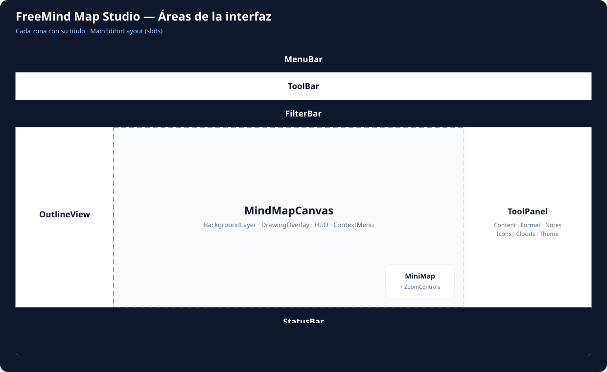
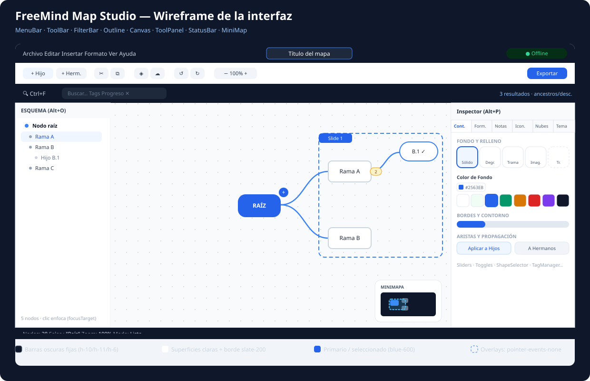

<div align="center">

# 🧠 FreeMind Map Studio

**Editor de Mapas Mentales · 100% Offline · Directo en el Navegador**

[](https://react.dev)
[](https://www.typescriptlang.org)
[](https://vitejs.dev)
[](https://tailwindcss.com)
[](https://zustand-demo.pmnd.rs/)
[](https://vitest.dev)
[](https://motion.dev)
[](#)
[](LICENSE)

> Crea, organiza y presenta mapas mentales complejos con la velocidad del teclado,  
> sin instalar nada y sin conexión a internet.

</div>

---

## ✨ ¿Qué es FreeMind Map Studio?

FreeMind Map Studio es una **aplicación web de mapas mentales de nivel profesional** que corre completamente en el navegador. Sin servidores, sin cuentas, sin límites. Toda la información se guarda localmente en tu navegador con `localStorage`.

Inspirado en [Freeplane](https://www.freeplane.org/) y [Mindomo](https://www.mindomo.com/), combina una arquitectura moderna basada en **Atomic Design**, potencia de edición con atajos de teclado y **3 modos de presentación cinematográficos**.

---

## 🗺️ Diagrama de la Aplicación

```
╔══════════════════════════════════════════════════════════════════════════════════╗
║                        FREEMIND MAP STUDIO — ARQUITECTURA                        ║
╠══════════════════════════════════════════════════════════════════════════════════╣
║  ┌─────────────────────────────────────────────────────────────────────────┐    ║
║  │  MENUBAR  [Archivo][Editar][Insertar][Formato][Ver][Ayuda]   [Título]   │    ║
║  ├─────────────────────────────────────────────────────────────────────────┤    ║
║  │  TOOLBAR  [+Hijo][+Herm][✂][📋] | [Forma][Nube][🔗] | [↺↻] | [Zoom]   │    ║
║  ├─────────────────────────────────────────────────────────────────────────┤    ║
║  │  FILTERBAR (Ctrl+F)  [🔍 Buscar...] [Tags] [Progreso] [✕ Limpiar]      │    ║
║  ╠══════════════════════════════════════════╦══════════════════════════════╣    ║
║  ║                                          ║  TOOLPANEL (Inspector)       ║    ║
║  ║      LIENZO INFINITO (MindMapCanvas)     ║  ┌──────────────────────┐   ║    ║
║  ║                                          ║  │ 📝 Contenido         │   ║    ║
║  ║    ╭──────────────────────╮              ║  │ 🎨 Formato           │   ║    ║
║  ║    │      NODO RAÍZ       │              ║  │ 📋 Notas             │   ║    ║
║  ║    │  (texto + imagen)    │              ║  │ 😀 Iconos            │   ║    ║
║  ║    ╰──────┬───────────────╯              ║  │ ☁️ Nubes             │   ║    ║
║  ║           │                             ║  │ 🎭 Tema              │   ║    ║
║  ║    ┌──────┴──────┐                      ║  └──────────────────────┘   ║    ║
║  ║    │             │                      ║                             ║    ║
║  ║  ╭───╮         ╭───╮                    ║  ┌──────────────────────┐   ║    ║
║  ║  │ A │         │ B │                    ║  │ ⚙️ Config del Mapa   │   ║    ║
║  ║  ╰───╯         ╰───╯                    ║  │   Tema / Layout      │   ║    ║
║  ║                                          ║  │   Fondo del lienzo   │   ║    ║
║  ║  [MINIMAP RADAR ▢]                       ║  └──────────────────────┘   ║    ║
║  ╚══════════════════════════════════════════╩══════════════════════════════╣    ║
║  │  STATUSBAR  Nodos: 28 | Selec.: "Raíz" | Zoom: 100% | Modo: Listo     │    ║
║  └─────────────────────────────────────────────────────────────────────────┘    ║
╚══════════════════════════════════════════════════════════════════════════════════╝
```

> El diagrama anterior resume la disposición. Estas son las zonas exactas del `MainEditorLayout` (cada slot con su título):
>
> 
>
> Y así se ve el editor con contenido real — barras, nodos, minimapa e inspector con la sección de color:
>
> 

---

## 🚀 Características Principales

### 🧩 Editor de Nodos Modular

| Propiedad | Opciones |
|-----------|---------|
| **Formas** | `bubble` `fork` `rectangle` `square` `oval` `circle` `pill` `hexagon` `arrow` `star` |
| **Fondo** | Color sólido · Transparente · Degradado (4 dir.) · Trama SVG (7 patrones) · Imagen de fondo |
| **Tipografía** | Fuente · Tamaño · Negrita · Cursiva · Color · Alineación (para título y cuerpo por separado) |
| **Imagen adjunta** | Posición: arriba · entre · abajo · izquierda · derecha · ajustar · Ancho 60–500px |
| **Bordes** | Grosor 0–8px · Sólido / Discontinuo / Punteado · Color personalizado o automático |
| **Tamaño** | Ancho 0–500px · Alto 0–300px · 0 = modo automático |
| **Metadatos** | Progreso 0–100% · Iconos vectoriales · Tags · URL · Nota Markdown enriquecida |

### 🗂️ Gestión del Árbol y Productividad

```
Operaciones sobre el árbol
├── Crear hijo (Tab / Insert)
├── Crear hermano (Enter)
├── Eliminar nodo + subtree (Supr / Backspace)
├── Plegar / Desplegar rama (Espacio)
├── Copiar subtree completo (Ctrl+C)
├── Cortar subtree (Ctrl+X)
├── Pegar como hijo (Ctrl+V)  ← clona con nuevos IDs
├── Drag & Drop para re-parentar (con protección anti-ciclos)
├── Aplicar estilo a hijos / hermanos
└── Historial Undo/Redo (Ctrl+Z/Y) ← 40 estados inmutables
```

### 🎨 Temas y Algoritmos de Layout

**8 Temas Visuales:**
```
  🔵 Clásico Azul     🌈 Arcoíris Vibrante   🌑 Modo Oscuro
  🌲 Bosque Esmeralda  🌅 Atardecer Cálido    ⬜ Minimalista Mono
  📐 Plano Técnico Blueprint  🍯 Panal Creativo
```

**9 Algoritmos de Layout Geométrico:**
```
  Standard (bifurcado)    Balanced-horizontal    Left (solo izquierda)
  Right (solo derecha)    Top (solo arriba)      Bottom (solo abajo)
  Tree-down (árbol)       Radial ●               Circular ○
```

**12 Fondos de Lienzo Interactivos:**
```
  Lienzo Puro     Cuaderno de Puntos    Papel Milimetrado
  Blueprint Téc.  Panal Hexagonal       Malla Triangular
  Rayas Cuaderno  Pizarra Oscura        Cyber Panal
  Malla Neón      Grafito con Rayas     Brisa de Menta
```

---

## 🎬 3 Modos de Presentación Profesionales

FreeMind Map Studio cuenta con tres sistemas de presentación complementarios:

### 1. 🎞️ Modo Presentación Clásica (`PresentationMode.tsx`)
Convierte el mapa mental en una secuencia de diapositivas automáticas sin scrollbars:
- **Fase 1 — Tema Principal:** Título, cuerpo e imagen principal auto-paginados.
- **Fase 2 — Notas del Presentador:** Markdown formateado (~9 líneas por slide con paginación limpia).
- **Fase 3 — Subtemas e Hijos:** Grid de tarjetas interactivas (máximo 6 por diapositiva) con salto directo y tecla `Backspace` para volver.
- **8 Temas Visuales:** los mismos del mapa (Clásico Azul, Arcoíris, Oscuro, Bosque, Atardecer, Minimalista, Blueprint, Panal).

### 2. ✨ Modo Presentación Dinámica (Lienzo Cinematográfico Prezi-Style)
Presentación continua con vuelo de cámara suave sobre el lienzo infinito:
- **Creación Automática con 1 Clic (`1. Seleccionar Nodo`):** Al hacer clic sobre cualquier nodo, se crea al instante un marco perimetral con encuadre de cámara inmediato y se agrega a la tira inferior.
- **Dibujo de Recuadros (`2. Dibujar Recuadro`):** Arrastra libremente un recuadro con indicador de dimensiones en tiempo real (`X × Y`) para agrupar múltiples nodos o regiones.
- **Empezar de Cero:** Limpia el lienzo a 0 diapositivas para diseñar una presentación 100% personalizada.
- **Tira Inferior (Filmstrip):** Navegación visual por chips con el orden de cada marco; en el editor, eliminar un marco con el icono al pasar el cursor.
- **Cero Bloqueo de Puntero:** Capas desacopladas con `pointer-events-none` en los marcos para permitir interacción libre con los nodos.

### 3. 🪐 Modo Presentación Espacial 3D (`ElaboratePresentationSystem.tsx`)
Experiencia tridimensional inmersiva:
- Vista isométrica/espacial con tarjetas 3D flotantes renderizadas con Motion.
- Rotación cinemática de cámara y manipulación en vivo de tarjetas (arrastre, rotación, escala) con compensación angular continua.
- Modal de detalle para inspección profunda de nodos y notas.

---

## 🔗 Conectores Cruzados y Nubes

- **Conectores flotantes** entre cualquier par de nodos: etiqueta personalizada, geometrías (`bezier`, `curved`, `straight`, `step`), capas (`above`/`below`), opacidad, estilo y color; la flecha es siempre final (`end`, sin selector en la UI).
- **Nubes de agrupación visual** con 8 formas geométricas y color RGBA personalizable.

## 🔍 Búsqueda y Filtrado Acumulativo

Filtros reactivos en tiempo real (`Ctrl+F`):
- Búsqueda por texto libre (**título y notas**).
- Filtrado por etiquetas (tags) exactas.
- Progreso: solo 100% completados, ≥50% o "con progreso activo".

## 📤 Exportar e Importar

| Formato | Descripción |
|---------|-------------|
| `.mm` (Freeplane XML) | Compatible con Freeplane 1.x — importación y exportación completa |
| `.html` | Página web interactiva autónoma — **sin dependencias externas ni conexión a internet** (incluye botón "Imprimir / PDF") |
| `.md` | Árbol jerárquico como encabezados Markdown |
| `.json` | Copia de seguridad integral del estado interno |

> ⚠️ No hay exportación directa a imagen (PNG/SVG): para obtener una imagen, exporta el `.html` y usa "Imprimir / PDF" del navegador.

---

## 🏗️ Estructura del Proyecto (Atomic Design + Zustand)

El proyecto implementa estrictamente **Atomic Design**, separando componentes por nivel de complejidad y responsabilidad única:

```
freemind-map-studio/
│
├── 📄 index.html                      # Punto de entrada HTML
├── 📦 package.json                    # React 19, TypeScript 5.8, Vite 6, Tailwind 4, Zustand 5
├── ⚙️ vite.config.ts                  # Configuración de Vite y Vitest
├── 🔷 tsconfig.json                   # TypeScript estricto sin errores
│
├── 📂 src/
│   ├── 🎯 App.tsx                     # Orquestador — consume store y envuelve en ErrorBoundary
│   ├── 🎨 index.css                   # Estilos globales + Tailwind v4
│   ├── ⚛️ main.tsx                    # ReactDOM.createRoot
│   │
│   ├── 📂 types/
│   │   └── 🔷 mindmap.ts              # Tipos TypeScript centralizados (MindMap, MindNode, SlideFrame...)
│   │
│   ├── 📂 hooks/                      # LÓGICA DE NEGOCIO Y ESTADO GLOBAL
│   │   ├── 🧠 useMindMapStore.ts      # Store Zustand — CRUD, historial inmutable, portapapeles, persistencia
│   │   ├── 🔍 useSearchFilter.ts      # Filtro reactivo en tiempo real
│   │   └── ⌨️ useKeyboardShortcuts.ts # Atajos globales de teclado desacoplados
│   │
│   ├── 📂 components/
│   │   │
│   │   │  ── TEMPLATES (Estructura de Pantalla) ──
│   │   ├── 📂 templates/
│   │   │   ├── MainEditorLayout.tsx   # Template del editor: MenuBar, ToolBar, Canvas, Paneles, Modales
│   │   │   └── 📂 __tests__/          # Pruebas de integración del template
│   │   │
│   │   │  ── ÁTOMOS (Componentes Primitivos Reutilizables) ──
│   │   ├── 📂 atoms/
│   │   │   ├── Badge.tsx              # Insignia para tags, conteos y estados
│   │   │   ├── Button.tsx             # Botón configurable (primary, secondary, danger, etc.)
│   │   │   ├── IconButton.tsx         # Botón compacto para iconos con tooltip
│   │   │   ├── Input.tsx              # Input de texto accesible y estilizado
│   │   │   ├── ModalBackdrop.tsx      # Fondo translúcido común para todos los modales
│   │   │   ├── ErrorBoundary.tsx      # Captura de errores en cascada para evitar pantallas blancas
│   │   │   ├── CollapsibleSection.tsx # Acordeón colapsable
│   │   │   ├── ColorPicker.tsx        # Selector de color con paletas y entrada hexadecimal
│   │   │   ├── SliderInput.tsx        # Control deslizante numérico sincronizado
│   │   │   ├── ToggleButton.tsx       # Switch interactivo on/off
│   │   │   ├── ToggleButtonGroup.tsx  # Grupo de botones de opción única
│   │   │   └── 📂 __tests__/          # Pruebas unitarias de átomos
│   │   │
│   │   │  ── MOLÉCULAS (Combinaciones Funcionales de Átomos) ──
│   │   ├── 📂 molecules/
│   │   │   ├── ModalHeader.tsx        # Encabezado estandarizado para modales con icono y cierre
│   │   │   ├── SearchInput.tsx        # Campo de búsqueda con icono y botón de limpieza
│   │   │   ├── HistoryControls.tsx    # Controles de Deshacer / Rehacer con atajos visibles
│   │   │   ├── ZoomControls.tsx       # Controles unificados de zoom (+, -, 100%, encuadrar)
│   │   │   ├── FontFormatToolbar.tsx  # Barra de tipografía (negrita, cursiva, fuente, tamaño, color)
│   │   │   ├── ShapeSelector.tsx      # Selector visual de las 10 formas de nodo
│   │   │   ├── TagManager.tsx         # Gestor de etiquetas con chips interactivos
│   │   │   └── 📂 node/               # Sub-moléculas especializadas de NodeComponent
│   │   │       ├── NodeBackgroundRenderer.tsx # Formas SVG (hexágonos, estrellas, colas de burbuja)
│   │   │       ├── NodeHeaderRow.tsx          # Fila de título, cuerpo editable e iconos
│   │   │       ├── NodeBadgesBar.tsx          # Badges de tags, notas, links y progreso
│   │   │       └── NodeActionButtons.tsx      # Botones de agregar hijo (+) y plegar rama
│   │   │
│   │   │  ── ORGANISMOS (Secciones Complejas de la Interfaz) ──
│   │   ├── 📂 organisms/
│   │   │   ├── 📂 canvas/
│   │   │   │   ├── CanvasBackgroundLayer.tsx  # Renderizado de los 12 fondos de lienzo
│   │   │   │   ├── CanvasDrawingOverlay.tsx   # Marcos de diapositivas y dibujo de áreas
│   │   │   │   ├── CanvasPresentationHUD.tsx  # Barra flotante de control de presentaciones dinámicas
│   │   │   │   └── CanvasContextMenu.tsx      # Menú contextual al hacer clic derecho
│   │   │   ├── 📂 toolpanel/                  # Pestañas del Inspector
│   │   │   │   ├── ContentTab.tsx             # Edición de título, cuerpo y tipografía
│   │   │   │   ├── FormatTab.tsx              # Formas, bordes, fondos, imágenes y aristas
│   │   │   │   ├── NotesTab.tsx               # Editor Markdown, hipervínculos y barra de progreso
│   │   │   │   ├── IconsTab.tsx               # Selector de iconos temáticos
│   │   │   │   ├── CloudsTab.tsx              # Configuración de nubes de agrupación
│   │   │   │   └── ThemeTab.tsx               # Selección global de temas, layouts y fondos
│   │   │   └── 📂 presentation/
│   │   │       ├── ElaboratePresentationSystem.tsx # Presentación espacial 3D
│   │   │       ├── SpatialSlideCardComponent.tsx   # Tarjetas 3D flotantes con transformaciones
│   │   │       └── SlideDetailModal.tsx            # Modal de detalle de diapositiva
│   │   │
│   │   │  ── COMPONENTES PRINCIPALES ──
│   │   ├── MenuBar.tsx                # Barra superior de menús desplegables
│   │   ├── ToolBar.tsx                # Barra de herramientas rápidas
│   │   ├── FilterBar.tsx              # Barra colapsable de filtrado y búsqueda
│   │   ├── MindMapCanvas.tsx          # Lienzo infinito orquestador de capas
│   │   ├── NodeComponent.tsx          # Renderizador de nodo modularizado
│   │   ├── ToolPanel.tsx              # Contenedor del inspector de 6 pestañas
│   │   ├── PresentationMode.tsx       # Modo presentación clásica
│   │   ├── OutlineView.tsx            # Vista en árbol jerárquico tipo esquema
│   │   ├── MiniMap.tsx                # Minimapa radar flotante con ZoomControls integrados
│   │   └── StatusBar.tsx              # Barra de estado inferior con métricas en tiempo real
│   │
│   ├── 📂 Modals/                     # MODALES ESTANDARIZADOS (con ModalBackdrop + ModalHeader)
│   │   ├── ExportImportModal.tsx      # Exportación a 4 formatos e importación .mm/.json
│   │   ├── ShortcutsModal.tsx         # Guía de atajos de teclado
│   │   ├── TemplatesModal.tsx         # Galería con +20 plantillas profesionales
│   │   ├── SavedMapsModal.tsx         # Gestor de mapas guardados en localStorage
│   │   ├── ConnectorModal.tsx         # Asistente de conectores cruzados
│   │   └── IconPackModal.tsx          # Catálogo de iconos vectoriales
│   │
│   └── 📂 utils/                      # UTILIDADES PURAS Y ALGORITMOS
│       ├── layoutEngine.ts            # Motor matemático de layout (9 algoritmos)
│       ├── themes.ts                  # Definición de 8 temas y 12 fondos de lienzo
│       ├── markdownRenderer.tsx       # Parser Markdown propio sin dependencias
│       ├── connectorUtils.ts          # Cálculo geométrico de curvas de Bézier y conectores
│       ├── freeplaneConverter.ts      # Importador y exportador nativo de XML .mm
│       ├── htmlExporter.ts            # Generador de archivo HTML autónomo portable
│       ├── storage.ts                 # Adaptador de almacenamiento en localStorage
│       ├── sampleMaps.ts              # Mapa tutorial de bienvenida y mapas base
│       ├── additionalTemplates.ts     # Catálogo temático de plantillas
│       ├── templateIllustrations.ts   # Ilustraciones vectoriales de vista previa
│       ├── iconMap.tsx                # Mapeo de identificadores a iconos
│       ├── vectorIconPack.tsx         # Paquete de iconos vectoriales premium
│       └── 📂 __tests__/              # Pruebas unitarias de utilidades matemáticas y convertidores
│
├── 📂 doc/                            # DOCUMENTACIÓN
│   ├── PROJECT_ARCHITECTURE.md        # Arquitectura v4.0 verificada contra código + cookbook + guía GitHub
│   ├── DESIGN.md                      # Sistema de diseño verificado (tokens, componentes, reglas)
│   ├── INTERFACE_SPEC.md              # Especificación de interfaz
│   ├── FEATURE_TREE.md                # Árbol de características (funcional + por interfaz)
│   ├── MEASURES.md                    # Hoja de medidas de la interfaz (áreas grandes)
│   ├── CHANGELOG.md                   # Historial de cambios
│   └── 📂 img/                        # Diagramas SVG (áreas, wireframe, layouts) y capturas
```

---

## ⌨️ Atajos de Teclado Principales

### Edición del Mapa

| Atajo | Acción |
|-------|--------|
| `Tab` / `Insert` | Crear nodo **hijo** |
| `Enter` | Crear nodo **hermano** |
| `F2` / Doble clic | Editar texto inline |
| `Espacio` | Plegar / Desplegar rama |
| `Supr` / `Backspace` | Eliminar nodo + sub-árbol |
| `↑` `↓` `←` `→` | Navegar entre nodos adyacentes |
| `Ctrl+C` / `Ctrl+X` / `Ctrl+V` | Copiar / Cortar / Pegar sub-árbol |
| `Ctrl+Z` / `Ctrl+Y` | Deshacer / Rehacer (40 niveles inmutables) |
| `Escape` | Seleccionar nodo raíz / Cerrar modales |

### Vistas y Navegación

| Atajo | Acción |
|-------|--------|
| `Ctrl+F` | Abrir / Cerrar barra de búsqueda y filtrado |
| `Alt+O` | Abrir / Cerrar vista de Esquema (`OutlineView`) |
| `Alt+P` | Abrir / Cerrar panel de propiedades (`ToolPanel`) |
| `F5` | Alternar modo presentación (reabre el último modo usado) |

### Modos de Presentación

| Tecla | Acción |
|-------|--------|
| `→` / `Espacio` | Siguiente diapositiva |
| `←` | Diapositiva anterior |
| `Backspace` | Volver al origen del salto entre tarjetas |
| `E` | Alternar entre modo reproducción y edición de marcos |
| `Esc` | Salir del modo presentación |

---

## 🏃 Inicio Rápido y Comandos

### Requisitos

- **Node.js** 18+ o **Bun**
- **pnpm** (recomendado), **npm** o **yarn**

### Instalación y Desarrollo

```bash
# 1. Clonar el repositorio
git clone https://github.com/cnodfcuellar/FreeMind-Map-Studio.git
cd FreeMind-Map-Studio

# 2. Instalar dependencias
pnpm install

# 3. Iniciar servidor de desarrollo con Vite
pnpm dev
```

La aplicación estará disponible en **http://localhost:3000** (puerto fijado en `package.json`).

### Verificación y Pruebas Automatizadas

```bash
# Comprobación de tipos estricta con TypeScript
pnpm lint          # ejecuta tsc --noEmit

# Suite de pruebas unitarias con Vitest (131 tests / 29 archivos)
pnpm test          # ejecuta vitest run (en Windows, si se cuelga: pnpm vitest run --pool=forks)

# Compilación optimizada para producción
pnpm build

# Vista previa local del empaquetado de producción
pnpm preview
```

---

## 💾 Privacidad y Persistencia de Datos

Todos los datos se guardan estrictamente en el `localStorage` de tu navegador:

```
localStorage
├── freemind_current_map_v1         ← Mapa activo en edición (auto-guardado continuo)
├── freemind_saved_maps_index_v1    ← Índice de mapas guardados en la galería local
└── freemind_map_{id}               ← Contenido JSON íntegro de cada mapa individual
```

- **Sin servidores intermedios:** Tu información nunca sale de tu equipo.
- **Sin cuentas requeridas:** Acceso inmediato sin necesidad de registro ni telemetría.
- **100% Portable:** El archivo `.html` exportado incluye el visor interactivo completo y puede abrirse en cualquier dispositivo sin conexión.

---

## 📚 Documentación Técnica Detallada

- [`doc/PROJECT_ARCHITECTURE.md`](doc/PROJECT_ARCHITECTURE.md): arquitectura v4.0 verificada contra el código, cookbook de extensión y guía de qué subir a GitHub.
- [`doc/DESIGN.md`](doc/DESIGN.md): sistema de diseño verificado (tokens, componentes, reglas para futuras implementaciones).
- [`doc/INTERFACE_SPEC.md`](doc/INTERFACE_SPEC.md): especificación de la interfaz.
- [`doc/FEATURE_TREE.md`](doc/FEATURE_TREE.md): árbol de características del producto (uno funcional y otro por superficie de interfaz).
- [`doc/MEASURES.md`](doc/MEASURES.md): hoja de medidas de la interfaz (áreas grandes: barras, paneles, lienzo, controles flotantes).
- [`doc/CHANGELOG.md`](doc/CHANGELOG.md): historial de cambios.

---

## 🤝 Contribuir

Las contribuciones son bienvenidas:

1. Haz un Fork del repositorio.
2. Crea una rama para tu funcionalidad (`git checkout -b feature/nueva-mejora`).
3. Confirma tus cambios (`git commit -m 'feat: agrega nueva mejora'`).
4. Sube la rama (`git push origin feature/nueva-mejora`).
5. Abre un **Pull Request**.

---

<div align="center">

**FreeMind Map Studio** — Diseñado con ❤️ para la productividad y el pensamiento visual.

*100% Offline. Sin suscripciones. Potencia creativa total.*

</div>
