# 📖 Manual de Usuario y Guía de Referencia Definitiva — FreeMind Map Studio

Bienvenido a la **Guía de Usuario y Manual Técnico Integral de FreeMind Map Studio**, la plataforma web avanzada de mapas conceptuales y diagramas mentales de nivel editorial diseñada para profesionales, investigadores, estudiantes, gerentes de producto y equipos ágiles.

Este manual ofrece una descripción enciclopédica de cada funcionalidad, menú, atajo, algoritmo matemático de layout, sistema de iluminación, motor de exportación e interacción en el lienzo, complementada con **ilustraciones vectoriales SVG** y **casos prácticos reales paso a paso**.

---

## 📑 Tabla de Contenidos

1. [Visión General, Filosofía Offline y Almacenamiento Local](#1-visión-general-filosofía-offline-y-almacenamiento-local)
2. [Estructura Ergonómica de la Interfaz y Áreas de Trabajo](#2-estructura-ergonómica-de-la-interfaz-y-áreas-de-trabajo)
   * [2.1 Menú Superior (MenuBar)](#21-menú-superior-menubar)
   * [2.2 Barra de Acceso Rápido (ToolBar)](#22-barra-de-acceso-rápido-toolbar)
   * [2.3 Barra de Búsqueda y Filtros (FilterBar)](#23-barra-de-búsqueda-y-filtros-filterbar)
   * [2.4 Lienzo Infinito Vectorial (MindMapCanvas)](#24-lienzo-infinito-vectorial-mindmapcanvas)
   * [2.5 Inspector Lateral de Propiedades (ToolPanel)](#25-inspector-lateral-de-propiedades-toolpanel)
   * [2.6 Vista de Esquema Jerárquico (OutlineView)](#26-vista-de-esquema-jerárquico-outlineview)
   * [2.7 Radar Minimapa y Controles Ópticos (MiniMap)](#27-radar-minimapa-y-controles-ópticos-minimap)
   * [2.8 Barra de Estado del Sistema (StatusBar)](#28-barra-de-estado-del-sistema-statusbar)
3. [Creación y Gestión Avanzada de Nodos (El Árbol Mental)](#3-creación-y-gestión-avanzada-de-nodos-el-árbol-mental)
   * 🌟 **[Caso Práctico Real 1: Construcción de un Mapa Estratégico en 3 Minutos con el Teclado](#caso-práctico-real-1-construcción-de-un-mapa-estratégico-en-3-minutos-solo-con-el-teclado)**
4. [Metadatos y Enriquecimiento Técnico de Contenido](#4-metadatos-y-enriquecimiento-técnico-de-contenido)
   * 🌟 **[Caso Práctico Real 2: Ficha Técnica de Tarea con Notas Markdown, Tags y Progreso](#caso-práctico-real-2-ficha-técnica-de-tarea-con-notas-markdown-tags-y-progreso)**
5. [Estilos Visuales, Formas Geométricas y Bocadillos](#5-estilos-visuales-formas-geométricas-y-bocadillos)
   * 🌟 **[Caso Práctico Real 3: Diseñando un Bocadillo Expresivo de Diálogo (Bubble)](#caso-práctico-real-3-diseñando-un-bocadillo-expresivo-de-diálogo-bubble)**
6. [Arquitectura del Sistema Modular de Sombras (6 Objetos)](#6-arquitectura-del-sistema-modular-de-sombras-6-objetos)
   * 🌟 **[Caso Práctico Real 4: Iluminación Editorial con Elevación 3D y Glow Neón](#caso-práctico-real-4-iluminación-editorial-con-elevación-3d-y-glow-neón)**
7. [Nubes de Territorio y Conectores Libres Transversales](#7-nubes-de-territorio-y-conectores-libres-transversales)
   * 🌟 **[Caso Práctico Real 5: Nube de Territorio y Conector Transversal con Etiqueta](#caso-práctico-real-5-nube-de-territorio-y-conector-transversal-con-etiqueta)**
8. [Los 9 Algoritmos de Distribución Espacial (Layout Engine) y Temas](#8-los-9-algoritmos-de-distribución-espacial-layout-engine-y-temas)
9. [Búsqueda Avanzada, Filtros de Metadatos y Efecto Spotlight](#9-búsqueda-avanzada-filtros-de-metadatos-y-efecto-spotlight)
   * 🌟 **[Caso Práctico Real 6: Auditoría de Emergencia del Sprint con Filtro Spotlight](#caso-práctico-real-6-auditoría-de-emergencia-del-sprint-con-filtro-spotlight)**
10. [Línea de Tiempo del Historial de Versiones (Undo / Redo)](#10-línea-de-tiempo-del-historial-de-versiones-undo--redo)
    * 🌟 **[Caso Práctico Real 7: Recuperar una Idea Eliminada sin Perder el Trabajo Reciente](#caso-práctico-real-7-recuperar-una-idea-eliminada-sin-perder-el-trabajo-reciente)**
11. [Paleta de Comandos Universal (Ctrl + K / Cmd + K)](#11-paleta-de-comandos-universal-ctrl--k--cmd--k)
12. [Modos de Presentación Cinematográficos (3 Modos)](#12-modos-de-presentación-cinematográficos-3-modos)
13. [Exportación Profesional e Impresión Técnica](#13-exportación-profesional-e-impresión-técnica)
    * 🌟 **[Caso Práctico Real 8: Impresión de un Mural Gigante de 1 Metro para la Sala de Juntas](#caso-práctico-real-8-impresión-de-un-mural-gigante-de-1-metro-para-la-sala-de-juntas)**
14. [Gestión de Mapas y Galería de Plantillas Profesionales](#14-gestión-de-mapas-y-galería-de-plantillas-profesionales)
15. [Tabla Maestra Completa de Atajos de Teclado](#15-tabla-maestra-completa-de-atajos-de-teclado)
16. [Preguntas Frecuentes, Resolución de Problemas y Diagnóstico](#16-preguntas-frecuentes-resolución-de-problemas-y-diagnóstico)

---

## 1. Visión General, Filosofía Offline y Almacenamiento Local

**FreeMind Map Studio** es una aplicación de escritorio web moderna concebida bajo el principio de **soberanía total de datos y ejecución puramente local**:

* **Filosofía 100% Offline (Zero-Cloud):** No existe ninguna base de datos remota, servidor intermedio ni telemetría oculta. La aplicación funciona de manera óptima sin conexión a internet, en aviones o entornos corporativos de alta confidencialidad.
* **Persistencia Inmediata en `localStorage`:** Los cambios se persisten automáticamente en milisegundos tras cada mutación del árbol mediante el módulo [storage.ts](file:///d:/admin/OneDrive/Documents/IA-code/FreeplaneWeb/Freemind/src/utils/storage.ts).
* **Claves de Almacenamiento Gobernadas:**
  * `freemind_current_map_v1`: Contiene el estado íntegro del mapa activo en sesión (nodos, estilos, posiciones relativas, historial de versiones y configuraciones de lienzo).
  * `freemind_saved_maps_index_v1`: Índice de catálogo de todos los mapas almacenados en el navegador con fecha de modificación, conteo de nodos y metadatos.
  * `freemind_map_{id}`: Almacena los volcados de mapas guardados individualmente para su restauración rápida.
  * `freemind_ui_theme_v1`: Registra el tema de interfaz del usuario (`light`, `dark`, `sepia`).
* **Renderizado Vectorial SVG Nativo:** Cada nodo, curva Bézier, nube y sombra se calcula matemáticamente en tiempo de ejecución. Al aplicar zoom hasta el 400%, los textos permanecen 100% nítidos sin pixelación.
* **Compatibilidad Estándar:** Importación y exportación de archivos nativos `.mm` compatibles con **Freeplane** y **FreeMind**, además de documentos autónomos en formato `.html`, `.md`, `.json` y `.pdf`.

---

## 2. Estructura Ergonómica de la Interfaz y Áreas de Trabajo

La interfaz de usuario ha sido concebida siguiendo una arquitectura modular estricta de 6 superficies de interacción:

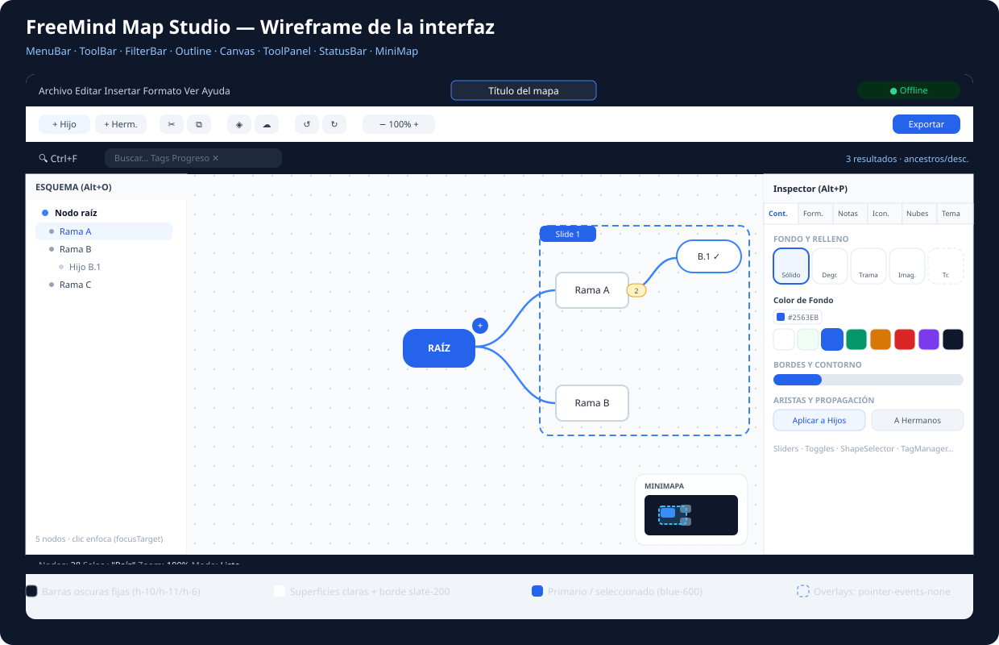

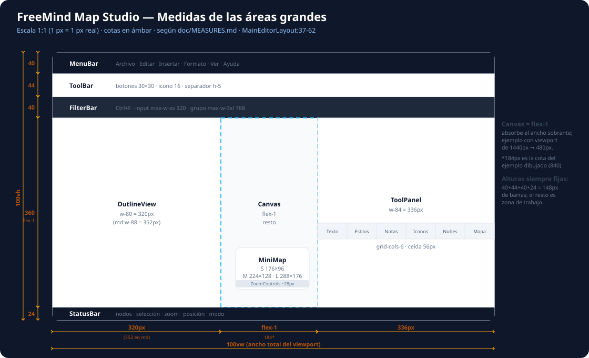

```
┌────────────────────────────────────────────────────────────────────────┐
│ 1. MENUBAR   [Archivo] [Editar] [Insertar] [Formato] [Ver] [Ayuda]     │
├────────────────────────────────────────────────────────────────────────┤
│ 2. TOOLBAR   [+Hijo] [+Herm] [Supr] | [Forma] [Nube] [🔗] | [↺ ↻ ⏳] │
├────────────────────────────────────────────────────────────────────────┤
│ 3. FILTERBAR (Ctrl+F) [🔍 Buscar...] [#Tags] [Progreso] [+Metadatos]  │
├────────────────────────────────────────┬───────────────────────────────┤
│                                        │ 5. TOOLPANEL (Inspector)      │
│                                        │ ┌───────────────────────────┐ │
│         4. LIENZO INFINITO             │ │ 📝 Contenido              │ │
│         (MindMapCanvas)                │ │ 🎨 Estilos & Sombras      │ │
│                                        │ │ 📋 Notas Markdown         │ │
│           [NODO CENTRAL]               │ │ 😀 Iconoteca (520+)       │ │
│           /            \               │ │ ☁️ Nube de Agrupación     │ │
│      [Rama A]        [Rama B]          │ │ 🎭 Temas & Fondo          │ │
│                                        │ └───────────────────────────┘ │
│                                        │                               │
│ [MINIMAPA RADAR ▢]   [Zoom +/- 100%]   │ [Propagar a Hijos/Hermanos]   │
├────────────────────────────────────────┴───────────────────────────────┤
│ 6. STATUSBAR  Nodos: 24 | Selec: "Estrategia" | Zoom: 100% | Listo     │
└────────────────────────────────────────────────────────────────────────┘
```

---

### 2.1 Menú Superior (MenuBar)

El componente [MenuBar.tsx](file:///d:/admin/OneDrive/Documents/IA-code/FreeplaneWeb/Freemind/src/components/MenuBar.tsx) proporciona acceso exhaustivo a todas las capacidades de la aplicación mediante 6 menús desplegables:

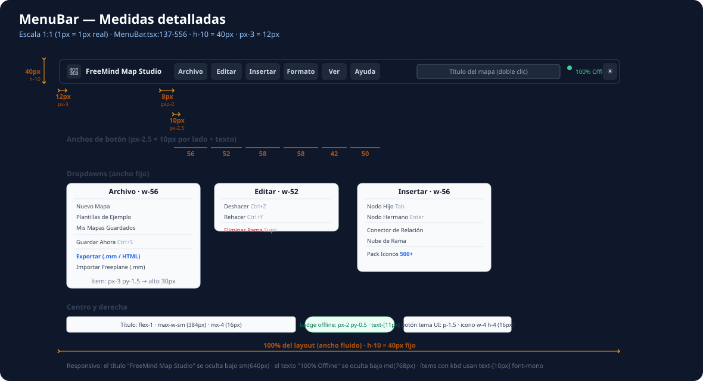

1. **Menú Archivo:**
   * **Nuevo Mapa (`Ctrl + N`):** Inicializa un mapa limpio con un nodo raíz predeterminado.
   * **Abrir Mapa Guardado... (`Ctrl + O`):** Despliega el gestor `SavedMapsModal` con la biblioteca local.
   * **Guardar Mapa (`Ctrl + S`):** Consolida el mapa activo en el índice de almacenamiento local.
   * **Galería de Plantillas...:** Abre el catálogo interactivo con más de 20 estructuras preconfiguradas.
   * **Importar (.mm, .json):** Carga archivos generados en Freeplane clásico o copias de seguridad JSON.
   * **Exportar a PDF...:** Abre el motor de impresión vectorial con soporte póster y mosaico.
   * **Exportar como HTML Autónomo (.html):** Genera un archivo web single-file autocontenido con visor interactivo integrado.
   * **Exportar como Freeplane (.mm):** Exporta el árbol en sintaxis XML estándar de Freeplane.
   * **Exportar como Markdown (.md):** Exporta la jerarquía en texto estructurado con encabezados y viñetas.
2. **Menú Editar:**
   * **Deshacer (`Ctrl + Z`):** Retrocede un paso en la historia de cambios.
   * **Rehacer (`Ctrl + Y` / `Ctrl + Shift + Z`):** Avanza un paso en la historia de rehacer.
   * **Línea de Tiempo del Historial (`Ctrl + Shift + H`):** Abre el modal cronológico de snapshots.
   * **Cortar (`Ctrl + X`), Copiar (`Ctrl + C`), Pegar (`Ctrl + V`):** Gestión profunda de subárboles con reasignación de IDs.
   * **Eliminar Nodo (`Supr` / `Delete`):** Remueve el nodo activo y todos sus descendientes.
   * **Seleccionar Todo (`Ctrl + A`):** Selecciona el nodo central para operaciones de enfoque.
3. **Menú Insertar:**
   * **Añadir Nodo Hijo (`Tab` / `Insert`):** Añade un descendiente balanceado.
   * **Añadir Nodo Hermano (`Enter`):** Inserta un nodo colateral en el mismo nivel.
   * **Insertar Enlace Web... (`Ctrl + K` en modo link):** Abre el cuadro de asignación de URL.
   * **Añadir Imagen...:** Incorpora una ilustración con tamaño y posición ajustable.
   * **Crear Conector Libre:** Inicia el modo de enlace transversal entre dos nodos distantes.
   * **Añadir Nube de Agrupación:** Envuelve el subárbol en una nube conceptual.
4. **Menú Formato:**
   * **Texto en Negrita (`Ctrl + B`), Cursiva (`Ctrl + I`):** Formato rápido tipográfico.
   * **Formas Geométricas:** Acceso directo a las 10 formas de nodo.
   * **Colitas de Bocadillo:** Configuración rápida del estilo de bocadillo cómic.
   * **Propagar Estilos:** Clonar estética a descendientes o nodos hermanos.
5. **Menú Ver:**
   * **Acercar Zoom (`Ctrl + +`), Alejar Zoom (`Ctrl + -`), Zoom 100% (`Ctrl + 0`):** Ajustes de escala óptica.
   * **Ajustar al Lienzo (Fit View):** Reubica y escala el mapa completo en el centro de la pantalla.
   * **Modo Presentación (`F5`):** Despliega el selector de presentaciones cinemáticas.
   * **Alternar Inspector Lateral (`Alt + P`):** Abre o cierra el ToolPanel.
   * **Alternar Vista de Esquema (`Alt + O`):** Abre o cierra el árbol jerárquico textual.
   * **Alternar Filtros (`Ctrl + F`):** Despliega la barra de búsqueda y Spotlight.
   * **Tema de Interfaz (Claro / Oscuro / Sepia):** Conmuta la paleta visual de la aplicación.
6. **Menú Ayuda:**
   * **Manual de Usuario:** Abre este documento de referencia interactivo.
   * **Tabla de Atajos de Teclado:** Modal sintético con los comandos de uso frecuente.
   * **Acerca de FreeMind Map Studio:** Versión del motor, licencias y créditos técnicos.

---

### 2.2 Barra de Acceso Rápido (ToolBar)

Ubicada en la franja superior debajo del menú, la [ToolBar.tsx](file:///d:/admin/OneDrive/Documents/IA-code/FreeplaneWeb/Freemind/src/components/ToolBar.tsx) reúne los controles de más alta frecuencia:

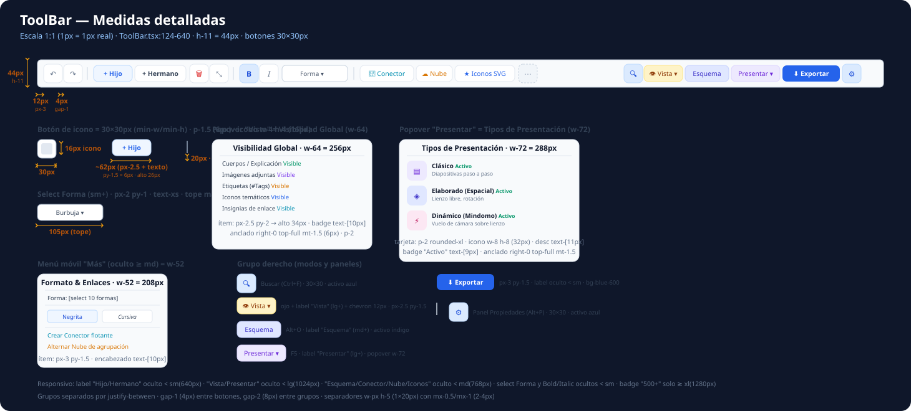

* **Grupo Estructural:** Botones directos para crear nodo hijo (`+Hijo`), hermano (`+Hermano`) y eliminar (`Eliminar`).
* **Grupo de Modificación Rápida:** Selector visual de forma geométrica desplegable, conmutador de nube envolvente y herramienta de trazado de conectores transversales (`🔗 Conector`).
* **Grupo Historial:** Deshacer (`↺`), Rehacer (`↻`) y acceso directo a la Línea de Tiempo de Versiones (`⏳`).
* **Grupo de Productividad:** Botón de la Paleta de Comandos (`⌘K` / `Ctrl+K`), botón de Presentación (`F5`), alternador de Vista de Esquema (`Outline`) y botón para plegar/desplegar el panel de propiedades.

---

### 2.3 Barra de Búsqueda y Filtros (FilterBar)

Invocada con `Ctrl + F`, la [FilterBar.tsx](file:///d:/admin/OneDrive/Documents/IA-code/FreeplaneWeb/Freemind/src/components/FilterBar.tsx) incorpora un sistema de filtrado multicampo en vivo con atenuación Spotlight:

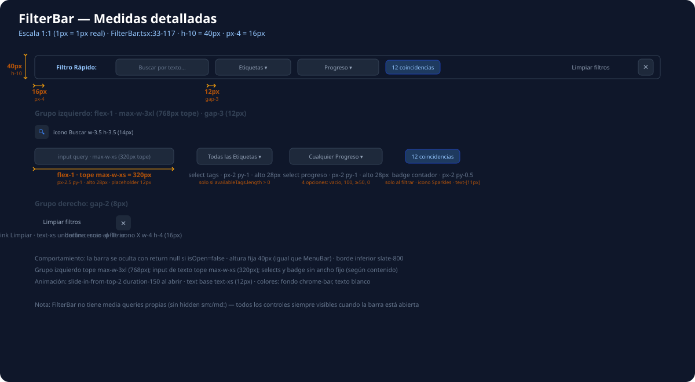

* **Buscador de Texto:** Indexa en tiempo real títulos, subtítulos (`body`), notas Markdown y etiquetas.
* **Filtro de Etiquetas (`#tags`):** Desplegable multi-selección con modos lógicos `AND` y `OR`.
* **Filtro de Progreso:** Presets rápidos (`Sin Iniciar 0%`, `En Curso 1-99%`, `Completado 100%`) y umbrales mayores o iguales ($\ge 25\%$, $\ge 50\%$, $\ge 75\%$).
* **Panel Expandible de Metadatos (`+ Metadatos`):** Filtra por presencia de notas (`📝`), enlaces (`🔗`), fotos (`🖼️`), nubes (`☁️`), iconos (`⭐`), filtros de fecha y modo Árbol Contextual (`includeAncestors`).

---

### 2.4 Lienzo Infinito Vectorial (MindMapCanvas)

El componente orquestador visual [MindMapCanvas.tsx](file:///d:/admin/OneDrive/Documents/IA-code/FreeplaneWeb/Freemind/src/components/MindMapCanvas.tsx) gestiona la física y renderizado del espacio:

* **Paneo Libre (Arrastre):**
  * Arrastra con el botón principal del ratón sobre cualquier área vacía del fondo.
  * También puedes usar el botón central del ratón (rueda) o mantener presionada la barra espaciadora (`Espacio + Arrastre`).
* **Zoom Óptico Infinito:**
  * Usa la rueda del ratón (`Ctrl + Rueda` o rueda directa según configuración) para escalar suavemente de 10% a 400%.
  * El zoom se calcula tomando como pivote la coordenada exacta del puntero del ratón, evitando desplazamientos involuntarios.
* **Selección Interaccional:**
  * Clic simple sobre un nodo: lo selecciona y sincroniza automáticamente las propiedades en el ToolPanel.
  * Clic sobre el lienzo vacío: deselecciona y transfiere el ToolPanel al modo "Tema del Mapa y Lienzo".
  * Clic sobre una curva de conector: selecciona la relación y muestra sus puntos de control Bézier.

---

### 2.5 Inspector Lateral de Propiedades (ToolPanel)

Deslizable desde el costado derecho con `Alt + P`, el [ToolPanel.tsx](file:///d:/admin/OneDrive/Documents/IA-code/FreeplaneWeb/Freemind/src/components/ToolPanel.tsx) se organiza en 6 pestañas especializadas:

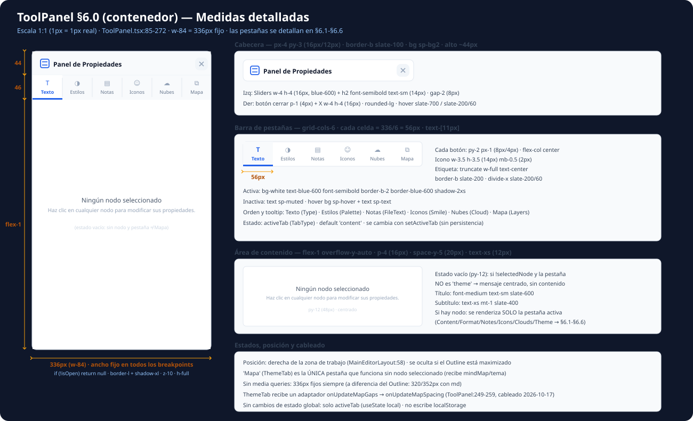

1. **📝 Pestaña Contenido ([ContentTab.tsx](file:///d:/admin/OneDrive/Documents/IA-code/FreeplaneWeb/Freemind/src/components/organisms/toolpanel/ContentTab.tsx)):** Título, subtexto descriptivo, imágenes adjuntas (posición y escala), barra de progreso (0% a 100%), enlaces externos e hipervínculos, y etiquetas semánticas `#tags`.
2. **🎨 Pestaña Estilos ([FormatTab.tsx](file:///d:/admin/OneDrive/Documents/IA-code/FreeplaneWeb/Freemind/src/components/organisms/toolpanel/FormatTab.tsx)):** Selector de las 10 formas geométricas, anatomía de bocadillos cómic (`NodeBubbleTail`), paleta de colores, degradados lineales y radiales, tramas geométricas, grosor y patrón de bordes, sombras 3D y botones de propagación en cascada.
3. **📋 Pestaña Notas ([NotesTab.tsx](file:///d:/admin/OneDrive/Documents/IA-code/FreeplaneWeb/Freemind/src/components/organisms/toolpanel/NotesTab.tsx)):** Editor de texto enriquecido con soporte de sintaxis Markdown completa, vista previa en tiempo real y selector de modo de despliegue (Inline en tarjeta vs Tooltip flotante).
4. **😀 Pestaña Iconoteca ([IconsTab.tsx](file:///d:/admin/OneDrive/Documents/IA-code/FreeplaneWeb/Freemind/src/components/organisms/toolpanel/IconsTab.tsx)):** Asignación de iconos vectoriales clasificados en 12 categorías, tintado personalizado de color y gestión de múltiples emblemas por nodo.
5. **☁️ Pestaña Nube ([CloudsTab.tsx](file:///d:/admin/OneDrive/Documents/IA-code/FreeplaneWeb/Freemind/src/components/organisms/toolpanel/CloudsTab.tsx)):** Activación de nube envolvente para el subárbol, selección de 8 formas perimetrales, opacidad translúcida, color de trazo, patrón de guiones y sombra perimetral Isla 3D.
6. **🎭 Pestaña Tema y Lienzo ([ThemeTab.tsx](file:///d:/admin/OneDrive/Documents/IA-code/FreeplaneWeb/Freemind/src/components/organisms/toolpanel/ThemeTab.tsx)):** Selección de los 9 algoritmos de layout, 8 temas cromáticos del mapa, 12 texturas de fondo del lienzo, sliders de separación horizontal/vertical (`hGap`, `vGap`) y sombra global neón para aristas.

---

### 2.6 Vista de Esquema Jerárquico (OutlineView)

Invocada con `Alt + O`, la [OutlineView.tsx](file:///d:/admin/OneDrive/Documents/IA-code/FreeplaneWeb/Freemind/src/components/organisms/OutlineView.tsx) ofrece una representación textual estructurada del mapa mental:

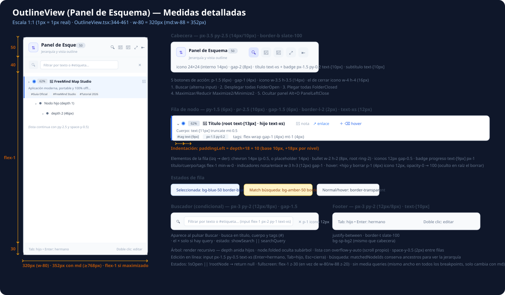

* Permite revisar la jerarquía completa del árbol como una lista anidada sangrada.
* Haz clic sobre cualquier ítem del esquema para que la cámara del lienzo vuele de inmediato hacia ese nodo y lo seleccione.
* Incluye indicadores visuales de progreso, notas y tags para cada entrada.

---

### 2.7 Radar Minimapa y Controles Ópticos (MiniMap)

Ubicado en la esquina inferior izquierda, el componente [MiniMap.tsx](file:///d:/admin/OneDrive/Documents/IA-code/FreeplaneWeb/Freemind/src/components/MiniMap.tsx) mantiene la orientación espacial en mapas gigantes:


* **Ventana de Radar 180×120px:** Dibuja una miniatura en tiempo real de todos los nodos y ramas del mapa mental.
* **Marco de Visor Arrastrable:** El rectángulo azul translúcido representa la porción de lienzo actualmente visible en tu pantalla. Puedes hacer clic y arrastrar este rectángulo dentro del minimapa para navegar velozmente por mapas con cientos de ramas sin tener que hacer scroll.
* **Botones de Control Óptico:** Accesos directos para zoom in (`+`), zoom out (`-`), reinicio al 100% y centrado total (*Fit to View*).

---

### 2.8 Barra de Estado del Sistema (StatusBar)

En la base de la pantalla, la [StatusBar.tsx](file:///d:/admin/OneDrive/Documents/IA-code/FreeplaneWeb/Freemind/src/components/StatusBar.tsx) expone telemetría en tiempo real:

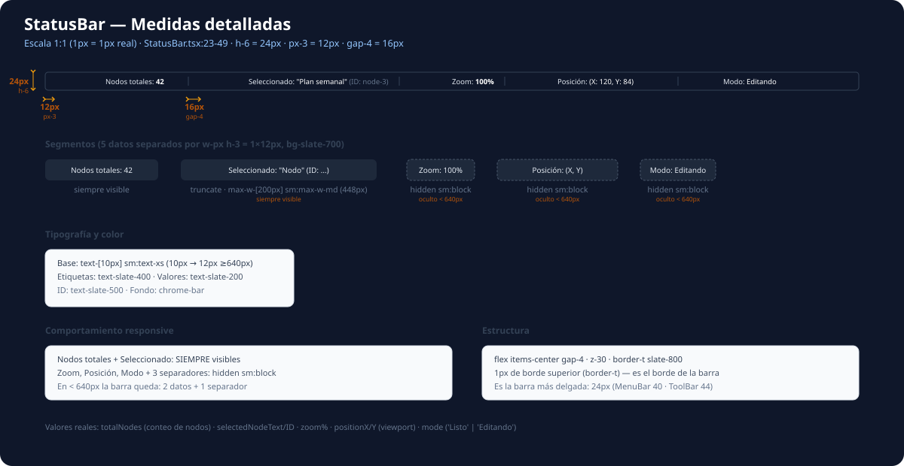

* Conteo total de nodos activos en el árbol mental.
* Título del nodo seleccionado actualmente y nivel jerárquico.
* Porcentaje exacto de escala óptica del zoom.
* Indicador de guardado local persistente (`Listo / Guardado`).

---

## 3. Creación y Gestión Avanzada de Nodos (El Árbol Mental)

El árbol mental de FreeMind Map Studio se rige por un motor estructural de grafo acíclico dirigido optimizado para máxima agilidad por teclado:

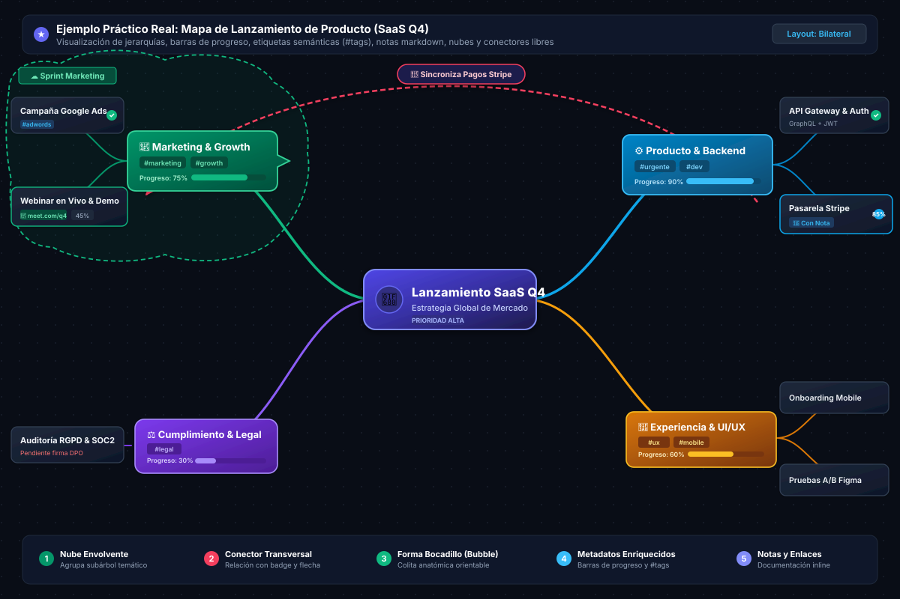

### Inserción Rápida por Teclado
* **Crear Nodo Hijo (`Tab` o `Insert`):** Añade un nodo subordinado. Si estás situado sobre el nodo raíz, el sistema ejecuta un balanceo inteligente distribuyendo la nueva rama entre el hemisferio derecho o izquierdo de forma simétrica.
* **Crear Nodo Hermano (`Enter`):** Inserta un nodo al mismo nivel jerárquico inmediatamente debajo del seleccionado.
* **Edición Rápida en Línea (`F2` o Doble Clic):** Abre el editor contextual directo sobre la tarjeta del nodo. Pulsa `Enter` o haz clic fuera para confirmar; pulsa `Escape` para descartar los cambios.
* **Plegado / Desplegado Dinámico (`Espacio`):** Pulsa la barra espaciadora para ocultar o revelar la descendencia de una rama. Los nodos plegados exhiben un badge numérico circular (`+3`) indicando el número de tareas contenidas.

### Reorganización Espacial por Arrastre (Drag & Drop)
* Haz clic sobre el asa lateral de arrastre de cualquier nodo y suéltalo sobre otro nodo para cambiar su pertenencia (*reparenting*).
* **Guarda Anti-Ciclos Infinitos (`isDescendant`):** El motor implementa una verificación recursiva rigurosa en [useMindMapStore.ts](file:///d:/admin/OneDrive/Documents/IA-code/FreeplaneWeb/Freemind/src/hooks/useMindMapStore.ts). Si un usuario intenta arrastrar un nodo padre para convertirlo en hijo de uno de sus propios descendientes, la operación se bloquea de forma transparente impidiendo la corrupción del árbol.

### Portapapeles Inteligente con Reasignación de Identificadores
* **Copiar Rama (`Ctrl + C`):** Almacena en la memoria del portapapeles el nodo seleccionado y todo su subárbol descendiente.
* **Cortar Rama (`Ctrl + X`):** Copia el subárbol y lo remueve del mapa mental.
* **Pegar Rama (`Ctrl + V`):** Clona el subárbol asignando **nuevos identificadores únicos (`node-${Date.now()}-${random}`)** a cada elemento clonado, preservando intactos sus colores, sombras, notas, enlaces y porcentajes de avance.

---

### 🌟 Caso Práctico Real 1: Construcción de un Mapa Estratégico en 3 Minutos solo con el Teclado

Supón que debes preparar el plan de lanzamiento de una solución SaaS antes de entrar a una reunión ejecutiva:

1. **Establecer el Nodo Raíz:**
   - Haz doble clic en el nodo central o presiona `F2`.
   - Escribe `🚀 Lanzamiento SaaS Q4` y presiona `Enter`.
2. **Crear las 4 Ramas Principales de Negocio:**
   - Estando en el nodo raíz, pulsa `Tab`: El sistema abre una rama a la derecha. Escribe `⚙️ Producto & Backend` y presiona `Enter`.
   - Pulsa `Enter` de nuevo: Se crea un hermano colateral debajo. Escribe `🎨 Experiencia & UI/UX` y presiona `Enter`.
   - Selecciona nuevamente la raíz (flecha `←`) y pulsa `Tab`: El motor detecta el peso a la derecha y orienta automáticamente la rama hacia la izquierda. Escribe `📣 Marketing & Growth` y presiona `Enter`.
   - Pulsa `Enter`: Escribe `⚖️ Cumplimiento & Legal` y presiona `Enter`.
3. **Desglosar Tareas Subordinadas:**
   - Con las flechas de dirección, sitúate en `⚙️ Producto & Backend`.
   - Pulsa `Tab`: Escribe `API Gateway & Auth` y presiona `Enter`.
   - Pulsa `Enter`: Escribe `Pasarela de Pagos Stripe` y confirma.
4. **Plegar para una Exposición Ejecutiva Limpia:**
   - Selecciona `Cumplimiento & Legal` y pulsa la barra espaciadora (`Espacio`). La rama se oculta mostrando una insignia `+1`, permitiéndote despejar el lienzo y enfocarte en las metas operativas.

---

## 4. Metadatos y Enriquecimiento Técnico de Contenido

A través del panel de propiedades (**ToolPanel**), cada nodo puede convertirse en una base de conocimiento técnica profunda:

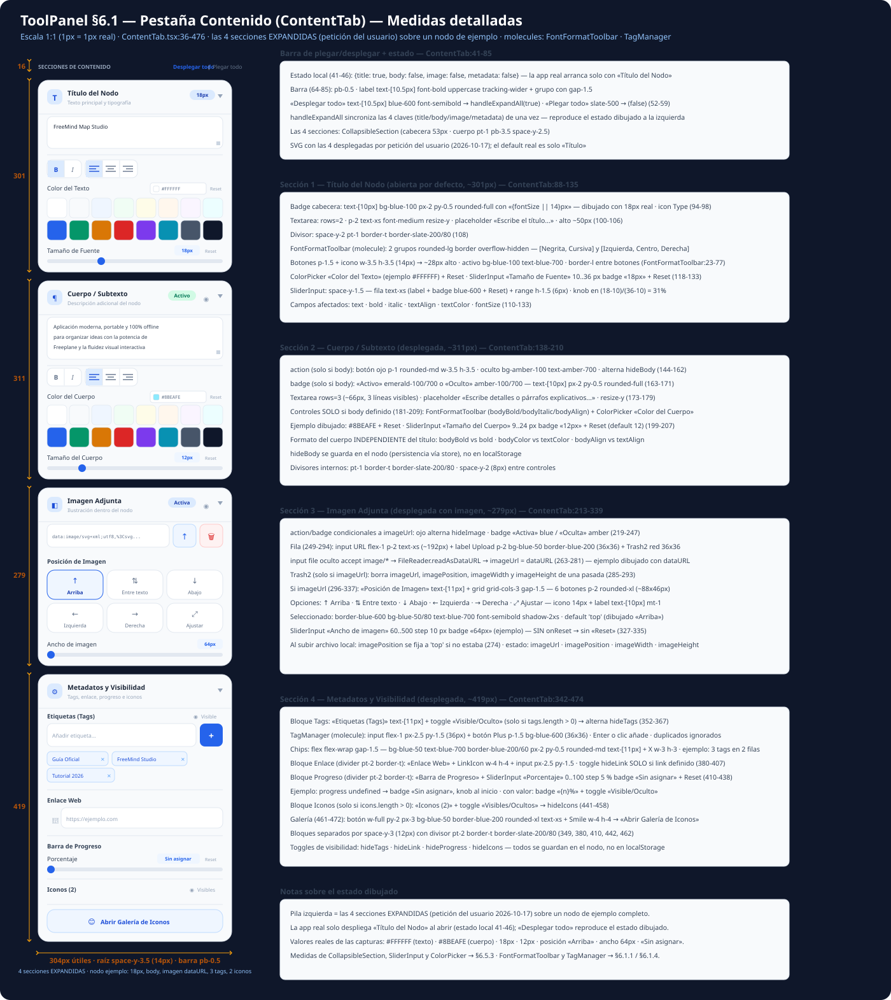

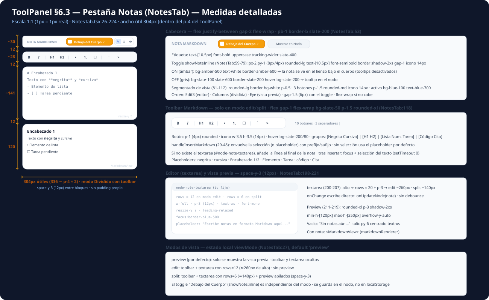

### 1. Subtexto o Cuerpo Descriptivo (`body`)
* Texto secundario renderizado debajo del título principal del nodo.
* Cuenta con controles dedicados de tamaño de fuente tipográfica (`bodyFontSize`), color y alineación.

### 2. Notas Enriquecidas en Markdown (`note`)
* Motor Markdown completo que interpreta:
  * Jerarquías de encabezados (`# H1`, `## H2`, `### H3`).
  * Estilos tipográficos: **negrita** (`**texto**`), *cursiva* (`*texto*`), tachado (`~~texto~~`).
  * Bloques de código con resaltado sintáctico e inline code (`` `const api = true;` ``).
  * Tablas completas con alineación por columnas.
  * Citas en bloque (`> Nota importante`) y listas de tareas interactivas (`- [x] Tarea hecha`, `- [ ] Tarea pendiente`).
* **Selector de Despliegue (Inline vs Tooltip):**
  * *Modo Inline (`showNoteInline: true`):* Despliega la nota formateada directamente dentro del cuerpo de la tarjeta del nodo en el lienzo, recalculando sus dimensiones vectoriales.
  * *Modo Tooltip:* Mantiene la tarjeta del nodo compacta y muestra la nota en una ventana flotante al pasar el cursor o hacer clic sobre el icono `📝`.

### 3. Enlaces Web e Hipervínculos (`link`)
* Admite direcciones web estándar (`https://...`), correos electrónicos (`mailto:...`) o deep-links a otros nodos del mismo mapa (`#node-id`).
* Muestra un distintivo azul con icono de enlace para apertura inmediata en nueva pestaña con un solo clic.

### 4. Motor de Imágenes Adjuntas
* Monta fotografías, bocetos de UI o logotipos corporativos mediante URL.
* **6 Posiciones de Ensamblado:** `top` (arriba del título), `bottom` (debajo del contenido), `left` (lateral izquierda), `right` (lateral derecha), `between` (entre título y cuerpo) y `fit`/`background` (relleno completo de la tarjeta).
* **Control Métrico:** Deslizador de tamaño continuo de 60px a 500px de ancho/alto.

### 5. Barra de Progreso de Tareas (0% a 100%)
* Permite dar seguimiento al estado de ejecución de proyectos.
* Gamificación cromática automática:
  * `0%`: Indicador gris/rojo de tarea pendiente.
  * `1% - 49%`: Barra naranja de avance inicial.
  * `50% - 99%`: Barra ámbar/azul de desarrollo activo.
  * `100%`: Barra verde esmeralda con emblema de verificación completada (`✓`).

### 6. Sistema de Etiquetas Semánticas (`#tags`)
* Permite catalogar nodos con palabras clave (ej. `#urgente`, `#backend`, `#marketing`, `#diseño`).
* Se renderizan como píldoras de colores y habilitan el filtrado instantáneo por metadatos.

### 7. Catálogo de Iconoteca Vectorial (520+ Iconos)
* Modal especializado [IconPackModal.tsx](file:///d:/admin/OneDrive/Documents/IA-code/FreeplaneWeb/Freemind/src/components/Modals/IconPackModal.tsx) con más de 520 glifos vectoriales clasificados en 12 categorías:
  * *Acciones, Negocios, Educación, Desarrollo, Emociones, Flechas, Estado, Clima, Multimedia, Seguridad, etc.*
* Permite tintar individualmente cada icono y asignar múltiples iconos por nodo.

---

### 🌟 Caso Práctico Real 2: Ficha Técnica de Tarea con Notas Markdown, Tags y Progreso

Tomemos el nodo `Pasarela de Pagos Stripe` para dotarlo de especificaciones de ingeniería:

1. **Seleccionar el Nodo y Abrir Inspector:**
   - Haz clic sobre `Pasarela de Pagos Stripe` y pulsa `Alt + P`.
2. **Asignar Etiquetas y Nivel de Cumplimiento:**
   - En la pestaña **Contenido**, escribe `urgente` en el gestor de etiquetas y presiona `Enter` (se crea `#urgente` en tono ámbar).
   - Escribe `dev` y presiona `Enter` (se crea `#dev` en tono azul).
   - Desplaza el selector de progreso al **90%**. En el lienzo, la tarjeta muestra una mini barra verde esmeralda y el badge `90%`.
3. **Redactar Especificación Markdown Desplegada (Inline):**
   - Ve a la pestaña **Notas**. En el editor, redacta la ficha técnica:
     ```markdown
     ### Integración de Pagos con Stripe API
     - [x] Crear cuenta y llaves de prueba en modo Sandbox
     - [x] Configurar Webhook para evento `checkout.session.completed`
     - [ ] Habilitar autenticación biométrica 3D Secure 2.0
     > Para detalles de credenciales consultar: [Documentación Stripe](https://stripe.com/docs)
     ```
   - Activa el interruptor **"Mostrar nota en el lienzo (Inline)"**.
   - En el lienzo, la tarjeta de `Pasarela de Pagos Stripe` se ensancha y alarga automáticamente, mostrando la checklist y el hipervínculo directamente sobre el fondo del mapa mental.

---

## 5. Estilos Visuales, Formas Geométricas y Bocadillos

Personaliza la apariencia estética de cada nodo en la pestaña **Estilos** (`FormatTab.tsx`):

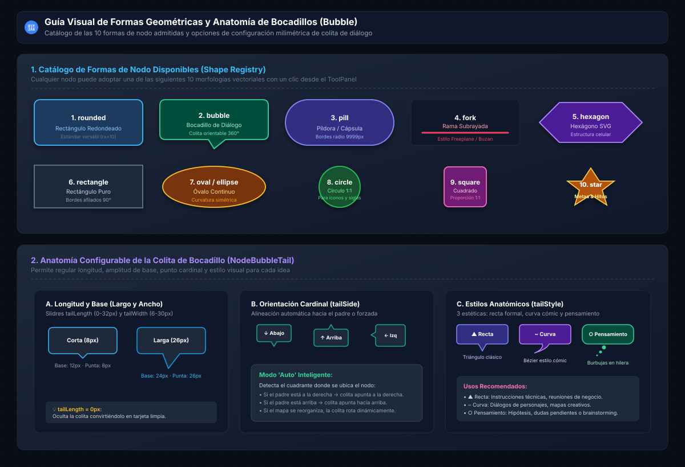

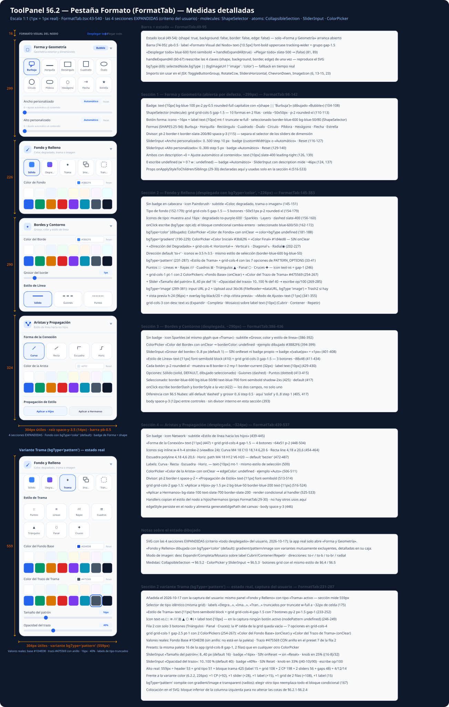

### Las 10 Formas Geométricas de Nodo
1. **`bubble` (Bocadillo de Diálogo / Cómic):** Tarjeta redondeada con colita anatómica orientable 360°.
2. **`fork` (Subrayado / Rama Tony Buzan):** Estilo minimalista donde el texto descansa directamente sobre una línea horizontal coloreada.
3. **`rectangle` (Rectángulo Puro):** Bordes rectos afilados de 90° para documentación técnica y diagramas de flujo formales.
4. **`rounded` (Rectángulo Redondeado):** La forma predilecta moderna con esquinas suavizadas de radio constante (`rx=10`).
5. **`square` (Cuadrado 1:1):** Proporción simétrica para códigos, siglas o números de paso.
6. **`oval` (Óvalo / Elipse):** Geometría elíptica fluida para conceptos integradores.
7. **`circle` (Círculo 1:1):** Tarjeta circular con auto-centrado del texto e iconos.
8. **`pill` (Píldora / Cápsula):** Bordes laterales curvados al máximo (`radio 9999px`) ideal para etiquetas, estados o roles.
9. **`hexagon` (Hexágono SVG):** Polígono geométrico celular de 6 vértices para arquitectura de software y biología.
10. **`star` / `arrow` (Estrella y Flecha SVG):** Formas de llamada de atención visual para metas, hitos o alertas críticas.

---

### 💬 Anatomía Configurable de la Colita de Bocadillo (`NodeBubbleTail`)

Al elegir la forma `bubble`, el sistema habilita el subpanel de control anatómico:

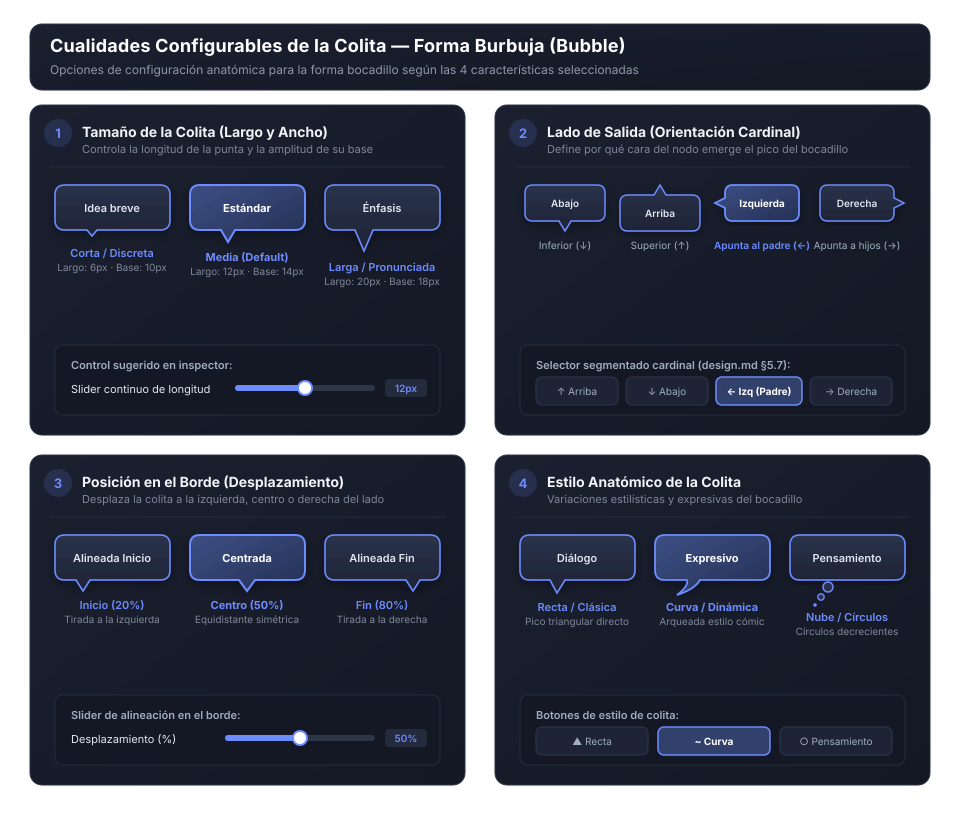

1. **Longitud de la Colita (`tailLength`):**
   * Rango continuo de `0px` a `32px`. Al deslizarlo a `0px`, la colita se suprime convirtiendo el bocadillo en una tarjeta redondeada limpia sin saliente.
   * Presets rápidos: `Ninguna (0px)`, `Corta (8px)`, `Media (16px)`, `Larga (26px)`.
2. **Ancho de Base (`tailWidth`):** Regula la amplitud de la raíz donde la colita brota del nodo (de 6px a 30px).
3. **Orientación Cardinal (`tailSide`):**
   * Opciones: `Auto (Hacia el Padre)`, `↓ Abajo`, `↑ Arriba`, `← Izquierda`, `→ Derecha`.
   * En modo `Auto`, el motor calcula el vector angular entre el centro del nodo padre y el nodo actual, orientando la colita exactamente hacia su origen sin importar cómo se mueva el árbol.
4. **Estilo Anatómico (`tailStyle`):**
   * `▲ Recta / Clásica`: Triángulo recto estilizado para diálogos corporativos.
   * `~ Curva / Cómic`: Curva Bézier arqueada dinámica para viñetas o lluvia de ideas.
   * `○ Nube / Pensamiento`: Hilera de esferas decrecientes para hipótesis, dudas o ideas no consolidadas.

---

### 🌟 Caso Práctico Real 3: Diseñando un Bocadillo Expresivo de Diálogo (Bubble)

1. **Transformar la Rama de Marketing:**
   - Selecciona el nodo `📣 Marketing & Growth`. En el ToolPanel > pestaña **Estilos**, pulsa el icono **"Bocadillo (Bubble)"**.
2. **Modelar la Colita:**
   - En el selector de estilo anatómico, elige **`~ Curva` (Cómic)**.
   - Ajusta la longitud a **16px** y el ancho de base a **18px**.
   - En orientación cardinal, marca **`Auto`**. Nota cómo la curva de diálogo apunta hacia el nodo raíz a su derecha.
3. **Estandarizar con Propagación en Cascada:**
   - Haz clic sobre el botón **"Aplicar Estilo a Hijos"**. De forma instantánea, las tareas `Google Ads` y `Webinar Demo` adoptan la misma forma de bocadillo cómic sin alterar sus títulos ni sus notas.

---

## 6. Arquitectura del Sistema Modular de Sombras (6 Objetos)

Para evitar la sobrecarga de GPU en ordenadores portátiles o mapas gigantes, FreeMind Map Studio implementa un **sistema de iluminación modular gobernado por interruptores dedicados `<Switch />`** (apagados por defecto, 0% costo de GPU):

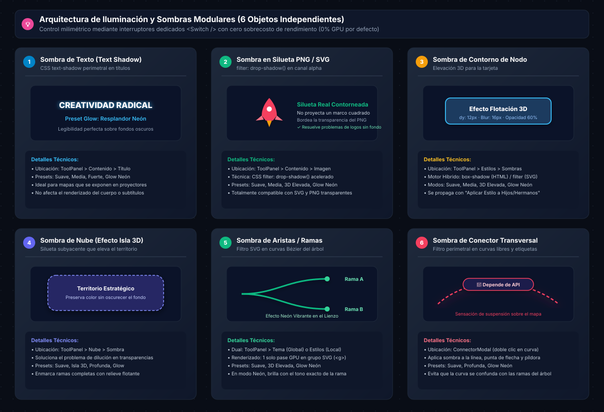

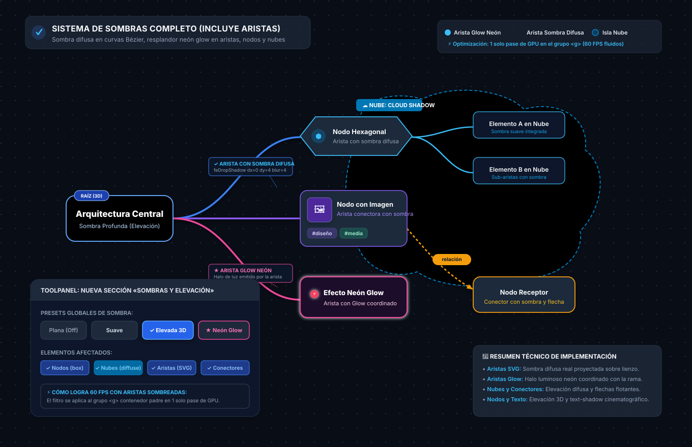

| Objeto de Sombra | Ubicación en Inspector | Técnica de Renderizado | Presets Disponibles |
|---|---|---|---|
| **1. Sombra de Texto** | Pestaña *Contenido* > Título | CSS `text-shadow` optimizado | `Suave`, `Media`, `Fuerte`, `Glow Neón` |
| **2. Sombra de Imagen** | Pestaña *Contenido* > Imagen | CSS `filter: drop-shadow()` en canal alpha | `Suave`, `Media`, `3D Elevada`, `Glow` |
| **3. Sombra de Contorno** | Pestaña *Estilos* > Sombras | Híbrido: `box-shadow` / `feDropShadow` SVG | `Suave`, `Media`, `3D Elevada`, `Glow` |
| **4. Sombra de Nube** | Pestaña *Nube* > Sombra | Silueta sólida opaca con `feGaussianBlur` | `Suave`, `Isla 3D`, `Profunda`, `Glow` |
| **5. Sombra de Aristas** | Dual: Pestaña *Tema* (Global) y *Estilos* (Local) | Filtro SVG `filter` agrupado en contenedor `<g>` | `Suave`, `3D Elevada`, `Glow Neón` |
| **6. Sombra de Conectores** | Modal de Conector (`ConnectorModal`) | Filtro SVG perimetral en línea y badge | `Suave`, `Profunda`, `Glow Neón` |

### Cualidades Técnicas Destacadas:
* **Siluetas PNG/SVG Reales (Objeto #2):** El filtro `drop-shadow` respeta la transparencia perimetral de logos o imágenes sin proyectar un marco cuadrado artificial.
* **Técnica Isla 3D para Nubes (Objeto #4):** Proyecta una silueta duplicada subyacente opaca con desenfoque gaussiano, evitando que la sombra se diluya al usar rellenos translúcidos.
* **Resplandor Neón en Aristas (Objeto #5):** Renderizado en un solo pase de GPU para todo el grupo de ramas, iluminando cada rama con su propio tono cromático.

---

### 🌟 Caso Práctico Real 4: Iluminación Editorial con Elevación 3D y Glow Neón

1. **Dar Relieve 3D a la Idea Central:**
   - Selecciona `🚀 Lanzamiento SaaS Q4`. En ToolPanel > pestaña **Estilos**, activa el interruptor **"Sombra de Caja"** y selecciona el preset **`3D Elevada`**. La tarjeta parece flotar sobre el mapa.
2. **Resaltar el Título con Glow Neón:**
   - Ve a la pestaña **Contenido**. Activa el interruptor **"Sombra de Texto"** y elige **`Glow Neón`**. El texto emite un halo de alta visibilidad para pantallas de proyector.
3. **Encender las Ramas en la Oscuridad:**
   - Ve a la pestaña **Tema**. En la sección "Aristas / Conexiones", activa **"Sombra de Aristas"** y pulsa **`Glow Neón`**. Cada rama Bézier se ilumina con una línea de neón vibrante que guía la vista.

---

## 7. Nubes de Territorio y Conectores Libres Transversales

### Nubes Envolventes de Territorio (Clouds)
Las nubes permiten delimitar visualmente un nodo y toda su descendencia bajo un perímetro unificado:

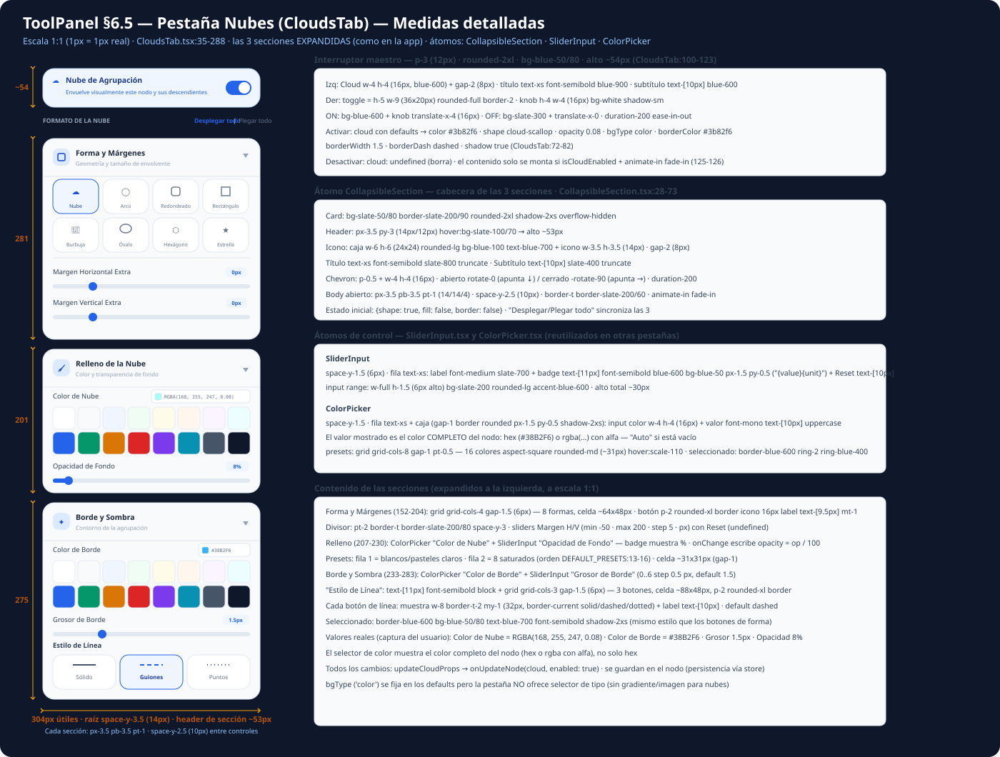

* **8 Formas Perimetrales:** `cloud-scallop` (festoneada tradicional de Freeplane), `round-rectangle`, `rectangle`, `arc`, `oval`, `circle`, `star` y `hexagon`.
* **Configuración Continua:** Selector de color de relleno, nivel de opacidad (de 5% a 100%), grosor y patrón de guiones del borde, y sombra Isla 3D envolvente.

### Conectores Libres Transversales (Relaciones Cruzadas)
Permiten conectar dos ideas que pertenecen a distintas ramas o hemisferios del mapa mental:
1. **Creación:** Pulsa el botón **"🔗 Conector"** en la ToolBar o selecciónalo en el menú contextual. Haz clic en el nodo origen y luego en el nodo destino.
2. **Edición Interactiva:** Haz **doble clic sobre la curva del conector** para abrir el `ConnectorModal`:
   * Color de línea, grosor de trazo y estilo (`Sólido`, `Discontinuo`, `Punteado`).
   * Puntas de flecha: Unidireccional, bidireccional o sin flecha.
   * Etiqueta de relación central con fondo tipo píldora para proteger la legibilidad.
   * Sombra perimetral flotante.
3. **Deformación Bézier:** Arrastra el tirador circular central para combar la curva y esquivar otros nodos.
4. **Eliminación:** Haz clic sobre el conector (se enciende un halo azul brillante) y presiona `Supr` (`Delete`).

---

### 🌟 Caso Práctico Real 5: Nube de Territorio y Conector Transversal con Etiqueta

1. **Crear Territorio para Marketing:**
   - Selecciona `📣 Marketing & Growth`. Abre ToolPanel > pestaña **Nube**.
   - Activa la nube, selecciona el estilo **`cloud-scallop`**, color verde esmeralda con opacidad al **12%**. Toda la rama de marketing queda enmarcada en una suave isla conceptual.
2. **Conectar la Dependencia Técnica:**
   - Haz clic en **"🔗 Conector"** en la barra superior.
   - Haz clic en `Pasarela Stripe` (origen) y luego en `Webinar Demo` (destino).
   - Haz doble clic en la curva resultante: selecciona color rosa fucsia (`#f43f5e`), estilo discontinuo y escribe como etiqueta central: `🔗 Sincroniza Pagos Stripe`.
   - Arrastra el punto de control hacia arriba en el lienzo para que la curva pase arqueada por encima del nodo central con total claridad.

---

## 8. Los 9 Algoritmos de Distribución Espacial (Layout Engine) y Temas

El motor matemático en [layoutEngine.ts](file:///d:/admin/OneDrive/Documents/IA-code/FreeplaneWeb/Freemind/src/utils/layoutEngine.ts) calcula las coordenadas $(x, y)$ de cada tarjeta de forma determinista:

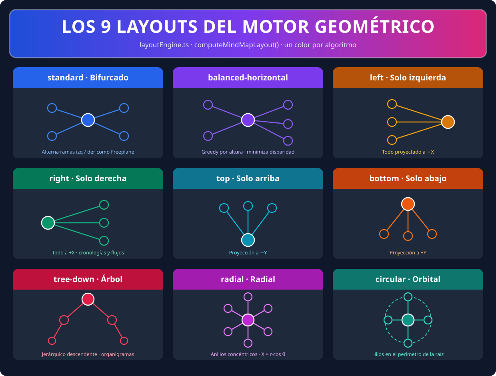

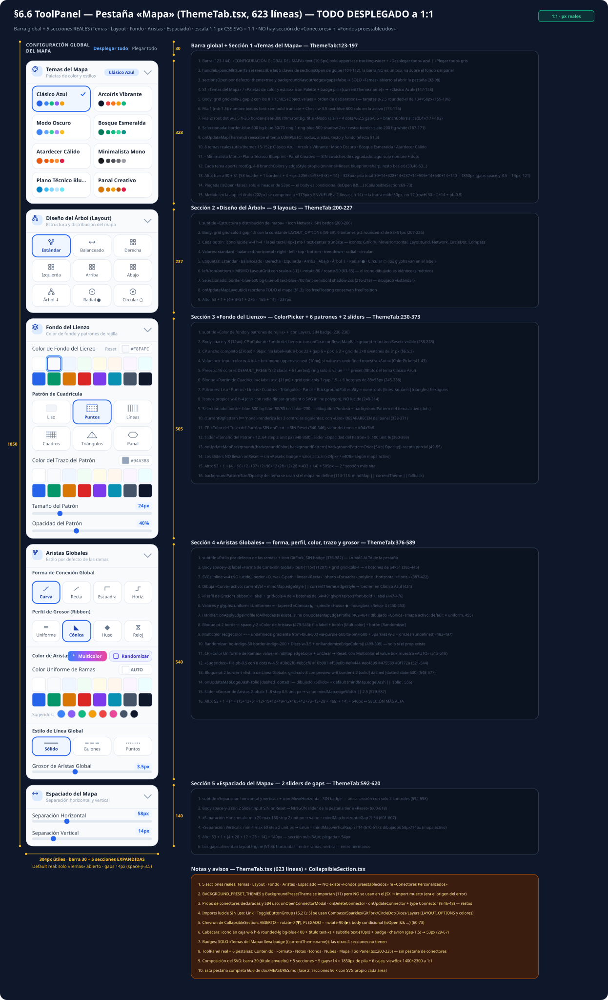

### Los 9 Algoritmos de Layout
1. **Estándar Bilateral:** Distribuye las ramas secundarias alternando entre izquierda y derecha del nodo raíz.
2. **Balanceado Horizontal:** Pesa la cantidad de descendientes de cada rama para equilibrar el centro de masa del mapa con precisión matemática.
3. **Árbol Derecho:** Todas las ramas nacen hacia la derecha (óptimo para hojas de ruta cronológicas, sprints o procesos paso a paso).
4. **Árbol Izquierdo:** Proyección hacia la izquierda para análisis retrospectivos o diagramas causa-raíz.
5. **Organigrama Descendente (Top-to-Bottom):** Árbol jerárquico de arriba hacia abajo para organigramas corporativos y estructuras de desglose de trabajo (WBS).
6. **Organigrama Ascendente (Bottom-to-Top):** Jerarquía de abajo hacia arriba para diagramas de metas y fundamentos.
7. **Árbol Genealógico Vertical:** Disposición con enlaces estilizados para linajes y taxonomías botánicas/zoológicas.
8. **Distribución Radial 360°:** Proyección angular polar $(\rho, \theta)$ que expande las ideas en círculo continuo alrededor de la idea central.
9. **Distribución Circular Cerrada:** Nodos distribuidos en órbitas concéntricas equidistantes.

### Los 8 Temas Cromáticos del Mapa
* **Clásico Azul:** Paleta corporativa sobria (tonos azul zafiro, pizarra y gris frío).
* **Bosque Orgánico:** Tonos verdes esmeralda, musgo y salvia para proyectos de ecología o crecimiento.
* **Modo Oscuro Profundo:** Fondo carbón con tarjetas neón de alto impacto visual.
* **Arcoíris Vibrante:** Ramas multicolores llamativas para lluvias de ideas y dinámicas de diseño.
* **Océano Pastel:** Cian suave, menta y lavanda para estudio y concentración prolongada.
* **Minimalista Monocromático:** Escala de grises pura para publicaciones académicas y libros impresos.
* **Atardecer Cálido:** Naranjas, corales y dorados estimulantes.
* **Púrpura Tecnológico:** Violetas, magentas y púrpuras modernos para productos de software.

---

## 9. Búsqueda Avanzada, Filtros de Metadatos y Efecto Spotlight

Presiona `Ctrl + F` para desplegar la barra de filtros avanzada:

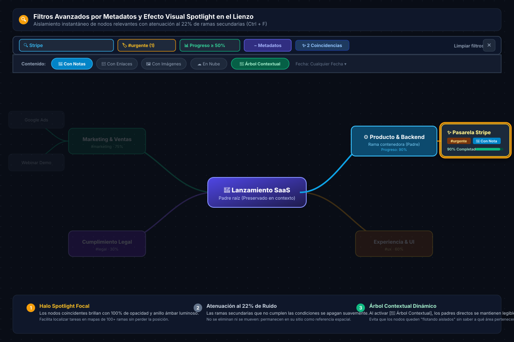

```
[🔍 Buscar por texto en nodos, notas, #tags... ] [Todas las Etiquetas ▼] [Cualquier Progreso ▼] [+ Metadatos] [✨ 2 coincidencias] [Limpiar filtros] [✕]
  └─ [+ Metadatos Expandido]: [📝 Con Notas] [🔗 Con Enlaces] [🖼️ Con Imágenes] [☁️ En Nube] [⭐ Con Iconos] [📅 Cualquier Fecha ▼] [🌳 Árbol Contextual]
```

### El Efecto Visual Spotlight
* **Aislamiento Visual Inmediato:** Cuando un filtro está activo, los nodos que coinciden se mantienen al **100% de opacidad y se enmarcan con un halo ámbar luminoso (`ring-2 ring-amber-400`)**.
* **Atenuación al 22% de Ramas No Relevantes:** Todos los nodos y ramas que no cumplen los criterios se **desvanecen al 22% de opacidad**, permitiendo enfocar la mirada de inmediato sin perder la noción de dónde están ubicados en el mapa mental.
* **Modo Árbol Contextual (`includeAncestors`):** Mantiene legibles al 85% de opacidad los nodos padres y ancestros directos hasta la raíz, para que las coincidencias no queden flotando huérfanas en el espacio.

---

### 🌟 Caso Práctico Real 6: Auditoría de Emergencia del Sprint con Filtro Spotlight

Pregunta del líder de proyecto: *"¿Qué tareas urgentes de desarrollo están a medio camino y tienen notas técnicas adjuntas?"*

1. **Abrir Filtros:** Pulsa `Ctrl + F`.
2. **Establecer Criterios:**
   - En el desplegable de etiquetas, selecciona **`#urgente`**.
   - En el desplegable de progreso, selecciona **`Progreso ≥ 50%`**.
   - Abre `+ Metadatos` y activa la píldora **`📝 Con Notas`**.
3. **El Resultado en el Lienzo:**
   - El contador muestra `✨ 1 coincidencia`.
   - El 98% del lienzo se atenúa al 22% de opacidad.
   - La tarjeta `Pasarela de Pagos Stripe` resplandece en el lienzo enmarcada en ámbar brillante, con el nodo padre `Producto & Backend` preservado para contextualizar el área.

---

## 10. Línea de Tiempo del Historial de Versiones (Undo / Redo)

Presiona `Ctrl + Shift + H` para abrir el modal cronológico [HistoryTimelineModal.tsx](file:///d:/admin/OneDrive/Documents/IA-code/FreeplaneWeb/Freemind/src/components/Modals/HistoryTimelineModal.tsx):

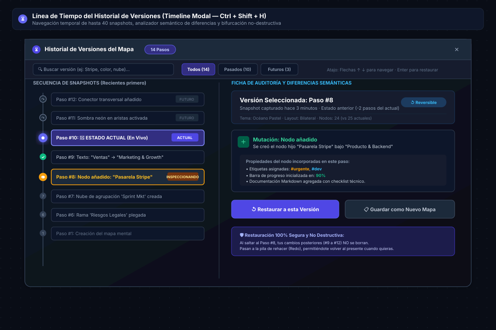

### Motor de Auditoría Semántica ([historyDiff.ts](file:///d:/admin/OneDrive/Documents/IA-code/FreeplaneWeb/Freemind/src/utils/historyDiff.ts))
* Registra hasta **40 estados completos e inmutables** del mapa mental.
* En cada paso, el motor calcula la mutación exacta y redacta una explicación en español:
  * *Nodo añadido*, *Texto modificado*, *Color/Tema cambiado*, *Rama reubicada*, *Sombra activada*, *Nube creada*, etc.
* **Viaje en el Tiempo No Destructivo:** Puedes saltar al Paso #5 para inspeccionar el mapa de hace 20 minutos. Las versiones posteriores no se pierden; pasan a la pila de rehacer (`Redo`), permitiéndote volver al presente en cualquier momento.
* **Bifurcación (Crear Copia):** Puedes hacer clic en **"📋 Guardar Copia como Nuevo Mapa"** para guardar cualquier versión pasada como un documento independiente en tu biblioteca.

---

### 🌟 Caso Práctico Real 7: Recuperar una Idea Eliminada sin Perder el Trabajo Reciente

1. **El Incidente:** Has eliminado sin querer la rama `Auditoría RGPD & SOC-2`. Tras ello, has continuado trabajando y añadiste colores y tareas en marketing.
2. **Abrir Historial:** Pulsa `Ctrl + Shift + H`.
3. **Localizar el Paso:**
   - En el buscador escribe `RGPD` o navega con las flechas hacia abajo hasta el **Paso #6**.
   - En la tarjeta derecha de auditoría semántica se confirma: *"Paso #6: Rama 'Auditoría RGPD' presente (25 nodos vs 24 actuales)"*.
4. **Restaurar con Seguridad:**
   - Haz clic en **"↺ Restaurar a esta Versión"**. El lienzo restaura la rama completa al instante. Tus pasos posteriores se conservan en la pila de rehacer (`Ctrl + Y`).

---

## 11. Paleta de Comandos Universal (Ctrl + K / Cmd + K)

Inspirada en entornos de máxima productividad como VS Code y Raycast, la paleta [CommandPaletteModal.tsx](file:///d:/admin/OneDrive/Documents/IA-code/FreeplaneWeb/Freemind/src/components/Modals/CommandPaletteModal.tsx) permite operar el 100% de la aplicación sin tocar el ratón:

* **Invocación:** Pulsa `Ctrl + K` (Windows/Linux) o `Cmd + K` (macOS), o pulsa el botón `⌘K` en la ToolBar.
* **Búsqueda Universal con Vuelo Cinemático:** Escribe el nombre de cualquier tarea o concepto. Al pulsar `Enter`, la cámara del lienzo **vuela suavemente hacia el nodo objetivo (`focusTarget`) y lo enfoca en pantalla**.
* **Sintaxis de Prefijos Especializados:**
  * `> texto`: Filtra exclusivamente **acciones, comandos de menú y herramientas**.
  * `@ texto`: Filtra exclusivamente **nodos e ideas del mapa mental**.
* **Pestañas de Filtrado Rápido:** *Todos, Acciones, Nodos, Temas, Diseño, Formas, Sombras, Vistas, Archivo*.

---

## 12. Modos de Presentación Cinematográficos (3 Modos)

Pulsa `F5` para transformar tu mapa mental en una experiencia expositiva:

### Modo 1: Presentación Dinámica (Vuelo Cinemático Estilo Mindomo)
* **Recorrido Guiado:** La cámara vuela suavemente de nodo en nodo siguiendo la jerarquía lógica del árbol.
* **Renderizado Vectorial Anti-Desenfoque:** Durante el desplazamiento se activa aceleración por hardware; al posarse sobre cada tarjeta, el motor conmuta a renderizado 1:1 vectorial para textos y bordes ultra-nítidos.
* **Editor de Diapositivas (*Filmstrip*):** Reordena manualmente los pasos de la exposición y añade notas privadas del orador visibles solo en pantalla de control.

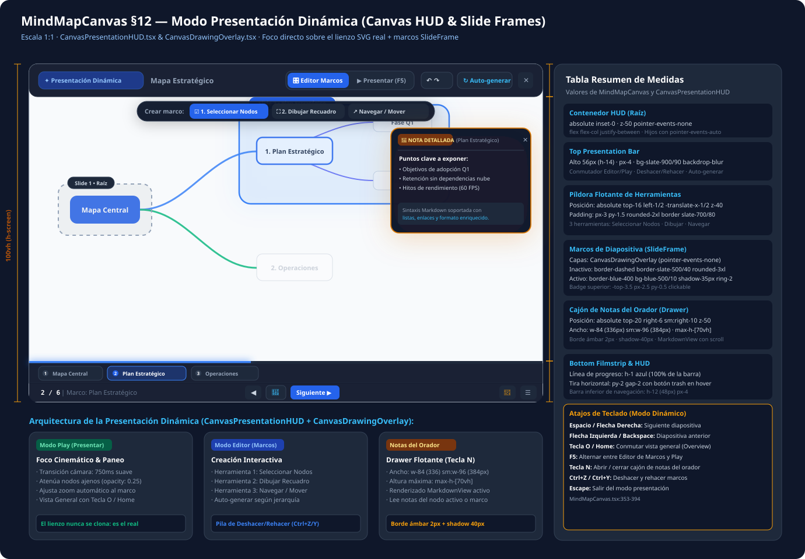

---

### Modo 2: Presentación Clásica (Diapositivas Temáticas)
* Convierte las ramas primarias en diapositivas pantalla completa con tipografías legibles a larga distancia.
* Incluye un radar minimapa interactivo para no perder el contexto global.

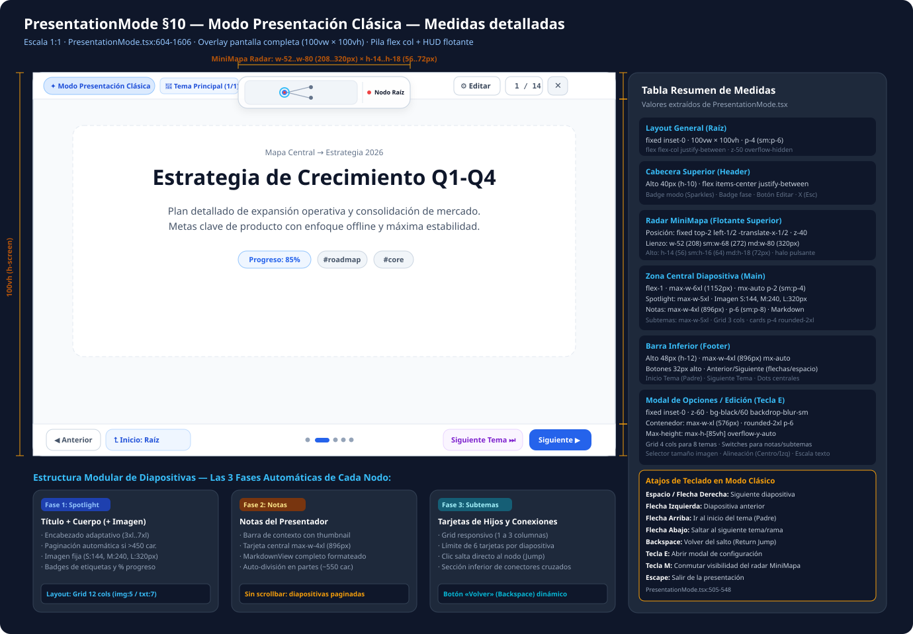

---

### Modo 3: Presentación Elaborada (Espacial 3D Estilo Prezi)
* Dispone las ideas en tarjetas tridimensionales de 720×440 píxeles suspendidas sobre un cosmos infinito.
* **5 Estrategias de Acomodo Espacial:** *Espiral Áurea, Constelación Orbital, Matriz Modular, Línea de Tiempo Cósmica y Jerarquía Piramidal*.
* Cámara con paneo tridimensional, zoom cinemático y rotación angular.

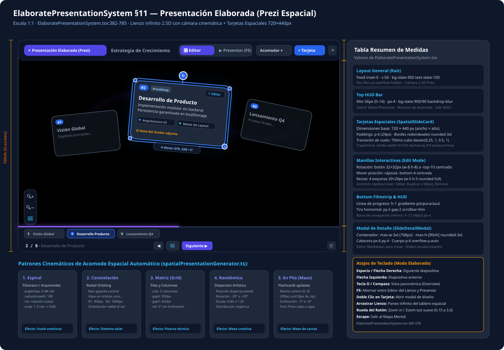

---

## 13. Exportación Profesional e Impresión Técnica

Pulsa en Menú *"Archivo"* > *"Exportar..."* para generar entregables de nivel editorial:

### 1. Motor de Impresión PDF Vectorial ([PdfExportModal.tsx](file:///d:/admin/OneDrive/Documents/IA-code/FreeplaneWeb/Freemind/src/components/Modals/PdfExportModal.tsx))
Genera documentos PDF de calidad vectorial sin rasterización:

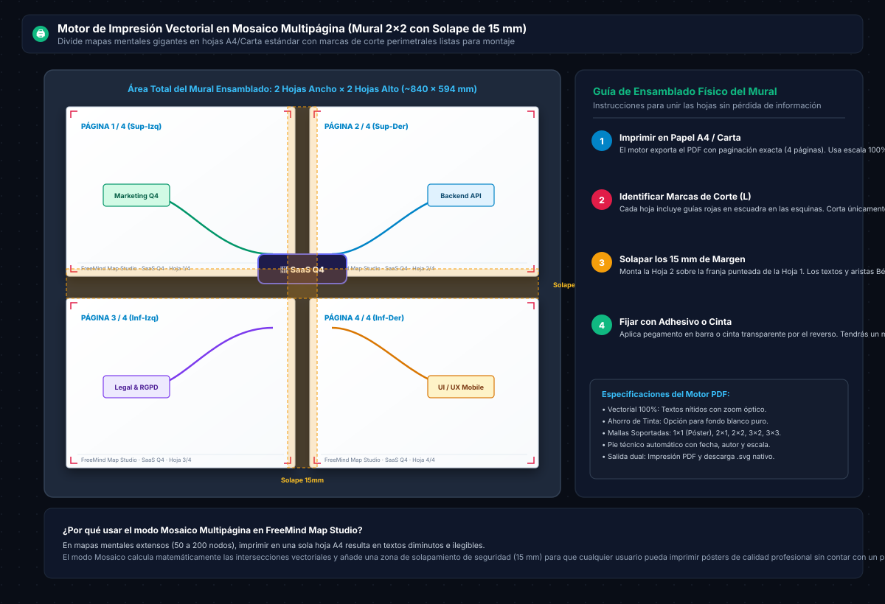

* **Formatos Físicos Soportados:** A4, A3, A2, Carta (Letter), Oficio (Legal), Tabloide y Póster Continuo.
* **Orientación:** Horizontal (*Landscape*) o Vertical (*Portrait*).
* **Modos de Paginación:**
  * `Póster de 1 Hoja`: Escala el mapa completo para encajar exactamente en una página.
  * `Mosaico Multipágina (2×1, 2×2, 3×2, 3×3)`: Para mapas grandes, divide el diagrama en una cuadrícula de páginas con **marcas de corte en escuadra (L) y franjas de solapamiento de 15 mm**, listas para recortar y ensamblar un mural gigante en la pared.
* **Acabados:** Opción de fondo blanco para ahorro de tóner, pie de imprenta técnico automático con fecha y autor, y descarga en formato `.svg` vectorial puro.

---

### 🌟 Caso Práctico Real 8: Impresión de un Mural Gigante de 1 Metro para la Sala de Juntas

1. **Abrir el Modal de Exportación:** Menú **Archivo** > **Exportar a PDF...** (o pulsa `Ctrl + K` y escribe `PDF`).
2. **Configuración de Mosaico:**
   - Papel: **A4**. Orientación: **Horizontal (Landscape)**.
   - Modo de Paginación: **Mosaico 2×2 (4 Hojas)**.
   - Activa el interruptor **"Fondo blanco para ahorro de tinta"**.
3. **Impresión y Ensamblado:**
   - Haz clic en **"🖨️ Imprimir PDF"**. Se generan 4 páginas A4.
   - Usa una regla y cúter para recortar los bordes guiándote por las marcas rojas en escuadra.
   - Monta la Hoja 2 sobre los 15 mm de solape de la Hoja 1 y fíjalas con cinta por el reverso para crear un póster de 84 × 60 cm de alta resolución.

---

### 2. Exportación a HTML Autónomo Single-File ([htmlExporter.ts](file:///d:/admin/OneDrive/Documents/IA-code/FreeplaneWeb/Freemind/src/utils/htmlExporter.ts))
Genera un archivo `.html` independiente con scripts y estilos embebidos que funciona sin internet ni servidores.

### 3. Formato Nativo Freeplane / FreeMind XML ([freeplaneConverter.ts](file:///d:/admin/OneDrive/Documents/IA-code/FreeplaneWeb/Freemind/src/utils/freeplaneConverter.ts))
Exportación e importación bidireccional compatible con la suite de escritorio Freeplane 1.x.

### 4. Esquema Markdown (.md) y Respaldo JSON (.json)
Exporta la estructura como documento Markdown jerárquico o descarga el archivo JSON con el estado interno del mapa.

---

## 14. Gestión de Mapas y Galería de Plantillas Profesionales

### Gestor de Mapas Guardados ([SavedMapsModal.tsx](file:///d:/admin/OneDrive/Documents/IA-code/FreeplaneWeb/Freemind/src/components/Modals/SavedMapsModal.tsx))
* Permite almacenar docenas de mapas independientes en el almacenamiento local.
* Lista fecha de modificación, número de nodos y opciones para duplicar, renombrar o eliminar.

### Catálogo de Plantillas Especializadas ([TemplatesModal.tsx](file:///d:/admin/OneDrive/Documents/IA-code/FreeplaneWeb/Freemind/src/components/Modals/TemplatesModal.tsx))
Inicia proyectos al instante con más de 20 estructuras preconfiguradas:
* **Estrategia y Negocios:** Modelo Canvas, Matriz FODA/DAFO, Plan de Lanzamiento SaaS, Organigrama Empresarial, Matriz de Decisión.
* **Gestión de Proyectos:** Roadmap de Producto, Sprint Planning Ágil, Diagrama Causa-Efecto (Ishikawa / Espina de Pescado).
* **Educación e Investigación:** Guía de Tesis, Síntesis de Libro, Temario de Examen.
* **Creatividad y Productividad:** Lluvia de Ideas (Brainstorming), Mapa de Empatía, Método de los 6 Sombreros para Pensar, Metas Personales.

---

## 15. Tabla Maestra Completa de Atajos de Teclado

### Edición y Estructura del Árbol
| Atajo | Acción |
|---|---|
| `Tab` o `Insert` | Crear nodo hijo (balanceo simétrico automático en nodo raíz) |
| `Enter` | Crear nodo hermano al mismo nivel |
| `F2` o `Doble clic` | Editar texto del nodo en línea |
| `Espacio` | Plegar o desplegar rama descendiente |
| `Supr` o `Delete` | Eliminar nodo seleccionado y su subárbol |
| `Ctrl + C` / `Cmd + C` | Copiar nodo o rama seleccionada |
| `Ctrl + X` / `Cmd + X` | Cortar nodo o rama seleccionada |
| `Ctrl + V` / `Cmd + V` | Pegar rama con nuevos identificadores |
| `Ctrl + B` / `Cmd + B` | Alternar texto en **Negrita** |
| `Ctrl + I` / `Cmd + I` | Alternar texto en *Cursiva* |

### Navegación y Vistas del Sistema
| Atajo | Acción |
|---|---|
| `↑` `↓` `←` `→` | Navegar entre nodos adyacentes por la estructura del árbol |
| `Ctrl + K` / `Cmd + K` | Abrir la **Paleta de Comandos Universal** |
| `Ctrl + F` / `Cmd + F` | Abrir / Cerrar la **Barra de Filtros y Búsqueda (Spotlight)** |
| `Ctrl + Shift + H` | Abrir la **Línea de Tiempo del Historial de Versiones** |
| `Ctrl + Z` / `Cmd + Z` | Deshacer último cambio (`Undo`) |
| `Ctrl + Y` / `Cmd + Shift + Z` | Rehacer último cambio (`Redo`) |
| `Alt + P` | Abrir / Cerrar el **ToolPanel** (Inspector lateral) |
| `Alt + O` | Abrir / Cerrar la **OutlineView** (Esquema jerárquico) |
| `F5` | Iniciar / Salir del modo de **Presentación** |
| `Escape` | Cerrar cualquier modal, cancelar edición o deseleccionar |
| `Rueda del ratón` | Zoom hacia adelante / atrás centrado en puntero |
| `Arrastrar fondo` | Paneo libre del mapa mental |

---

## 16. Preguntas Frecuentes, Resolución de Problemas y Diagnóstico

### ¿Dónde se guardan mis mapas mentales?
Se guardan de forma exclusiva en el almacenamiento local (`localStorage`) de tu navegador web. Si limpias el historial de navegación asegurándote de no borrar datos de sitios, tus mapas se conservan intactos. Para mayor seguridad, usa regularmente **Archivo > Exportar como JSON** para guardar copias de respaldo en tu disco duro.

### ¿Qué hago si el mapa mental tiene más de 300 nodos y la animación pierde fluidez?
1. Desactiva las sombras de contorno globales o ponlas en modo `Suave`.
2. Pliega con la barra espaciadora (`Espacio`) las ramas que no estés editando activamente.
3. El motor de FreeMind Map Studio continuará ejecutándose a 60 FPS.

### ¿Cómo imprimo en hojas A4 normales un mapa muy extenso?
Usa la modalidad **Mosaico 2×2 o 3×2** en el modal de exportación a PDF. El sistema añade 15 mm de solapamiento y marcas de corte para que ensambles las hojas como un puzzle sin que falte ni una sola letra.

---
*Manual oficial y definitivo de FreeMind Map Studio — Desarrollado con React 19, TypeScript 5.8, Tailwind CSS v4, Zustand 5 y Vite.*
