# 📏 Hoja de Medidas — FreeMind Map Studio

> **Actualizado**: 2026-10-17 · **Estado**: verificado leyendo las clases Tailwind directamente de `src/`.
> **Alcance**: por ahora solo las **áreas grandes** (contenedores principales de la interfaz). Los controles
> internos (botones, sliders, tarjetas, iconos) se documentarán en una segunda fase.
>
> **Convención de medida**: Tailwind usa un espaciado base de 4px → `1 unidad = 4px`.
> `h-10` = 40px · `w-80` = 320px · `w-84` = 336px · `w-88` = 352px. Los tamaños `sm:` (640px) y `md:` (768px)
> son *breakpoints* de ancho de viewport, no medidas fijas.

> 🖼 **Diagrama de las áreas grandes** (escala 1:1 con cotas en px):

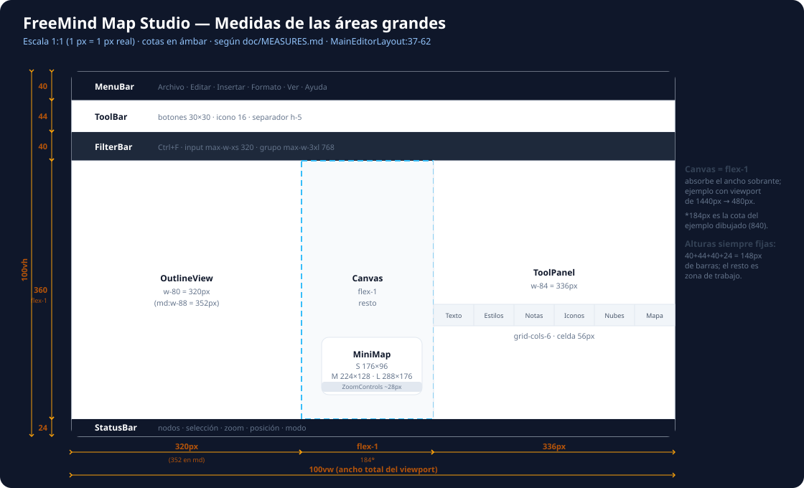

---

## 1. Estructura general (layout raíz)

`src/components/templates/MainEditorLayout.tsx:37` → `
`

| Propiedad | Medida | Origen |
|-----------|--------|--------|
| Altura raíz | **100vh** (`h-screen`) | MainEditorLayout:37 |
| Ancho raíz | **100vw** (`w-screen`) | MainEditorLayout:37 |
| Disposición | **columna** vertical (`flex flex-col`), `overflow-hidden` | MainEditorLayout:37 |

El layout es una columna de altura completa que apila, de arriba a abajo: MenuBar → ToolBar → FilterBar (opcional) → **zona de trabajo** (`flex-1`) → StatusBar. La zona de trabajo (`MainEditorLayout:48`) es una fila `flex-1 flex` que distribuye: Outline (izq) · Canvas (`flex-1`, centro) · ToolPanel (der). En modo presentación desaparecen las barras y paneles, y el overlay ocupa toda la pantalla (`MainEditorLayout:65`).

---

## 2. Zona de trabajo (fila central)

| Sub-zona | Comportamiento de medida | Origen |
|----------|--------------------------|--------|
| Contenedor fila | `flex-1 flex overflow-hidden relative` → ocupa el alto sobrante | MainEditorLayout:48 |
| Outline (izquierda) | Ancho fijo (ver §5) · `shrink-0` · ocupa el alto de la fila (`h-full`) | MainEditorLayout:50 |
| **Canvas (centro)** | **`flex-1`** (absorbe todo el ancho sobrante) · `relative overflow-hidden flex flex-col` | MainEditorLayout:53 |
| ToolPanel (derecha) | Ancho fijo (ver §6) · oculta en `isOutlineFullscreen` | MainEditorLayout:58 |

El canvas no tiene ancho fijo: **se adapta al espacio que dejan** el Outline y el ToolPanel. Su alto = alto de la fila = `100vh − (MenuBar + ToolBar + FilterBar + StatusBar)`.

---

## 3. MenuBar (barra superior) — detallada

`src/components/MenuBar.tsx:137-556`

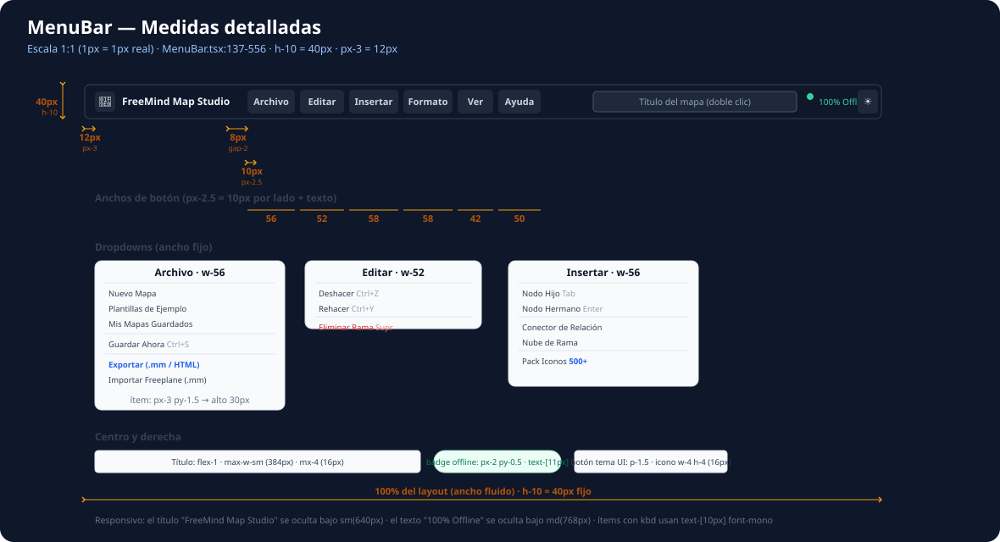

### 3.1 Contenedor raíz

| Propiedad | Medida | Origen |
|-----------|--------|--------|
| **Altura** | **40px** (`h-10`) | MenuBar:137 |
| Ancho | 100% del layout (`justify-between`) | MenuBar:137 |
| Padding lateral | **12px** (`px-3`) | MenuBar:137 |
| Bordes | `border-b border-slate-800` (1px inferior) | MenuBar:137 |
| Base de texto | `text-xs` (12px) | MenuBar:137 |
| z-index | `z-50` | MenuBar:137 |

El layout es `flex items-center justify-between` con 3 grupos: **izquierda** (marca + 6 menús), **centro** (título editable, `flex-1`), **derecha** (badge offline + botón de tema).

### 3.2 Grupo izquierdo — marca y botones de menú

| Elemento | Medida | Origen |
|----------|--------|--------|
| Contenedor grupo | `gap-2` → **8px** entre elementos | MenuBar:140 |
| Logo 🧠 | `text-base` (16px) | MenuBar:143 |
| Texto marca | `gap-1.5` (6px) + `mr-2` (8px) · oculto bajo `sm` (640px) | MenuBar:142-144 |
| **Botón de menú** | `px-2.5 py-1` → **10px** lateral / **4px** vertical, `rounded-md` | MenuBar:151 |

Anchos reales de cada botón (10px de padding por lado + el texto, según el label):

| Menú | Ancho | Origen |
|------|-------|--------|
| Archivo | **56px** | MenuBar:155 |
| Editar | **52px** | MenuBar:210 |
| Insertar | **58px** | MenuBar:250 |
| Formato | **58px** | MenuBar:309 |
| Ver | **42px** | MenuBar:427 |
| Ayuda | **50px** | MenuBar:492 |

Estado abierto: `bg-slate-800 text-blue-400 font-semibold`; cerrado/hover: `text-slate-300 hover:bg-slate-800`.

### 3.3 Dropdowns (paneles desplegables)

Todos comparten: `absolute top-full left-0 mt-1` (**4px** de separación), `rounded-xl`, `shadow-2xl`, `border`, `py-1.5` (**6px**), `z-50`. **Ítem base**: `px-3 py-1.5` → **12px** lateral / **6px** vertical → **alto ~30px**; iconos `w-3.5 h-3.5` (14px); atajos en `kbd` `text-[10px] font-mono`.

| Dropdown | Ancho | Ítems | Origen |
|----------|-------|-------|--------|
| **Archivo** | **224px** (`w-56`) | Nuevo Mapa · Plantillas · Mis Mapas Guardados · ─ · Guardar Ahora (Ctrl+S) · ─ · Exportar · Importar | MenuBar:158 |
| **Editar** | **208px** (`w-52`) | Deshacer (Ctrl+Z, disabled sin historial) · Rehacer (Ctrl+Y) · ─ · Eliminar Rama (Supr, rojo) | MenuBar:213 |
| **Insertar** | **224px** (`w-56`) | Nodo Hijo (Tab) · Nodo Hermano (Enter) · ─ · Conector · Nube · ─ · Pack Iconos (badge 500+) | MenuBar:253 |
| **Formato** | **224px** (`w-56`) | Encabezado "Temas Visuales" + 5 temas · ─ · "Forma del Nodo" + 10 formas · ─ · Restablecer Formato | MenuBar:312 |
| **Ver** | **224px** (`w-56`) | Panel Esquema (Alt+O) · 3 presentaciones · ─ · Desplegar/Plegar · ─ · Pantalla Completa (F11) | MenuBar:430 |
| **Ayuda** | **224px** (`w-56`) | Atajos de Teclado (?) · Guía Tutorial | MenuBar:495 |

Encabezados de sección (Formato): `px-3 py-1 text-[10px] font-bold uppercase tracking-wider`. Badges "500+"/"Activo": `text-[10px]`/`text-[9px]`, `px-1.5`, `rounded-full`.

### 3.4 Centro — título editable

| Propiedad | Medida | Origen |
|-----------|--------|--------|
| Contenedor | `flex-1 max-w-sm mx-4 text-center` → crece, tope **384px**, margen **16px** | MenuBar:515 |
| Modo vista | `px-2 py-0.5 rounded text-xs` | MenuBar:530 |
| Modo edición (input) | `px-2 py-0.5 text-xs`, borde azul | MenuBar:524 |

### 3.5 Derecha — indicador offline y tema de UI

| Elemento | Medida | Origen |
|----------|--------|--------|
| Contenedor | `gap-2` (8px), `shrink-0` | MenuBar:538 |
| Badge "100% Offline" | `px-2 py-0.5 rounded-full` · punto `w-1.5 h-1.5` · texto `text-[11px]`, oculto bajo `md` (768px) | MenuBar:539-541 |
| Botón tema UI | `p-1.5` (6px), icono `w-4 h-4` (16px), cicla Sol/Luna/Café | MenuBar:548-552 |

---

## 4. ToolBar (barra de herramientas) — detallada

`src/components/ToolBar.tsx:124-640`

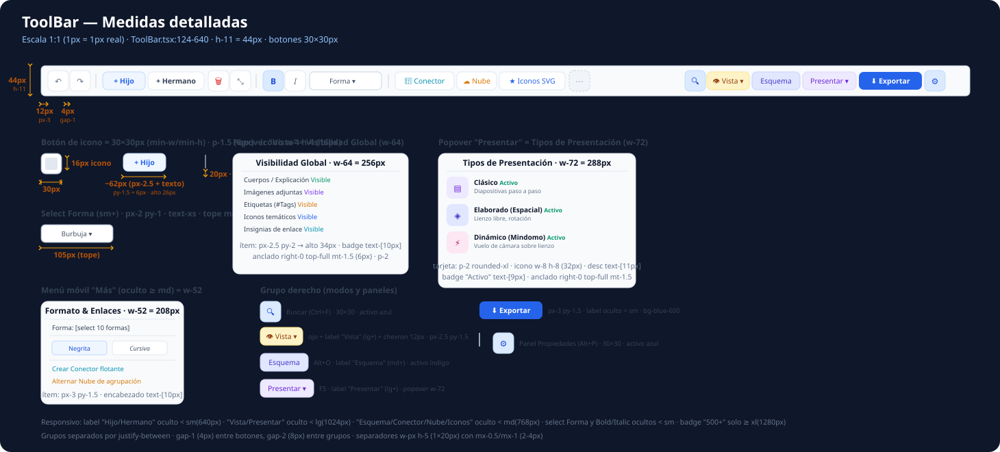

### 4.1 Contenedor raíz

| Propiedad | Medida | Origen |
|-----------|--------|--------|
| **Altura** | **44px** (`h-11`) — 4px más que MenuBar | ToolBar:124 |
| Padding lateral | `px-2 sm:px-3` → **8px** / **12px** (≥640px) | ToolBar:124 |
| Gap entre grupos | `gap-1 sm:gap-2` → **4px** / **8px** | ToolBar:124 |
| Bordes | `border-b border-slate-200` | ToolBar:124 |
| z-index | `z-40` | ToolBar:124 |

Layout `flex items-center justify-between` con 2 grupos: **izquierda** (historial, acciones de nodo, formato, enlaces) y **derecha** (búsqueda, vistas, presentar, exportar, panel).

### 4.2 Botones de icono (base repetida)

| Propiedad | Medida | Origen |
|-----------|--------|--------|
| **Tamaño mínimo** | **30×30px** (`min-w-[30px] min-h-[30px]`) | ToolBar:133 |
| Padding | `p-1.5` → **6px** | ToolBar:133 |
| Icono | `w-4 h-4` = **16px** (Deshacer/Rehacer/Eliminar/Fold/Buscar/Panel) · `w-3.5 h-3.5` = **14px** (Bold/Italic/Conector/Nube/Iconos/Esquema/Presentar/Exportar) | ToolBar:135, 201 |
| Gap grupos internos | `gap-0.5 sm:gap-1` → **2px** / **4px** | ToolBar:126 |

### 4.3 Botones con texto

| Botón | Medida | Origen |
|-------|--------|--------|
| Hijo / Hermano | `px-2 sm:px-2.5 py-1.5` → **8px/10px** lateral, **6px** vertical · alto ~**26px** | ToolBar:153, 163 |
| Conector / Nube / Iconos / Vista / Esquema / Presentar | `px-2 sm:px-2.5 py-1.5` | ToolBar:240, 251, 264, 393, 501, 514 |
| **Exportar** (primario) | `px-2.5 sm:px-3 py-1.5`, `bg-blue-600` | ToolBar:621 |

### 4.4 Separadores

`w-px h-5 bg-slate-200 mx-0.5 sm:mx-1` → **1px × 20px**, margen **2px** / **4px**. Hay 4 (líneas 147, 189, 233 `md:block`, 627); el de la 233 solo ≥768px.

### 4.5 Select Forma (≥640px)

| Propiedad | Medida | Origen |
|-----------|--------|--------|
| Padding | `px-2 py-1` → 8px / 4px | ToolBar:222 |
| **Ancho tope** | `max-w-[105px]` → **105px**; `md:max-w-none` (sin tope ≥768px) | ToolBar:222 |
| Opciones | 6 (Burbuja, Horquilla, Rectángulo, Óvalo, Hexágono, Cápsula) —≠ a las 10 del menú Formato | ToolBar:224-229 |

### 4.6 Popovers flotantes

| Popover | Ancho | Anclaje | Contenido |
|---------|-------|---------|-----------|
| **Visibilidad Global** (ojo Vista) | **256px** (`w-64`) | `right-0 top-full mt-1.5` (6px), `p-2` | 5 filas conmutables (Cuerpos, Imágenes, Etiquetas, Iconos, Insignias) · ítem `px-2.5 py-2` (~34px), badge `text-[10px]` | ToolBar:407 |
| **Tipos de Presentación** | **288px** (`w-72`) | `right-0 top-full mt-1.5`, `p-2` | 3 tarjetas (Clásico/Elaborado/Dinámico) · tarjeta `p-2 rounded-xl`, icono `w-8 h-8` (32px), desc `text-[11px]`, badge "Activo" `text-[9px]` | ToolBar:526 |

### 4.7 Menú móvil "Más" (oculto ≥768px)

**208px** (`w-52`), `py-1.5` (Tool Bar:285). Contiene: select Forma (10 opciones, ≠ al de escritorio), Negrita/Cursiva (`flex-1 py-1`), Crear Conector, Alternar Nube. Encabezado `text-[10px] uppercase`.

### 4.8 Visibilidad responsive (labels y grupos)

| Elemento | Se oculta bajo |
|----------|----------------|
| Labels "Hijo"/"Hermano"/"Exportar" | `sm` (640px) |
| Negrita/Cursiva + select Forma | `sm` (640px) |
| Conector / Nube / Iconos SVG / Esquema | `md` (768px) |
| Menú móvil "Más" | visible solo `< md` |
| Labels "Vista" / "Presentar" | `lg` (1024px) |
| Badge "500+" (Iconos) | `xl` (1280px) |

---

## 5. OutlineView (panel izquierdo) — detallada

`src/components/OutlineView.tsx:344-461`

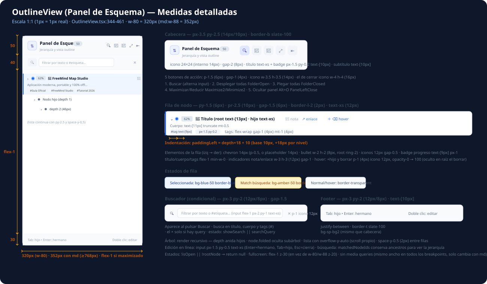

### 5.1 Contenedor (aside)

| Propiedad | Medida | Origen |
|-----------|--------|--------|
| **Ancho normal** | **320px** (`w-80`) · **352px** (`md:w-88`, ≥768px) · `shrink-0` | OutlineView:348 |
| **Ancho fullscreen** | **`flex-1`** + `z-30` (en vez de `z-20`) | OutlineView:347 |
| Altura / overflow | `h-full overflow-hidden` — altura de la zona de trabajo | OutlineView:349 |
| Bordes | `border-r` + `shadow-xl` (solo panel lateral, no fullscreen) | OutlineView:348 |
| **Visibilidad** | `if (!isOpen \|\| !rootNode) return null` | OutlineView:124 |

### 5.2 Cabecera (alto ~50px)

| Elemento | Medida | Origen |
|----------|--------|--------|
| Padding | `px-3.5 py-2.5` → **14px / 10px** · `border-b border-slate-100` | OutlineView:352 |
| Icono de marca | caja `w-6 h-6` (**24×24**) `rounded-md` + icono `w-3.5 h-3.5` (14px) · `gap-2` (8px) | OutlineView:354-355 |
| Título + badge | `h2 text-xs bold` + badge `px-1.5 py-0.2 rounded-full text-[10px]` (contador de nodos), `gap-1.5` (6px) | OutlineView:359-361 |
| Subtítulo | `text-[10px] text-slate-400` | OutlineView:364 |
| **5 botones de acción** | `p-1.5` (6px), `gap-1` (4px), icono `w-3.5 h-3.5` (14px) — el de cerrar `w-4 h-4` (16px) | OutlineView:369-425 |

Botones: **Buscar** (alterna input, activo `bg-blue-100`) · **Desplegar todas** (FolderOpen) · **Plegar todas** (FolderClosed) · **Maximizar/Reducir** (Maximize2/Minimize2) · **Ocultar panel** (PanelLeftClose, Alt+O).

### 5.3 Buscador (condicional, alto ~40px)

| Propiedad | Medida | Origen |
|-----------|--------|--------|
| Fila | `px-3 py-2` (12px/8px) · `gap-1.5` (6px) · `bg-slate-50/50` | OutlineView:430 |
| Icono | `w-3.5 h-3.5` (14px) | OutlineView:431 |
| Input | `flex-1 px-2 py-1 text-xs` → alto ~**24px** | OutlineView:438 |
| Botón × | `p-1` (4px), icono `w-3 h-3` (12px) — solo con query | OutlineView:441-446 |

Aparece al pulsar Buscar; busca en título, cuerpo y `tags` (`#`). El estado es `showSearch || searchQuery`.

### 5.4 Lista de nodos (flex-1, scroll propio)

| Propiedad | Medida | Origen |
|-----------|--------|--------|
| Contenedor | `flex-1 overflow-y-auto py-2.5` (10px) · `space-y-0.5` (**2px** entre filas) | OutlineView:452 |
| **Fila**: padding | `depth × 18 + 10` → base **10px**, **+18px por nivel** | OutlineView:149 |
| **Fila**: resto | `gap-1.5` (6px) · `py-1.5` (6px) · `pr-2.5` (10px) · `border-l-2` (**2px**) · `text-xs` (12px) | OutlineView:151 |
| Chevron fold | `p-0.5` + icono `w-3.5 h-3.5` (14px); sin hijos → placeholder 14px | OutlineView:162-178 |
| Bullet | `w-2 h-2` (**8px**); raíz con `ring-2 ring-blue-300` | OutlineView:185 |
| Iconos del nodo | `gap-0.5` (2px), `text-xs` (12px) | OutlineView:191-194 |
| Badge progreso | `text-[9px] px-1 py-0.2` (verde en 100%) | OutlineView:201 |
| Título | raíz `text-[13px] bold` · nodo `text-xs` | OutlineView:248 |
| Cuerpo | `text-[11px] truncate mt-0.5` | OutlineView:262 |
| **Tags** | `flex-wrap gap-1` (4px) `mt-1` (4px) · chip `text-[9px] px-1.5 py-0.2` | OutlineView:270-274 |
| Nota / enlace | iconos `w-3 h-3` (12px), `gap-1` | OutlineView:286-302 |
| **Acciones hover** | `p-1` (4px) + icono `w-3 h-3` (12px), `gap-0.5`, `opacity-0 → 100` · borrar oculto en raíz | OutlineView:307-330 |
| Input de edición | `px-1.5 py-0.5 text-xs`, borde azul (Enter=hermano, Tab=hijo, Esc) | OutlineView:232 |

Estados de fila: **seleccionada** `bg-blue-50/90 border-blue-600` · **match de búsqueda** `bg-amber-50/80 border-amber-400` · normal/hover `border-transparent hover:bg-[var(--sp-hover)]`.

### 5.5 Footer (alto ~30px)

`px-3 py-2` (12px/8px) · `text-[10px]` · `justify-between` · "Tab: hijo • Enter: hermano" a la izquierda y "Doble clic: editar" a la derecha (OutlineView:457-459).

---

## 6. ToolPanel (panel de propiedades, derecha) — detallada

`src/components/ToolPanel.tsx:85-272`

> 📌 El ToolPanel son **7 ficheros (~2.600 líneas)**. Esta §6.0 documenta el **contenedor**; cada pestaña se detalla en su propia subsección: §6.1 Contenido · §6.2 Formato · §6.3 Notas · §6.4 Iconos · §6.5 Nubes · §6.6 Mapa/Tema.

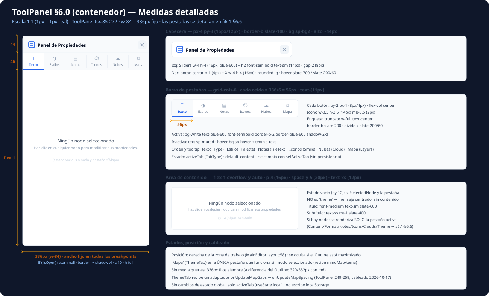

### 6.0.1 Contenedor (aside) y cabecera

| Propiedad | Medida | Origen |
|-----------|--------|--------|
| **Ancho** | **336px** (`w-84`) — **fijo, sin media queries** (el Outline sí cambia 320→352 con `md`) | ToolPanel:92 |
| Estructura | `flex flex-col h-full overflow-hidden` · `border-l` + `shadow-xl` · `z-10` | ToolPanel:92 |
| **Visibilidad** | `if (!isOpen) return null` · se oculta en presentación y en `isOutlineFullscreen` | ToolPanel:89, MainEditorLayout:58 |
| Cabecera | `px-4 py-3` (16px/12px) → **alto ~44px** · `border-b slate-100` · `bg sp-bg2` | ToolPanel:94 |
| Cabecera: izq | Sliders `w-4 h-4` (16px, blue-600) + `h2 text-sm font-semibold` · `gap-2` (8px) | ToolPanel:96-97 |
| Cabecera: der | Cerrar `p-1` (4px) + X `w-4 h-4` (16px) · `rounded-lg` | ToolPanel:99-105 |

### 6.0.2 Barra de pestañas (alto ~46px)

| Propiedad | Medida | Origen |
|-----------|--------|--------|
| Rejilla | **`grid grid-cols-6`** → cada celda = 336/6 = **56px** · `divide-x divide-slate-200/60` · `text-[11px]` | ToolPanel:109 |
| Botón | `py-2 px-1` (8px/4px) · `flex-col items-center justify-center` | ToolPanel:114 |
| Icono | `w-3.5 h-3.5` (**14px**) `mb-0.5` (2px) · etiqueta `truncate w-full text-center` | ToolPanel:120-121 |
| **Activa** | `bg-white text-blue-600 font-semibold border-b-2 border-blue-600 shadow-2xs` | ToolPanel:116 |
| Inactiva | `text sp-muted` · hover `bg sp-hover` + `text sp-text` | ToolPanel:117 |
| Orden (tooltip) | **Texto** (Type) · **Estilos** (Palette) · **Notas** (FileText) · **Iconos** (Smile) · **Nubes** (Cloud) · **Mapa** (Layers) | ToolPanel:113-186 |

Estado: `activeTab` (`TabType`), valor por defecto `'content'`; sin persistencia (useState local).

### 6.0.3 Área de contenido y estados

| Propiedad | Medida | Origen |
|-----------|--------|--------|
| Contenedor | `flex-1 overflow-y-auto p-4` (16px) · `space-y-5` (20px) · `text-xs` (12px) | ToolPanel:191 |
| **Estado vacío** | `py-12` (48px) centrado: "Ningún nodo seleccionado" `text-sm slate-600` + subtítulo `text-xs mt-1` | ToolPanel:192-196 |
| Condición | se muestra si `!selectedNode && activeTab !== 'theme'` | ToolPanel:192 |
| Render | solo la pestaña activa (Content/Format/Notes/Icons/Clouds/Theme → §6.1-§6.6) | ToolPanel:199-266 |

**`'Mapa'` (ThemeTab) es la única pestaña que funciona sin nodo seleccionado** — recibe `mindMap`, tema y layout del mapa. ThemeTab además recibe un adaptador `onUpdateMapGaps → onUpdateMapSpacing` (ToolPanel:249-259, cableado 2026-10-17).

### 6.1 Pestaña Contenido (ContentTab)

`src/components/organisms/toolpanel/ContentTab.tsx:36-476`

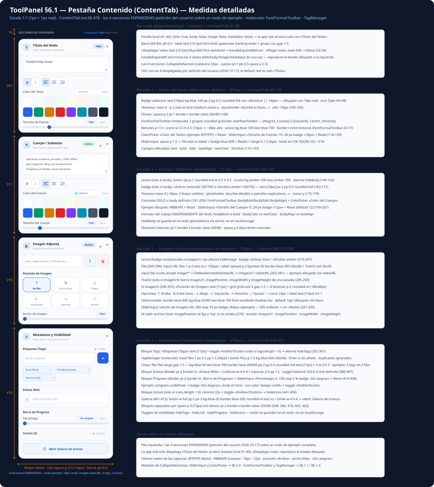

Raíz `space-y-3.5` (14px) · ancho útil 304px. Barra superior `pb-0.5`: label «SECCIONES DE CONTENIDO» `text-[10.5px] font-bold uppercase tracking-wider` + «Desplegar todo» (`blue-600` semibold) / «Plegar todo» (`slate-500`) `text-[10.5px]` (ContentTab:64-85).

Estado local (ContentTab:41-46): `{title: true, body: false, image: false, metadata: false}` — **solo «Título del Nodo» arranca desplegado** · `handleExpandAll` sincroniza las 4 claves de una vez.

> 🖼 El SVG muestra las **4 secciones desplegadas** (petición del usuario 2026-10-17) sobre un nodo de ejemplo con valores reales de la app: título `FreeMind Map Studio` **18px** · color texto `#FFFFFF` · cuerpo con texto, color `#8BEAFE` y **12px** · imagen dataURL (posición «Arriba», ancho **64px**, subida vía Upload) · 3 tags (Guía Oficial, FreeMind Studio, Tutorial 2026) · sin enlace ni progreso (badge «Sin asignar») · **Iconos (2)**. Altos expandidos: S1 ~301 · S2 ~311 · S3 ~279 · S4 ~419. «Desplegar todo» reproduce ese mismo estado.

#### 6.1.1 Sección 1 — Título del Nodo (abierta por defecto, alto ~303px)

| Control | Medida | Origen |
|---------|--------|--------|
| Badge cabecera | `text-[10px] bg-blue-100 px-2 py-0.5 rounded-full` con «{fontSize \|\| 14}px» · icon Type | ContentTab:94-98 |
| Textarea | `rows=2` · `p-2 text-xs font-medium resize-y` · placeholder «Escribe el título...» · alto ~50px | ContentTab:100-106 |
| Divisor | `space-y-2 pt-1 border-t border-slate-200/80` | ContentTab:108 |
| **FontFormatToolbar** (molecule) | 2 grupos `rounded-lg border overflow-hidden`: [Negrita, Cursiva] y [Izquierda, Centro, Derecha] — botones `p-1.5` + icono `w-3.5 h-3.5` (14px) → ~28px alto · activo `bg-blue-100 text-blue-700` · `border-l` entre botones del grupo | FontFormatToolbar:23-77 |
| ColorPicker «Color del Texto» | con `onClear` → `textColor: undefined` | ContentTab:118-123 |
| SliderInput «Tamaño de Fuente» | `10..36` px (default 14) con Reset | ContentTab:125-133 |

Campos afectados: `text` (textarea) · `bold` · `italic` · `textAlign` · `textColor` · `fontSize`.

#### 6.1.2 Sección 2 — Cuerpo / Subtexto (cerrada por defecto, alto ~53px)

- **action** (solo si `body`): botón ojo `p-1 rounded-md w-3.5 h-3.5` · oculto `bg-amber-100 text-amber-700` · alterna `hideBody` (ContentTab:144-162).
- **badge** (solo si `body`): «Activo» `emerald-100/700` o «Oculto» `amber-100/700` — `text-[10px] px-2 py-0.5 rounded-full` (ContentTab:163-171).
- Textarea `rows=3` (más alto que el de título) · placeholder «Escribe detalles o párrafos explicativos...».
- Controles **solo si `body` definido**: FontFormatToolbar (`bodyBold`/`bodyItalic`/`bodyAlign`) + ColorPicker «Color del Cuerpo» + SliderInput «Tamaño del Cuerpo» `9..24` px (default 12).
- `hideBody` se guarda en el nodo (persistencia vía store), no en localStorage.

#### 6.1.3 Sección 3 — Imagen Adjunta (cerrada por defecto, alto ~53px)

- action/badge **condicionales a `imageUrl`**: ojo alterna `hideImage` · badge «Activa» `blue` / «Oculta» `amber` (ContentTab:219-247).
- Fila (ContentTab:249-294): input URL `flex-1 p-2 text-xs` + label Upload `p-2 bg-blue-50 border-blue-200` (input file oculto `accept image/*` → `FileReader.readAsDataURL` → `imageUrl` = dataURL) + botón Trash2 `p-2` red (solo si `imageUrl`; borra imageUrl/position/width/height).
- Si `imageUrl`: «Posición de Imagen» `text-[11px]` + **`grid grid-cols-3 gap-1.5` — 6 botones** `p-2 rounded-xl flex-col` icono 14px + label `text-[10px] mt-1`: ↑ Arriba · ⇅ Entre texto · ↓ Abajo · ← Izquierda · → Derecha · ⤢ Ajustar · seleccionado `border-blue-600 bg-blue-50/80 text-blue-700 font-semibold` · default `imagePosition 'top'` (al subir archivo se fija `'top'` si no estaba).
- SliderInput «Ancho de imagen» `60..500` step 10 px (default 140) — **sin `onReset`** (ContentTab:327-335).

#### 6.1.4 Sección 4 — Metadatos y Visibilidad (cerrada por defecto, alto ~53px)

Bloques separados por `pt-2 border-t border-slate-200/80`:

| Bloque | Contenido | Origen |
|--------|-----------|--------|
| Etiquetas (Tags) | label `text-[11px] font-semibold` + toggle «Visible/Oculto» (solo si `tags.length > 0`) → `hideTags` · **TagManager** (molecule): input `flex-1 px-2.5 py-1.5` + botón Plus `p-1.5 bg-blue-600` (Enter o clic añade; duplicados ignorados) · chips `bg-blue-50 text-blue-700 border-blue-200/60 px-2 py-0.5 rounded-md text-[11px]` con X `w-3 h-3` | ContentTab:351-377, TagManager:33-72 |
| Enlace Web | LinkIcon `w-4 h-4` + input `px-2.5 py-1.5` · toggle `hideLink` (solo si `link`) | ContentTab:380-407 |
| Barra de Progreso | SliderInput «Porcentaje» `0..100` step 5 % · **badge «Sin asignar»** si `progress` undefined · Reset → `undefined` | ContentTab:410-438 |
| Iconos (n) | fila solo si `icons.length > 0` → toggle `hideIcons` («Visibles»/«Ocultos») | ContentTab:441-458 |
| Galería | botón `w-full py-2 px-3 bg-blue-50 border-blue-200 rounded-xl text-xs font-semibold` + Smile 14px → `onOpenIconPackModal` | ContentTab:461-472 |

### 6.2 Pestaña Formato (FormatTab)

`src/components/organisms/toolpanel/FormatTab.tsx:43-540`

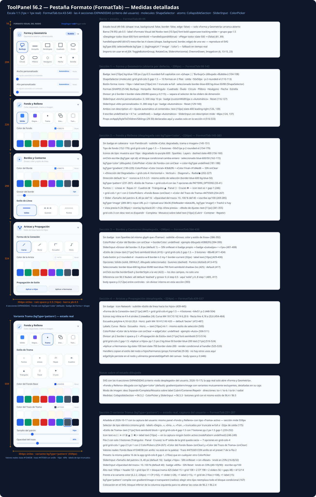

Raíz `space-y-3.5` (14px) · ancho útil 304px. Barra superior `pb-0.5`: label «Formato Visual del Nodo» `text-[10.5px] font-bold uppercase tracking-wider` + «Desplegar todo» (`blue-600` semibold) / «Plegar todo» (`slate-500`) `text-[10.5px]` (FormatTab:74-95).

Estado local (FormatTab:49-54): `{shape: true, background: false, border: false, edge: false}` — **solo «Forma y Geometría» arranca desplegado** · `handleExpandAll` (60-67) sincroniza las 4 claves. `bgType` (69): `selectedNode.bgType || (bgImageUrl ? 'image' : 'color')` (fallback en tiempo real).

> 🖼 El SVG muestra las **4 secciones desplegadas** (criterio «todo desplegado» del usuario, 2026-10-17), con «Fondo y Relleno» en su variante `bgType='color'` (default real; gradient/pattern/image son radios excluyentes → 6.2.2). Badge de Forma = `{shape || 'Burbuja'}` con `capitalize` (dibujado «Bubble»). Altos expandidos: S1 ~299 · S2 ~226 · S3 ~290 · S4 ~324.

> ⚠️ Imports sin uso en el JSX: `ToggleButtonGroup`, `RotateCcw`, `SlidersHorizontal`, `ChevronDown`, `ImageIcon` (FormatTab:6, 13-15, 23). Las props `onApplyStyleToChildren/Siblings` (29-30) se usan solo en la sección 4.

#### 6.2.1 Sección 1 — Forma y Geometría (abierta por defecto, alto ~299px)

| Elemento | Medidas | Origen |
|----------|---------|--------|
| Badge cabecera | `capitalize text-[10px] font-semibold text-blue-700 bg-blue-100 px-2 py-0.5 rounded-full` con `{shape \|\| 'Burbuja'}` · icon Square 14px | FormatTab:104-108 |
| **ShapeSelector** (molecule) | `grid grid-cols-5 gap-1.5` → 10 formas en 2 filas, celda ~50×50px: `p-2 rounded-xl border` + icono `w-4 h-4` (16px) + label `text-[10px] mt-1 truncate w-full` · seleccionado `border-blue-600 bg-blue-50/80 text-blue-700 font-semibold` | ShapeSelector:101-118 |
| Formas (`SHAPES`) | Burbuja · Horquilla · Rectángulo · Cuadrado · Óvalo · Círculo · Píldora · Hexágono · Flecha · Estrella | ShapeSelector:25-94 |
| Divisor | `pt-2 border-t border-slate-200/80 space-y-3` | FormatTab:115 |
| Slider «Ancho personalizado» | `0..500` step 10 px · badge `{n}px` o **«Automático»** · Reset → `undefined` · **description** «0 = Ajuste automático al contenido» (`text-[10px] slate-400 leading-tight`) · `0` escribe `undefined` | FormatTab:116-127 |
| Slider «Alto personalizado» | `0..300` step 5 px · mismo patrón (badge «Automático» + Reset + description) · `SliderInput` con `description` mide ~46px (vs ~28px sin ella) | FormatTab:129-140, SliderInput:43-55 |

#### 6.2.2 Sección 2 — Fondo y Relleno (cerrada por defecto, alto ~226px con `bgType='color'`)

- **Selector de tipo** (152-179): `grid grid-cols-5 gap-1.5` → 5 botones ~50×51px `p-2 rounded-xl`: **Sólido** (muestra azul 16px) · **Degradado** (gradiente `to-purple-600`) · **Trama** (Sparkles) · **Imagen** (Layers) · **Transp.** (`border-2 border-dashed`). `onClick` escribe `{bgType}` y cambia todo el bloque condicional. Labels `text-[10px] truncate w-full`: a 50px de celda se ven **«Degra…», «Ima…», «Tran…»** (verificado en captura real).
- **`color`** (dibujado, 181-188): ColorPicker «Color de Fondo» con `onClear → {color: undefined, bgType: undefined}`.
- **`gradient`** (190-229): ColorPicker «Color Inicial» `#3b82f6` y «Color Final» `#1d4ed8` (**sin** `onClear`) + label «Dirección del Degradado» + `grid-cols-4` ~64×51px: Horizontal (`to-r`, **default**) · Vertical (`to-b`) · Diagonal (`to-br`) · Radial (`radial`), iconos 14px.
- **`pattern`** (231-287): label «Estilo de Trama» + `grid-cols-4` con **7 opciones** `py-2 px-1.5 gap-1` — icon `text-xs` (`::: ≡ /// ⊞ ▲ ⬡ ✚`) + label `text-[10px]`: Puntos · Líneas · Rayas · Cuadros · Triángulos · Panal · Cruces (`PATTERN_OPTIONS`, 33-41) + 2 ColorPickers («Color del Fondo Base» con `onClear`, «Color del Trazo de Trama» `#475569`) + Slider «Tamaño del patrón» `8..40` px (def 16) + Slider «Opacidad del trazo» `10..100` % (def 40 → escribe `op/100`).
- **`image`** (289-381): fila input URL `p-2 text-xs` + **Upload** azul 36×36 (`FileReader.readAsDataURL → {bgImageUrl, bgType:'image'}`) + **Trash2** rojo si hay imagen · vista previa `h-24` (96px) con overlay `bg-black/20` + chip «Vista previa» · label «Modo de Ajuste» + `grid-cols-3` con **desc** `text-xs font-semibold` (Expandir · Completa · Mosaico) sobre **label** `text-[10px]` (Cubrir · Contener · Repetir), default `cover`.
- **`transparent`**: solo el botón seleccionado, sin controles extra.

> 🖼 El SVG dibuja además, en un **bloque inferior de la columna izquierda, la variante Trama** con el estado real de la captura del usuario (2026-10-17), a 1:1 y con cota propia de **559px**: «Trama» activo en el selector de tipo · 7 estilos de trama en 2 filas (4ª celda vacía, **ninguno activo** — `nodePattern` undefined) · **Color del Fondo Base `#1D4ED8`** (sin anillo: no está en la paleta) · **Color del Trazo `#475569`** con **anillo en el preset** de la fila 2 · **Tamaño del patrón `16px`** (knob 25%, sin Reset) · **Opacidad del trazo `40%`** (knob 33%, sin Reset). Desglose en la caja «Sección 2 variante Trama» de la columna derecha.

#### 6.2.3 Sección 3 — Bordes y Contorno (cerrada por defecto, alto ~290px)

| Elemento | Medidas | Origen |
|----------|---------|--------|
| ColorPicker «Color del Borde» | `onClear → borderColor: undefined` (ejemplo dibujado `#3B82F6`) | FormatTab:394-399 |
| Slider «Grosor del borde» | `0..8` px (default 1) · **sin** `onReset` ni badge propio → badge `{value}px` («1px») | FormatTab:401-408 |
| Estilo de Línea | label `text-[11px] font-semibold block` + `grid grid-cols-3 gap-1.5` → 3 botones ~88×48 `p-2 rounded-xl`: muestra `w-8 border-t-2 my-1 border-current` (32px) + label `text-[10px]` — **Sólido** (`solid`, **default**) · Guiones (`dashed`) · Puntos (`dotted`) · `onClick` escribe `borderDash` **y** `borderStyle` | FormatTab:410-434 |
| vs §6.5 Nubes | allí default `dashed` y grosor `0..6` step 0.5 · aquí `solid` y `0..8` step 1 · cuerpo `space-y-3` **sin** divisor interno | FormatTab:393, 405, 417 |

#### 6.2.4 Sección 4 — Aristas y Propagación (cerrada por defecto, alto ~324px)

| Elemento | Medidas | Origen |
|----------|---------|--------|
| Forma de la Conexión | label `text-[11px]` + `grid grid-cols-4 gap-1.5` → 4 botones ~64×51 `p-2`: iconos `svg w-4 h-4 stroke-2` (viewBox 24, path `M4 18 C10 18,14 6,20 6` / línea / polilínea / paso) — **Curva** (`bezier`, **default**) · Recta (`linear`) · Escuadra (`sharp`) · Horiz. (`horizontal`) | FormatTab:447-504 |
| ColorPicker «Color de la Arista» | `onClear → edgeColor: undefined` (ejemplo «Auto») | FormatTab:506-511 |
| Propagación de Estilo | divisor `pt-2 border-t space-y-2` + label `text-[11px] font-semibold` + `grid grid-cols-2 gap-1.5`: **«Aplicar a Hijos»** `bg-blue-50 border-blue-200 text-blue-700` y **«Aplicar a Hermanos»** `bg-slate-100 border-slate-200`, `py-1.5 px-2 text-[11px]` — render condicional al handler → copia el estilo del nodo a hijos/hermanos | FormatTab:513-533 |
| edgeStyle | se persiste en el nodo y alimenta `generateEdgePath` del canvas (straight/step/bezier/curved) | — |

### 6.3 Pestaña Notas (NotesTab)

`src/components/organisms/toolpanel/NotesTab.tsx:26-224`

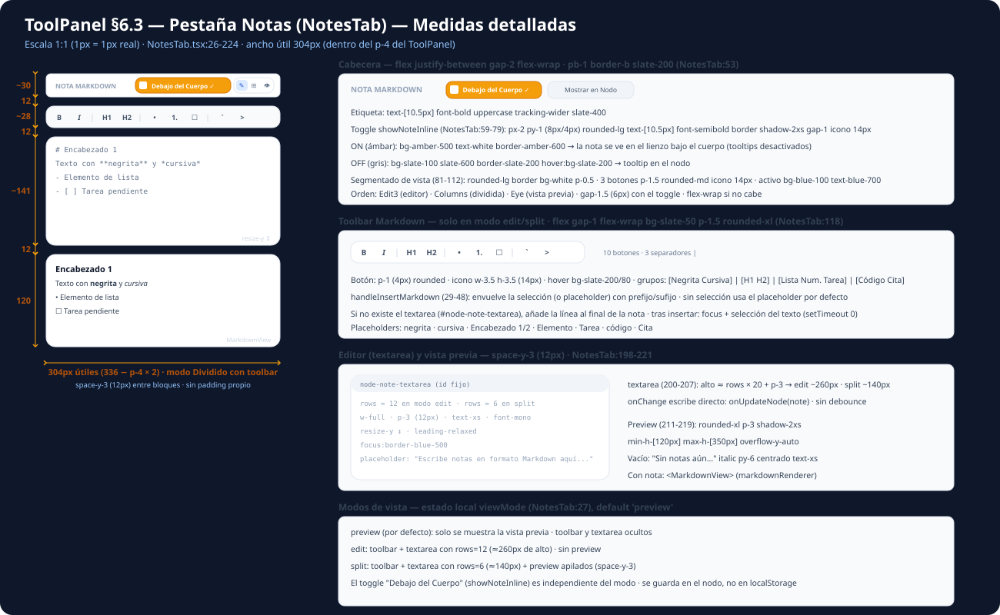

Sin padding propio: vive dentro del `p-4` del ToolPanel → **ancho útil 304px**. Raíz `space-y-3` (12px) entre bloques.

#### 6.3.1 Cabecera (alto ~30px)

| Elemento | Medida | Origen |
|----------|--------|--------|
| Fila | `flex justify-between gap-2 flex-wrap` · `pb-1 border-b border-slate-200` | NotesTab:53 |
| Etiqueta | `text-[10.5px] font-bold uppercase tracking-wider` slate-400 | NotesTab:54 |
| **Toggle "Mostrar en Nodo"** | `px-2 py-1` (8px/4px) `rounded-lg text-[10.5px] font-semibold` · icono 14px · `gap-1` | NotesTab:59-79 |
| Toggle ON (`showNoteInline`) | `bg-amber-500 text-white border-amber-600` → «Debajo del Cuerpo ✓» (la nota se ve en el lienzo, tooltips desactivados) | NotesTab:68 |
| Toggle OFF | `bg-slate-100 text-slate-600 border-slate-200` → «Mostrar en Nodo» | NotesTab:69 |
| **Segmentado de vista** | `rounded-lg border bg-white p-0.5 shadow-2xs` · 3 botones `p-1.5 rounded-md` icono 14px · activo `bg-blue-100 text-blue-700` | NotesTab:81-112 |
| Orden segmentado | Edit3 (editor) · Columns (dividida) · Eye (vista previa) · `gap-1.5` (6px) con el toggle | NotesTab:88-110 |

#### 6.3.2 Toolbar Markdown (solo modo edit/split, alto ~28px)

| Propiedad | Medida | Origen |
|-----------|--------|--------|
| Contenedor | `flex gap-1 flex-wrap bg-slate-50 p-1.5 rounded-xl border-slate-200 shadow-2xs` | NotesTab:118 |
| **10 botones** | `p-1` (4px) `rounded` · icono `w-3.5 h-3.5` (14px) · hover `bg-slate-200/80` | NotesTab:119-193 |
| Separadores | `\|` `text-slate-300` entre grupos | NotesTab:135, 152, 177 |
| Grupos | [Negrita ** · Cursiva *] · [H1 # · H2 ##] · [Lista - · Num. 1. · Tarea - [ ]] · [Código ` · Cita >] | NotesTab:121-192 |

`handleInsertMarkdown` (29-48): envuelve la selección con prefijo/sufijo (o placeholder por defecto); si no existe el `textarea` (#node-note-textarea) añade la línea al final; tras insertar recupera foco y selección (`setTimeout 0`).

#### 6.3.3 Editor y vista previa

| Elemento | Medida | Origen |
|----------|--------|--------|
| **Textarea** | `w-full rounded-xl p-3` (12px) `text-xs font-mono resize-y leading-relaxed` · focus `border-blue-500` | NotesTab:200-207 |
| Filas | `rows = 12` en edit (**~260px**) · `rows = 6` en split (**~140px**) | NotesTab:204 |
| onChange | escribe directo `onUpdateNode(note)` — sin debounce | NotesTab:203 |
| **Preview** | `rounded-xl p-3 shadow-2xs` · **`min-h-[120px] max-h-[350px]`** `overflow-y-auto` | NotesTab:211 |
| Preview vacío | «Sin notas aún…» italic `py-6 text-xs` centrado | NotesTab:215 |
| Preview con nota | `<MarkdownView>` (markdownRenderer) | NotesTab:213 |

#### 6.3.4 Modos de vista (`viewMode`, default `'preview'`)

| Modo | Qué se muestra | Origen |
|------|----------------|--------|
| `preview` | solo vista previa (toolbar y textarea ocultos) | NotesTab:210 |
| `edit` | toolbar + textarea `rows=12` | NotesTab:199 |
| `split` | toolbar + textarea `rows=6` + preview apilados (`space-y-3`) | NotesTab:199, 210 |

El toggle «Debajo del Cuerpo» (`showNoteInline`) es **independiente del modo**: se guarda en el nodo, no en localStorage.

### 6.4 Pestaña Iconos (IconsTab)

`src/components/organisms/toolpanel/IconsTab.tsx:51-314`

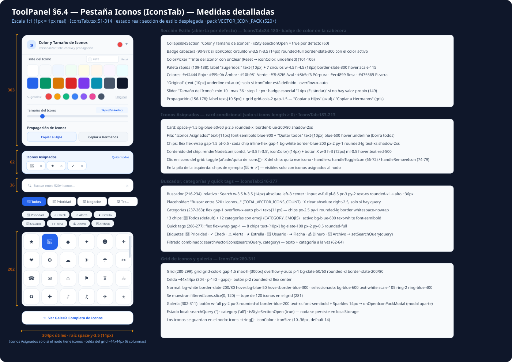

Raíz `space-y-3.5` (14px) · ancho útil 304px · estado local: `searchQuery` · `category` (`'all'`) · `isStyleSectionOpen` (**`true`** — la sección de estilo arranca desplegada).

#### 6.4.1 Sección Estilo (abierta por defecto, alto ~303px)

`CollapsibleSection` «Color y Tamaño de Iconos» con **badge de color en la cabecera**: si `iconColor` está definido, circulito `w-3.5 h-3.5` (14px) `rounded-full border-slate-300` con el color activo (IconsTab:90-97).

| Control | Medida | Origen |
|---------|--------|--------|
| ColorPicker «Tinte del Icono» | con `onClear` → «Reset» (`iconColor: undefined`) | IconsTab:101-106 |
| **Paleta rápida** | label «Sugeridos:» `text-[10px]` + **7 círculos `w-4.5 h-4.5` (18px)** `border-slate-300 hover:scale-115` · `overflow-x-auto` | IconsTab:109-138 |
| Colores sugeridos | `#ef4444` Rojo · `#f59e0b` Ámbar · `#10b981` Verde · `#3b82f6` Azul · `#8b5cf6` Púrpura · `#ec4899` Rosa · `#475569` Pizarra | IconsTab:112-118 |
| «Original» | `text-[10px] underline ml-auto` — solo si hay `iconColor` | IconsTab:129-136 |
| Slider «Tamaño del Icono» | `10..36` step 1 px · **badge especial `14px (Estándar)`** si no hay valor propio · Reset | IconsTab:142-152 |
| **Propagación** | `pt-2 border-t` + label `text-[10.5px]` + **`grid grid-cols-2 gap-1.5`**: «Copiar a Hijos» (azul) / «Copiar a Hermanos» (gris) — `py-1.5 px-2 rounded-lg text-[10.5px]`, condicional a los handlers | IconsTab:156-178 |

#### 6.4.2 Iconos Asignados (card condicional, alto ~62px)

Solo si `icons.length > 0` (IconsTab:183): card `bg-blue-50/60 p-2.5 rounded-xl border-blue-200/80` con «Iconos Asignados» `text-[11px]` + «Quitar todos» `text-[10px]` (borra el array). Chips: `inline-flex gap-1 bg-white border-blue-200 px-2 py-1 rounded-lg text-xs` con icono `w-3.5 h-3.5` (14px, teñido por `iconColor`) + X `w-3 h-3` (12px).

#### 6.4.3 Buscador, categorías y quick tags

| Control | Medida | Origen |
|---------|--------|--------|
| **Buscador** | Search 14px `absolute left-3` · input `pl-8.5 pr-3 py-2 text-xs rounded-xl` → **alto ~36px** · placeholder «Buscar entre 520+ iconos…» · X `right-2.5` con query | IconsTab:216-234 |
| **Categorías** | `flex gap-1 overflow-x-auto pb-1 text-[11px]` — **13 chips** `px-2.5 py-1 rounded-lg` (🌟 Todos + 12 con emoji) · activo `bg-blue-600 text-white` | IconsTab:237-263 |
| **Quick tags** | `flex flex-wrap gap-1` — **8 chips** `text-[10px] bg-slate-100 px-2 py-0.5 rounded-full` → `setSearchQuery(query)` | IconsTab:266-277 |

Filtrado combinado `searchVectorIcons(searchQuery, category)` (texto + categoría).

#### 6.4.4 Grid y galería

| Elemento | Medida | Origen |
|----------|--------|--------|
| **Grid** | `grid grid-cols-6 gap-1.5` · **celda ~44×44px** · `p-1` · `max-h-[300px] overflow-y-auto` · `bg-slate-50/60 rounded-xl` | IconsTab:280 |
| Celdas | `filteredIcons.slice(0, 120)` — **tope de 120** | IconsTab:281 |
| Celda normal | `bg-white border-slate-200/80 hover:bg-blue-50 hover:border-blue-300` | IconsTab:292 |
| Celda seleccionada | `bg-blue-600 text-white scale-105 ring-2 ring-blue-400` (clic = toggle en `icons[]`) | IconsTab:291 |
| Galería | botón `w-full py-2 px-3 rounded-xl border-blue-200 text-xs font-semibold` + Sparkles 14px → `onOpenIconPackModal` (modal aparte) | IconsTab:302-311 |

Estado del nodo: `icons: string[]` · `iconColor` · `iconSize` (10..36px, default 14).

### 6.5 Pestaña Nubes (CloudsTab)

`src/components/organisms/toolpanel/CloudsTab.tsx:35-288`

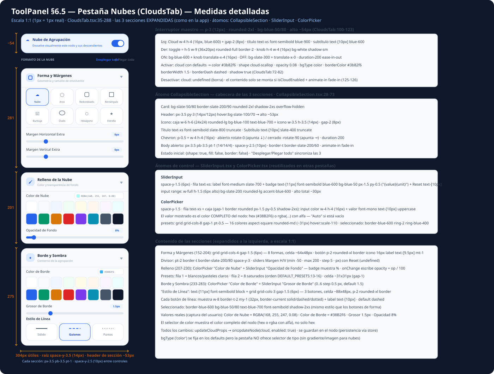

Raíz `space-y-3.5` (14px) · ancho útil 304px. Usa los átomos `CollapsibleSection`, `SliderInput` y `ColorPicker` (medidos en 6.5.5).

#### 6.5.1 Interruptor maestro (alto ~54px)

| Elemento | Medida | Origen |
|----------|--------|--------|
| Tarjeta | `p-3` (12px) `rounded-2xl bg-blue-50/80 border-blue-200/80 shadow-2xs` | CloudsTab:100 |
| Izquierda | Cloud `w-4 h-4` (16px, blue-600) + `gap-2` · título `text-xs font-semibold blue-900` · subtítulo `text-[10px] blue-600` | CloudsTab:101-108 |
| **Toggle switch** | **`h-5 w-9` (36×20px)** `rounded-full border-2` · knob **`h-4 w-4` (16px)** blanco `shadow-sm` | CloudsTab:113-120 |
| Toggle ON / OFF | ON `bg-blue-600` + knob `translate-x-4` (16px) · OFF `bg-slate-300` · `duration-200` | CloudsTab:113-119 |

Activar crea `cloud` con defaults (**color/borderColor `#3b82f6` · shape `cloud-scallop` · opacity `0.08` · borderWidth `1.5` · borderDash `dashed` · shadow `true`**); desactivar escribe `cloud: undefined` (borra). El resto **solo se monta si `isCloudEnabled`** (`animate-in fade-in`, CloudsTab:125-126).

#### 6.5.2 Barra y secciones colapsables

Barra «Formato de la Nube» (`text-[10.5px] bold uppercase`) + «Desplegar todo | Plegar todo» (`text-[10.5px]`, gap-1.5). Estado inicial: **`{shape: true, fill: false, border: false}`** — solo Forma abierto (CloudsTab:49-53).

Cada sección es un `CollapsibleSection`:

| Sección | Contenido | Origen |
|---------|-----------|--------|
| **Forma y Márgenes** | `grid grid-cols-4 gap-1.5` — **8 formas**, celda ~**64×48px**: Nube · Arco · Redondeado · Rectángulo · Burbuja · Óvalo · Hexágono · Estrella · sliders Margen H/V (`-50..200`, step 5, px, con Reset) | CloudsTab:152-204 |
| **Relleno de la Nube** | ColorPicker «Color de Nube» (`#3b82f6`) + SliderInput «Opacidad de Fondo» (`0..100 %`, **default 8%**) | CloudsTab:207-230 |
| **Borde y Sombra** | ColorPicker «Color de Borde» + SliderInput «Grosor de Borde» (`0..6` step 0.5, **default 1.5**) + «Estilo de Línea» `grid grid-cols-3` (Sólido · **Guiones** · Puntos) con muestra `w-8 border-t-2` | CloudsTab:233-283 |

Botón de forma/estilo: `p-2 rounded-xl border` · icono `w-4 h-4` (16px) · label `text-[9.5px]` (formas) / `text-[10px]` (línea) · seleccionado `border-blue-600 bg-blue-50/80 text-blue-700`.

#### 6.5.3 Átomos de control (reutilizados en otras pestañas)

| Átomo | Medidas clave | Origen |
|-------|---------------|--------|
| **SliderInput** | `space-y-1.5` · fila `text-xs` (label + badge `text-[11px] bg-blue-50 px-1.5 py-0.5` + «Reset» `text-[10px]`) · range **`h-1.5` (6px)** `accent-blue-600` · alto ~40px | SliderInput:29-57 |
| **ColorPicker** | caja `px-1.5 py-0.5` con input color **`w-4 h-4`** (16px) + valor `text-[10px] font-mono uppercase` — muestra el **color completo del nodo** (hex `#38B2F6` o `rgba(…)` con alfa; «Auto» si vacío) · presets `grid grid-cols-8 gap-1` — **16 colores `aspect-square` (~31px)**: fila 1 pasteles claros, fila 2 saturados · seleccionado `ring-2 ring-blue-400` | ColorPicker:30-75, 13-16 |

Todos los cambios pasan por `updateCloudProps` → `onUpdateNode(cloud)` con `enabled: true` (se guardan en el nodo).

> 🖼 En la captura real de la app (2026-10-17) las 3 secciones están desplegadas con valores de ejemplo: Color de Nube `RGBA(168, 255, 247, 0.08)` · Color de Borde `#38B2F6` · Grosor `1.5px` · Opacidad `8%` · Estilo «Guiones» seleccionado. `bgType` se fija en los defaults pero la pestaña **no ofrece selector de tipo** (sin gradiente/imagen para nubes).

---

### 6.6 Pestaña Mapa (ThemeTab)

`src/components/organisms/toolpanel/ThemeTab.tsx:23-623` (623 líneas)

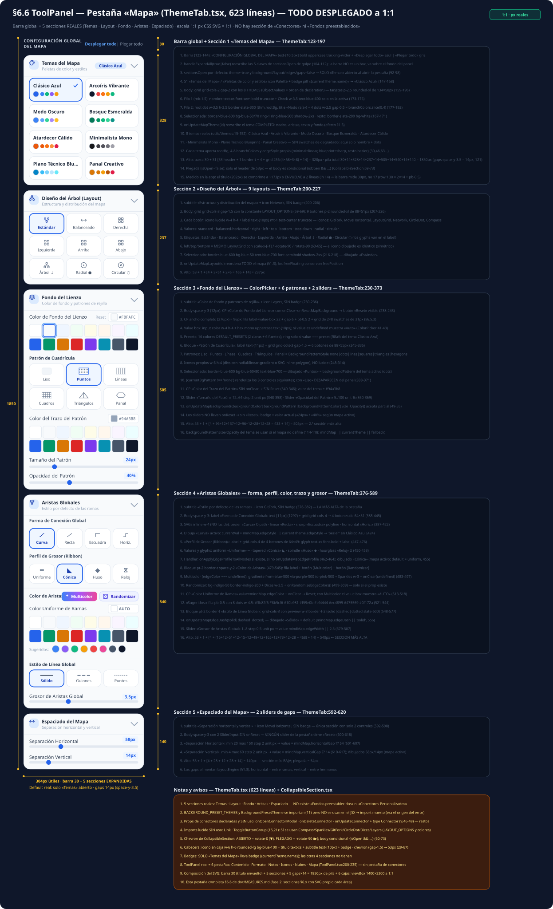

Raíz `space-y-3.5` (14px) · ancho útil 304px. **5 secciones colapsables** (Temas · Layout · Fondo · Aristas · Espaciado) + barra global. La pestaña **no tiene sección de conectores**: las props `onOpenConnectorModal`/`onDeleteConnector`/`onUpdateConnector` y el type `Connector` están declarados y sin uso; el import de `BACKGROUND_PRESET_THEMES`/`BackgroundPresetTheme` (línea 11) es código muerto — no existe ninguna UI de «Fondos preestablecidos» ni «Conectores Personalizados».

#### 6.6.1 Barra global (alto 30px reales)

| Elemento | Medida | Origen |
|----------|--------|--------|
| Fila | `flex items-center justify-between pb-0.5` (sin contenedor propio, va sobre el fondo del panel) | ThemeTab:123 |
| Título | «Configuración Global del Mapa» `text-[10.5px] font-bold uppercase tracking-wider` — mide ~202px; en 304px útiles el span se comprime a ~173px y **envuelve a 2 líneas** (lh 14) → barra de **30px**, no 17 (medido en la app: `rowH 30 = 2×14 + pb-0.5`) | ThemeTab:124-126 |
| Acciones | «Desplegar todo» `text-[10.5px] text-blue-600 font-semibold` · `|` `text-slate-300 text-[10px]` · «Plegar todo» `text-[10.5px] text-slate-500 font-medium`, `gap-1.5` (~145px en total) | ThemeTab:127-143 |

`handleExpandAll(true|false)` reescribe las 5 claves de `sectionsOpen` de golpe (104-112).

#### 6.6.2 Estado por defecto y plegado

`sectionsOpen` inicial: **solo `{theme: true}`** — «Temas» abierto y las otras 4 plegadas al abrir la pestaña (92-98). Cada sección es un `CollapsibleSection` (medido en 6.5.3): cabecera **53px** (icono en caja `w-6 h-6 rounded-lg bg-blue-100` + título `text-xs` + subtítulo `text-[10px]` + badge/chevron `gap-1.5`), chevron `rotate-0` (▼) abierto / `-rotate-90` (▶) plegado, body condicional `{isOpen && …}`. **Solo «Temas del Mapa» lleva badge** (`{currentTheme.name}`); las otras 4 secciones no.

#### 6.6.3 Secciones y alturas (todas desplegadas en el SVG)

| # | Sección | Contenido | Alto | Origen |
|---|---------|-----------|------|--------|
| 1 | **Temas del Mapa** | badge «Clásico Azul» + `grid grid-cols-2 gap-2` con los **8 THEMES** (`Object.values`): tarjeta `p-2.5 rounded-xl` **134×58px** — fila 1 nombre `text-xs font-semibold truncate` + `Check w-3.5`; fila 2 root dot `w-3.5 h-3.5` (title «Nodo raíz») + 4 branch dots `w-2.5 gap-0.5` (`branchColors.slice(0,4)`); activa `border-blue-600 bg-blue-50/70 ring-1 ring-blue-500 shadow-2xs` | **328** | ThemeTab:147-197 |
| 2 | **Diseño del Árbol** | `grid grid-cols-3 gap-1.5` con la constante `LAYOUT_OPTIONS` (59-69): **9 botones p-2 88×51px** (icono lucide `w-4 h-4` + label `text-[10px]`): Estándar · Balanceado · Derecha · Izquierda · Arriba · Abajo · Árbol ↓ · Radial ● · Circular ○ (izquierda/arriba/abajo = mismo LayoutGrid girado) | **237** | ThemeTab:200-227 |
| 3 | **Fondo del Lienzo** | ColorPicker «Color de Fondo del Lienzo» **con Reset** + «Patrón de Cuadrícula» **6 botones 88×55px** (Liso · Puntos · Líneas · Cuadros · Triángulos · Panal; iconos propios `w-6 h-4`, no lucide) + CP «Color del Trazo del Patrón» **sin Reset** + SliderInput «Tamaño del Patrón» (`12..64` step 2 px) y «Opacidad del Patrón» (`5..100` %) — estos 3 últimos **solo se montan si patrón ≠ `none`** (338-371) | **505** ← 2.ª más alta | ThemeTab:230-373 |
| 4 | **Aristas Globales** | «Forma de Conexión Global» `grid-cols-4` **64×51** con SVGs inline (Curva bezier · Recta · Escuadra · Horiz.) + «Perfil de Grosor (Ribbon)» `grid-cols-4` **64×49** con glyphs (Uniforme ═ · Cónica ◣ · Huso ◆ · Reloj ⧖) + bloque `pt-2 border-t`: botón [Multicolor] gradiente + botón [Randomizar] indigo + CP «Color Uniforme de Ramas» (muestra **AUTO** con Multicolor) + fila «Sugeridos:» con 8 dots `w-4.5` + «Estilo de Línea Global» 3 botones `grid-cols-3` (Sólido · Guiones · Puntos, preview `w-8 border-t-2`) + SliderInput «Grosor de Aristas Global» (`1..8` step 0.5 px) | **540** ← la más alta | ThemeTab:376-589 |
| 5 | **Espaciado del Mapa** | 2 SliderInput **sin Reset** (~28px cada uno): «Separación Horizontal» (`20..150` step 2, default **54**) y «Separación Vertical» (`4..60` step 2, default **14**); los gaps alimentan `layoutEngine` (§1.3) | **140** ← la más baja | ThemeTab:592-620 |

Pila total desplegada: barra 30 + 5 secciones + 5 gaps×14 = **1850px**. Plegadas: cada sección queda en su cabecera de 53px.

#### 6.6.4 Color y selección (estado dibujado en el SVG)

| Control | Valor dibujado | Origen del valor |
|---------|----------------|------------------|
| Tema activo | **Clásico Azul** (`background: #f8fafc`, patrón `dots #94a3b8` 24px/45 %, `edgeStyle: bezier`) | themes.ts:30-44 |
| Layout | Estándar (`standard`) | `mindMap.layout` |
| Fondo + trazo patrón | `#F8FAFC` (con Reset) + `#94A3B8` | tema activo |
| Forma + perfil | Curva (bezier) + Cónica (tapered) | `mindMap.edgeStyle \|\| tema.edgeStyle` / `mindMap.edgeProfile` (default del código: `uniform`, 455) |
| Línea + grosor | Sólido (`solid`) + `3.5px` | `mindMap.edgeDash \|\| 'solid'` / `mindMap.edgeWidth \|\| 2.5` |
| Color de aristas | **Multicolor** (`edgeColor === undefined`) | default |
| Espaciado | `58px` / `14px` | `mindMap.horizontalGap ?? 54` / `verticalGap ?? 14` (mapa activo; defaults 54/14) |

Botones de color: **Multicolor** = gradiente `from-blue-500 via-purple-500 to-pink-500` + Sparkles `w-3` → `onClear(undefined)` (483-497); **Randomizar** = `bg-indigo-50 border-indigo-200` + Dices `w-3.5` → `onRandomizeEdgeColors()` (499-509). «Sugeridos»: `#3b82f6 #8b5cf6 #10b981 #f59e0b #ef4444 #ec4899 #475569 #0f172a` (521-544).

> 🖼 El SVG previo de esta sección era inválido (dibujaba secciones fantasma «Fondos preestablecidos» y «Conectores Personalizados» por lecturas corruptas del archivo) y quedó sin commitear en `aff2835`; se rehízo entero contra el código real (2026-10-17) y la barra se midió en la app viva. Imports lucide sin uso en el archivo: `Link`, `ToggleButtonGroup` (15, 21); sí se usan `Compass`, `Sparkles`, `GitFork`, `CircleDot`, `Dices`, `Layers` (LAYOUT_OPTIONS y bloque de color).

---

## 7. FilterBar (barra de filtros) — detallada

`src/components/FilterBar.tsx:33-117`

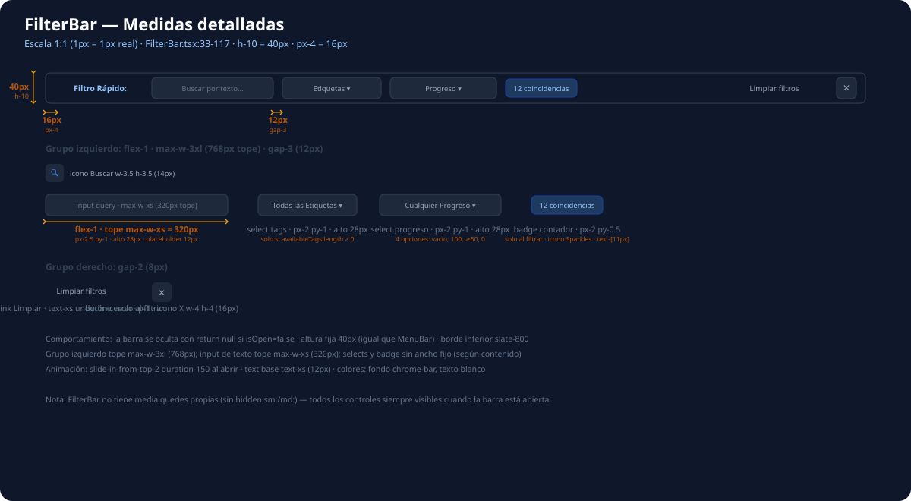

### 7.1 Contenedor raíz

| Propiedad | Medida | Origen |
|-----------|--------|--------|
| **Altura** | **40px** (`h-10`) — igual que MenuBar | FilterBar:33 |
| Padding lateral | **16px** (`px-4`) | FilterBar:33 |
| Ancho | 100% del layout | FilterBar:33 |
| Bordes | `border-b border-slate-800` | FilterBar:33 |
| Base de texto | `text-xs` (12px) | FilterBar:33 |
| z-index | `z-30` | FilterBar:33 |
| **Visibilidad** | `if (!isOpen) return null` — no se monta | FilterBar:24 |
| Animación | `slide-in-from-top-2 duration-150` | FilterBar:33 |

### 7.2 Grupo izquierdo (controles de filtro)

| Elemento | Medida | Origen |
|----------|--------|--------|
| Contenedor | `flex-1 max-w-3xl` (tope **768px**) `gap-3` (**12px**) | FilterBar:34 |
| Etiqueta "Filtro Rápido" | `gap-2` (8px) + icono `w-3.5 h-3.5` (14px) | FilterBar:35-37 |
| **Input de texto** | `flex-1 max-w-xs` (tope **320px**) · `px-2.5 py-1` → **alto ~28px** · `text-xs` | FilterBar:41,47 |
| Botón × (limpiar query) | `absolute right-2` — solo si `query` no vacío | FilterBar:50-55 |
| **Select etiquetas** | `px-2 py-1` → **alto ~28px** · solo si `availableTags.length > 0` | FilterBar:61-64 |
| **Select progreso** | `px-2 py-1` → **alto ~28px** · 4 opciones (vacío, 100, ≥50, 0) | FilterBar:76-83 |
| Badge contador | `px-2 py-0.5` · `text-[11px]` · icono Sparkles · solo al filtrar | FilterBar:93-96 |

### 7.3 Grupo derecho (acciones)

| Elemento | Medida | Origen |
|----------|--------|--------|
| Contenedor | `gap-2` (**8px**) | FilterBar:101 |
| "Limpiar filtros" | link `text-xs underline` — solo si `isFiltering` | FilterBar:105 |
| Botón cerrar (X) | `p-1` (4px) · icono `w-4 h-4` (16px) | FilterBar:112-114 |

### 7.4 Comportamiento

- **No tiene media queries propias** — todos los controles siempre visibles cuando la barra está abierta.
- El badge contador y "Limpiar filtros" aparecen solo cuando `isFiltering` (query, tag, icon o minProgress definido).
- Los colores usan `bg-slate-800` para inputs y `border-slate-700` (tonos oscuros sobre fondo chrome-bar).

---

## 8. StatusBar (barra de estado, pie) — detallada

`src/components/StatusBar.tsx:23-49`

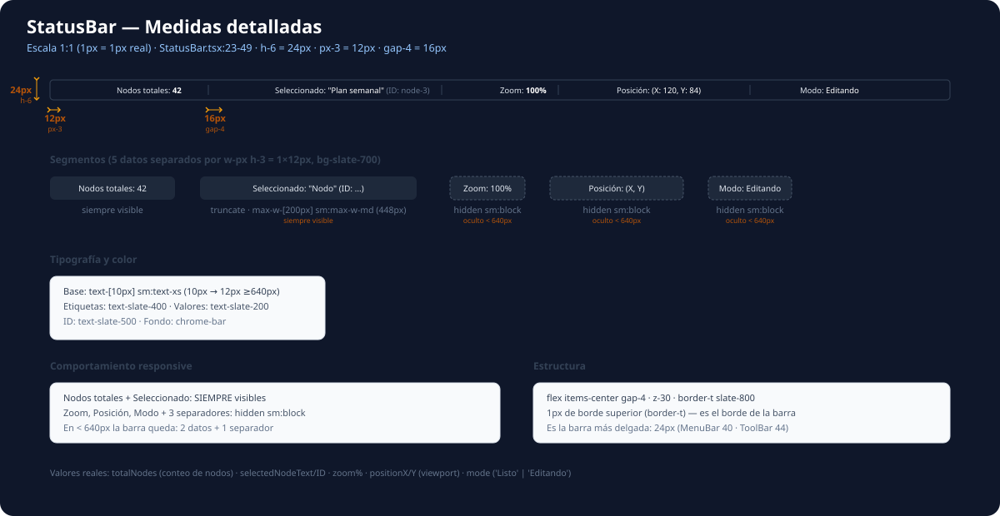

### 8.1 Contenedor raíz

| Propiedad | Medida | Origen |
|-----------|--------|--------|
| **Altura** | **24px** (`h-6`) — la barra más delgada | StatusBar:23 |
| Padding lateral | **12px** (`px-3`) | StatusBar:23 |
| Gap entre datos | **16px** (`gap-4`) | StatusBar:23 |
| Base de texto | `text-[10px] sm:text-xs` → **10px** / **12px** (≥640px) | StatusBar:23 |
| Bordes | `border-t border-slate-800` (1px superior) | StatusBar:23 |
| z-index | `z-30` | StatusBar:23 |

Es la **más baja** (24px): MenuBar=40, ToolBar=44, FilterBar=40, StatusBar=24.

### 8.2 Segmentos de datos (5)

Separadores `w-px h-3` (**1×12px**, `bg-slate-700`) entre cada dato.

| Dato | Contenido | Visibilidad | Origen |
|------|-----------|-------------|--------|
| Nodos totales | `Nodos totales: {n}` | **siempre** | StatusBar:24-26 |
| **Seleccionado** | texto + `(ID: …)` · `truncate` · **`max-w-[200px]`** → `sm:max-w-md` (**448px**) | **siempre** | StatusBar:28-36 |
| Zoom | `Zoom: {zoom}%` | `hidden sm:block` | StatusBar:38-40 |
| Posición | `Posición: (X, Y)` | `hidden sm:block` | StatusBar:42-44 |
| Modo | `Modo: {mode}` (`Listo`/`Editando`) | `hidden sm:block` | StatusBar:46-48 |

Los 3 separadores de la parte derecha también son `hidden sm:block` → **en <640px la barra queda con 2 datos y 1 separador**.

### 8.3 Tipografía y color

- Etiquetas: `text-slate-400` · Valores: `text-slate-200` · ID: `text-slate-500`.
- Fondo: `bg-[var(--chrome-bar)]` (mismo que MenuBar/FilterBar).

---

## 9. Controles flotantes del lienzo (MiniMap + ZoomControls) — detallada

`src/components/MiniMap.tsx:206-463` · `src/components/molecules/ZoomControls.tsx:29-78`


### 9.1 Contenedor raíz compartido (MiniMap:207-210)

| Propiedad | Medida | Origen |
|-----------|--------|--------|
| Posición | `absolute bottom-2 right-5` → **8px** inferior, **20px** derecho | MiniMap:208 |
| Disposición | `flex flex-col items-end gap-1.5` → separación **6px**, alineados a la derecha | MiniMap:208 |
| z-index | `z-40` | MiniMap:208 |

La **tarjeta MiniMap va arriba** y los **ZoomControls debajo**. Ambos se ocultan en modo presentación.

### 9.2 Tamaños de la tarjeta MiniMap (S / M / L)

| Tamaño | Ancho tarjeta | Alto SVG | **Alto total tarjeta** | Referencia |
|--------|---------------|----------|------------------------|------------|
| **Compacto (S)** | **176px** (`w-44`) | **96px** (`h-24`) | **≈132px** | MiniMap:82-83 |
| **Mediano (M)** | **224px** (`w-56`) | **128px** (`h-32`) | **≈164px** | MiniMap:95-96 |
| **Grande (L)** | **288px** (`w-72`) | **176px** (`h-44`) | **≈212px** | MiniMap:88-89 |

Alto total = SVG + cabecera (~20px + `mb-1`) + padding `p-1.5` (6+6). El tamaño se recuerda en `localStorage` (`mindmap_minimap_size`, default `compact`).

### 9.3 Tarjeta: cabecera y estilo

| Elemento | Medida | Origen |
|----------|--------|--------|
| Tarjeta | `p-1.5` (6px) · `rounded-2xl` (16px) · `backdrop-blur-md` · opacidad **85% → 100%** al hover | MiniMap:221 |
| Fondo | `var(--sp-glass, rgba(255,255,255,0.65))` · borde 1px `rgba(226,232,240,0.85)` · sombra `0 10px 25px` | MiniMap:214-220 |
| Cabecera | `px-1 py-0.5 mb-1` → **4px / 2px** + 4px inferior · `gap-1` (4px) | MiniMap:224 |
| Compass | `w-3.5 h-3.5` (**14px**), `text-blue-600` · `gap-1.5` (6px) con la etiqueta | MiniMap:226 |
| Etiqueta "MiniMapa" | `text-[11px] uppercase tracking-wider` — **no se muestra en tamaño S** | MiniMap:227-231 |
| Selector S/M/L | caja `p-0.5 rounded-lg border text-[9px] font-mono` · botón `px-1.5 py-0.5` (6px/2px) · activo `bg-white text-blue-600` | MiniMap:236-262 |
| Botón plegar | `p-1` (4px) + ChevronDown `w-3.5 h-3.5` (14px) | MiniMap:265-271 |
| **Área SVG** | `w-full` × `h-24/h-32/h-44` · `rounded-xl` (12px) · borde 1px · `cursor-crosshair` | MiniMap:276-281 |

Solo se monta si `showMiniMap && layoutMap.size > 0` (MiniMap:212).

### 9.4 Interior del SVG (radar)

| Elemento | Medida | Origen |
|----------|--------|--------|
| viewBox | bounds de nodos **+60px** y de viewport **+40px** · `xMidYMid meet` | MiniMap:131-140, 287 |
| **Nodos mínimos** | raíz **50×30** · depth 1 **36×20** · depth ≥2 **24×16** | MiniMap:369-370 |
| Radio `rx` | raíz **8** · depth 1 **6** · resto **4** | MiniMap:413 |
| Borde nodo | blanco **2px** (raíz **3px**) · seleccionado `#fbbf24` **4px** | MiniMap:389-393 |
| Relleno | color del nodo o color de rama (raíz `#3b82f6`) | MiniMap:379-386 |
| Nodo plegado | círculo rojo `#ef4444` **r=4** + borde blanco 2px (esquina sup. der.) | MiniMap:419-428 |
| Aristas | bézier cúbica según `side` · grosor **3** (depth 1, op 0.95) / **2** (op 0.75) · `round` | MiniMap:348-356 |
| **Rect. viewport** | fill `rgba(56,189,248,0.2)` · stroke `#38bdf8` **3px** · `stroke-dasharray 6 3` · `rx 6` | MiniMap:435-444 |

### 9.5 Interacción

- **Clic en el fondo**: centra el lienzo en ese punto (`pan = centro − punto × zoom`).
- **Clic en un nodo**: lo selecciona y centra el lienzo sobre él.
- **Arrastrar el rectángulo viewport**: pan en vivo (mousedown → mousemove → mouseup en el contenedor raíz).

### 9.6 ZoomControls (fila HUD, alto 36px)

| Propiedad | Medida | Origen |
|-----------|--------|--------|
| Contenedor | `p-1` (4px) · `gap-1` (4px) · `rounded-2xl` · `bg var(--sp-bg)` · `backdrop-blur-md` · borde slate-200/90 | ZoomControls:30 |
| **Alto total** | **36px** = botón 28 + `p-1` (8) — la versión anterior decía ~28px | cálculo |
| Botones | `IconButton size=sm` = **`w-7 h-7` (28×28)** `p-1.5 rounded-xl` · iconos zoom/Ajustar `w-3.5 h-3.5` (14px) · Compass `w-4 h-4` (16px) | IconButton:27, ZoomControls:35-75 |
| Botón % | `px-2 py-0.5 text-xs font-mono tabular-nums` → alto ~20px · clic = 100% | ZoomControls:53-60 |
| Separadores | `w-[1px] h-4` (**1×16px**) `mx-0.5` (2px) — antes de Compass (si hay toggle) y de Ajustar | ZoomControls:42, 68 |
| Orden | MiniMap (Compass) · \| · ZoomOut · % · ZoomIn · \| · Ajustar (Maximize2) | ZoomControls:32-77 |
| Estado MiniMap activo | `bg-blue-50 text-blue-600 font-bold` | ZoomControls:40 |

---

## Resumen de alturas (columna vertical)

| Barra | Alto | px |
|-------|------|-----|
| MenuBar | `h-10` | 40 |
| ToolBar | `h-11` | 44 |
| FilterBar | `h-10` | 40 (solo visible) |
| **Zona de trabajo** | `flex-1` | `100vh − (84 + 24 [+40 si FilterBar])` |
| StatusBar | `h-6` | 24 |

## Resumen de anchos (fila horizontal)

| Zona | Ancho |
|------|-------|
| Outline (izq) | 320px / 352px (≥768px) / `flex-1` (maximizado) |
| **Canvas (centro)** | **`flex-1`** (resto) |
| ToolPanel (der) | 336px |

---

> ⚠️ **Mantener sincronizado**: si cambias una clase de medida en el código, actualiza esta hoja (y `doc/CHANGELOG.md`).
> La segunda fase documentará los controles internos de cada pestaña y modal.
