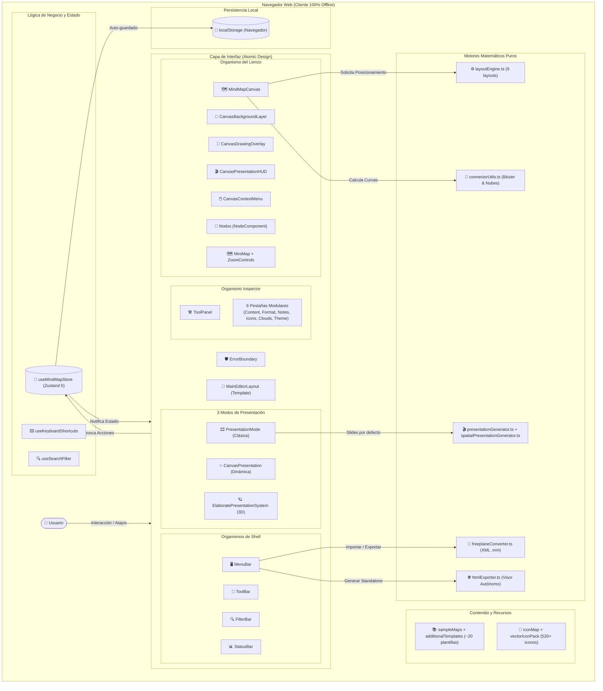
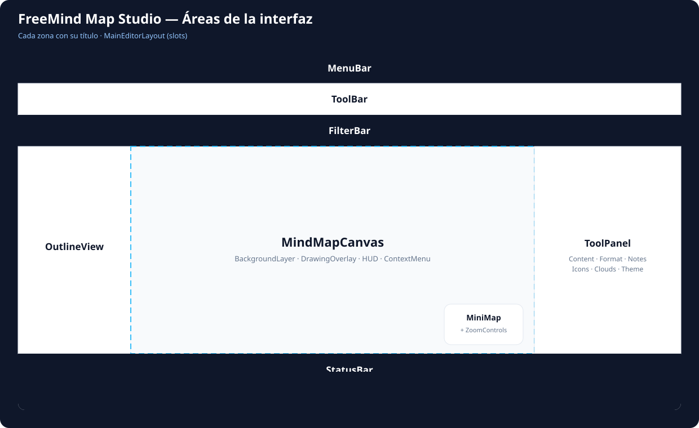
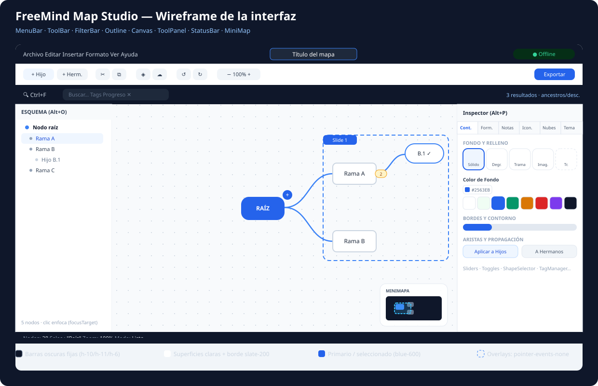
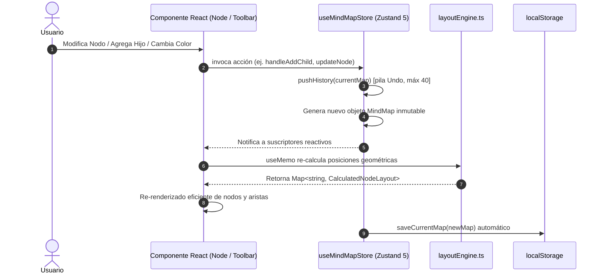

# 🧠 FreeMind Map Studio — Documento Maestro de Arquitectura de Software

**Versión:** 4.0
**Fecha:** Octubre 2026 (revisado contra código; corrige v3.0)
**Tecnologías Principales:** React 19 · TypeScript 5.8 · Vite 6 · Tailwind CSS v4 · Zustand 5 · Vitest 4 · Motion 12
**Gestor de Paquetes:** pnpm
**Persistencia:** `localStorage` (100% Offline, sin servidores, privacidad absoluta)
**Patrones de Diseño:** Atomic Design + Store Unidireccional Reactivo (Zustand) + Inmutabilidad Funcional + Error Boundaries

> **Correcciones respecto a v3.0 (verificadas en código):** 8 temas (no 9) · 8 temas de presentación (no 7) · 7 tramas de nodo (no 8) · 8 formas de nube (no 4) · IDs reales de layout (`standard`, `balanced-horizontal`, … — no `right_only`/`tree_vertical`) · nombres reales de acciones del store (`handleCopyNode`, … — no `copyNode`) · `presentationType` vive en `App`, no en el store · suite real: **22 tests / 6 archivos** (no 14) · enlaces relativos (los `file:///d:/…` absolutos se rompen en GitHub) · se agregan módulos que v3.0 omitía (generadores de presentación, icon packs, plantillas, `enrich_shapes.py`, path hosted AI Studio, docs `AGENTS.md`/`DESIGN.md`) · nueva §11: qué subir a GitHub y qué no.

---

## 📑 Tabla de Contenidos

1. [Visión General del Sistema y Ficha Técnica](#1-visión-general-del-sistema-y-ficha-técnica)
2. [Arquitectura Atomic Design (4 Niveles)](#2-arquitectura-atomic-design-4-niveles)
3. [Flujo de Datos y Estado Global con Zustand](#3-flujo-de-datos-y-estado-global-con-zustand)
4. [Motor Matemático de Layout y Geometría (`layoutEngine.ts`)](#4-motor-matemático-de-layout-y-geometría-layoutenginets)
5. [Los 3 Sistemas de Presentación](#5-los-3-sistemas-de-presentación)
6. [Interoperabilidad, Exportación y Almacenamiento](#6-interoperabilidad-exportación-y-almacenamiento)
7. [Infraestructura de Pruebas y Calidad de Código](#7-infraestructura-de-pruebas-y-calidad-de-código)
8. [Matriz Código a Código del Repositorio](#8-matriz-código-a-código-del-repositorio)
9. [Anatomía Visual de un Nodo y Mapeo a Código](#9-anatomía-visual-de-un-nodo-y-mapeo-a-código)
10. [Guía Práctica de Extensión para Desarrolladores ("Cookbook")](#10-guía-práctica-de-extensión-para-desarrolladores-cookbook)
11. [GitHub: Qué Subir y Qué No Subir](#11-github-qué-subir-y-qué-no-subir)

---

## 1. Visión General del Sistema y Ficha Técnica

FreeMind Map Studio es una suite de mapas mentales y presentaciones interactivas de grado profesional diseñada para ejecutarse íntegramente en el navegador web cliente. No requiere servidores centrales, bases de datos remotas ni autenticación de usuarios.

### Comandos (fuente: `package.json`, manda sobre el README)
- `pnpm install` / `pnpm dev` → http://localhost:3000 (`vite --port=3000 --host=0.0.0.0`; el README dice 5173, obsoleto).
- `pnpm lint` = `tsc --noEmit` (solo tipos, no hay ESLint). Verificado: exit 0.
- `pnpm test` = `vitest run` (22 tests). ⚠️ En Windows/OneDrive el pool de workers por defecto puede colgarse (timeout 60s, 0 tests); usar `pnpm vitest run --pool=forks`. Un archivo: `pnpm vitest run src/utils/__tests__/<n>.test.ts`.
- `pnpm build` / `pnpm preview`. `pnpm clean` usa `rm -rf` → falla en PowerShell; borrar `dist/` a mano.
- Alias `@/*` → raíz del repo (`./`), no `src/` (`tsconfig.json`, `vite.config.ts`). No tocar el bloque `DISABLE_HMR` de `vite.config.ts` (AI Studio lo usa durante ediciones de agentes).

### Principios Rectores de Diseño:
1. **100% Offline y Privacidad Absoluta**: Toda la información reside en la máquina del usuario (`localStorage` y descargas de archivos locales).
2. **Cero Dependencias Externas en Exportables**: El exportador HTML genera un visor interactivo autónomo operable sin conexión.
3. **Inmutabilidad y Robustez Funcional**: Cada operación genera nuevas referencias inmutables; historial de Deshacer/Rehacer de **40 estados**.
4. **Desacoplamiento Estricto (Atomic Design)**: Átomos, Moléculas, Organismos y Templates, sin componentes monolíticos (ver §2.3: `NodeComponent` orquesta 4 sub-moléculas).
5. **Tipado Estricto de Extremo a Extremo**: Cero errores en `tsc --noEmit` con React 19 y TypeScript 5.8.



---

## 2. Arquitectura Atomic Design (4 Niveles)

```mermaid
graph TD
    subgraph Nivel4["NIVEL 4 — TEMPLATES"]
        T1["MainEditorLayout.tsx"]
    end

    subgraph Nivel3["NIVEL 3 — ORGANISMOS"]
        O1["MindMapCanvas.tsx"]
        O2["ToolPanel.tsx (6 Tabs)"]
        O3["MenuBar.tsx & ToolBar.tsx & FilterBar.tsx & StatusBar.tsx & OutlineView.tsx & MiniMap.tsx"]
        O4["PresentationMode.tsx"]
        O5["ElaboratePresentationSystem.tsx"]
        O6["7 Modales Estandarizados"]
        O7["CanvasBackgroundLayer.tsx"]
        O8["CanvasDrawingOverlay.tsx"]
        O9["CanvasPresentationHUD.tsx"]
        O10["CanvasContextMenu.tsx"]
    end

    subgraph Nivel2["NIVEL 2 — MOLÉCULAS"]
        M1["ModalHeader.tsx"]
        M2["SearchInput.tsx"]
        M3["HistoryControls.tsx"]
        M4["ZoomControls.tsx"]
        M5["FontFormatToolbar.tsx"]
        M6["ShapeSelector.tsx"]
        M7["TagManager.tsx"]
        subgraph NodeMolecules["Moléculas de NodeComponent"]
            M8["NodeBackgroundRenderer.tsx"]
            M9["NodeHeaderRow.tsx"]
            M10["NodeBadgesBar.tsx"]
            M11["NodeActionButtons.tsx"]
        end
    end

    subgraph Nivel1["NIVEL 1 — ÁTOMOS"]
        A1["Button.tsx"]
        A2["IconButton.tsx"]
        A3["Input.tsx"]
        A4["Badge.tsx"]
        A5["ModalBackdrop.tsx"]
        A6["ErrorBoundary.tsx"]
        A7["CollapsibleSection.tsx"]
        A8["ColorPicker.tsx"]
        A9["SliderInput.tsx"]
        A10["ToggleButton.tsx"]
        A11["ToggleButtonGroup.tsx"]
    end

    T1 --> O1 & O2 & O3 & O4 & O5 & O6
    O1 --> O7 & O8 & O9 & O10 & M8 & M9 & M10 & M11 & M4
    O2 --> M5 & M6 & M7 & A7 & A8 & A9 & A10 & A11
    O6 --> M1 & A5 & A1 & A3
    M1 --> A2
    M2 --> A3 & A2
    M3 --> A2
    M4 --> A2
    M7 --> A4 & A3 & A2
```



---

### 2.1. Nivel 4 — Templates (`MainEditorLayout.tsx`)

Orquesta la disposición espacial en slots declarativos:
- **Barra Superior**: `menuBar` y `toolBar`.
- **Barra de Búsqueda Desplegable**: `filterBar` (condicional a `isFilterBarOpen`).
- **Área Central**: panel izquierdo `outlineView` (`isOutlineOpen`), lienzo central `canvas`, panel derecho `toolPanel` (`isToolPanelOpen`).
- **Barra de Estado Inferior**: `statusBar`. **Modales**: `modals`. **Overlay de Presentación**: `presentationOverlay` (oculta barras).
- `src/App.tsx` = orquestador conciso envuelto en `ErrorBoundary`. Estado local solo para modales y `presentationType` (`'classic' | 'canvas' | 'elaborate'` — **vive en `App`, no en el store**).

Así se reparten las zonas en pantalla (una por slot, cada una con su título):



### 2.2. Nivel 3 — Organismos

Vista detallada del editor con contenido real (nodos, aristas, minimapa e inspector con la sección de color activa):



#### A. Lienzo (`MindMapCanvas.tsx`)
1. `CanvasBackgroundLayer.tsx`: los **12 fondos** del lienzo (ver §5/temas: puntos, milimetrado, blueprint, panal, triángulos, rayas, oscuros, menta) con patrones SVG nativos y `translate3d`.
2. `CanvasDrawingOverlay.tsx`: recuadro punteado azul en vivo con dimensiones (`Ancho × Alto`), etiquetas de diapositivas, `pointer-events-none` para no bloquear clics a nodos.
3. `CanvasPresentationHUD.tsx`: barras flotantes de Presentación Dinámica (Editor de Marcos / Presentar, `1. Seleccionar Nodo`, `2. Dibujar Recuadro`, Empezar de Cero, Filmstrip).
4. `CanvasContextMenu.tsx`: clic derecho sobre nodo (11 acciones en 5 grupos: hijo/hermano/editar, copiar/cortar/pegar, conector/nube, aplicar estilo a hijos/hermanos, eliminar — oculto en raíz) o fondo del lienzo (item único "Agregar Rama Principal"). Contrato: `doc/DESIGN.md` §9.
5. Shell: `MenuBar` (Archivo/Editar/Insertar/Formato/Ver/Ayuda; contratos y gotchas en `doc/DESIGN.md` §7), `ToolBar` (accesos rápidos + popovers Vista/Presentar), `FilterBar` (`Ctrl+F`, filtros query/tag/minProgress), `StatusBar` (nodos, selección, modo — **zoom/posición hardcodeados** `100`/`(0,0)` en `App:622-624`), `OutlineView` (árbol lateral editable `Alt+O`), `MiniMap` (radar `bottom-2 right-5` = **inferior derecha**, 3 tamaños S/M/L, viewport arrastrable + `ZoomControls`).

#### B. Inspector (`ToolPanel.tsx`, `aside w-84`)
6 pestañas en `src/components/organisms/toolpanel/`:
- `ContentTab.tsx`: título, cuerpo, alineación, tipografía, imagen adjunta (6 posiciones en panel: `top/between/bottom/left/right/fit`; el tipo admite además `background`) y Metadatos (tags, enlace, progreso, ojos `hide*`).
- `FormatTab.tsx`: forma (**10**: `bubble fork rectangle square oval circle hexagon pill arrow star`) + Ancho/Alto personalizado (0–500 / 0–300, 0 = auto), fondo (**5 `bgType`**: color, gradiente 4 direcciones, **7 tramas**: `dots lines stripes squares triangles hexagons cross`, imagen con modos cover/contain/tile, transparente), bordes (0–8px, sólido/discontinuo/punteado), aristas (**4 botones**: `bezier linear sharp horizontal`; `hidden` solo en el tipo; color de arista + "Aplicar a Hijos/Hermanos"). Perfiles y grosor de arista son de mapa (ThemeTab), no por nodo.
- `NotesTab.tsx`: editor Markdown (parser propio `markdownRenderer.tsx`) con 3 vistas y toolbar; progreso/enlace viven en ContentTab.
- `IconsTab.tsx`: 1 sección (tinte `iconColor` + 7 Sugeridos, tamaño 10–36, "Copiar a Hijos/Hermanos" → `icons/iconColor/iconSize/iconPosition`), buscador + categorías + 8 quick tags, grid-cols-6 con **tope de 120 iconos** y acceso a `IconPackModal` (`vectorIconPack`, 520+).
- `CloudsTab.tsx`: 3 secciones tras switch maestro (apagar borra `cloud`): **8 formas**, márgenes -50–200, color+opacidad decimal, borde 0–6 con `borderDash` def `dashed`. Gotchas: sin control de `shadow`; `bgType` gradient/pattern/image solo en render. Detalle en `doc/DESIGN.md` §8.
- `ThemeTab.tsx`: **8 temas**, 9 layouts, fondo = color + **6 patrones** de cuadrícula (no "12 presets": ese import está muerto), aristas globales (4 estilos, 4 perfiles, color/Multicolor/Randomizar, grosor 1–8) y espaciado (**cableado 2026-10-17** vía adaptador `onUpdateMapGaps`→`onUpdateMapSpacing`); queda **1 hueco de wiring**: `onApplyEdge*ToAllNodes` no se pasa (solo efecto mapa). Detalle en `doc/DESIGN.md` §8.

#### C. Modales Estandarizados (7)
`ExportImportModal` (xl), `ShortcutsModal` (lg), `TemplatesModal` (4xl, ~20 plantillas), `SavedMapsModal` (lg, galería `localStorage`), `ConnectorModal` (md), `IconPackModal` (5xl `h-[90vh]`), `ComingSoonModal` (md, `rounded-3xl`). Base común: `ModalBackdrop` (`fixed inset-0 z-50 bg-slate-950/60 backdrop-blur-xs`) + `ModalHeader` (`px-6 py-4`, icono `w-10 h-10 rounded-xl`, cierre con `Escape`).

### 2.3. Nivel 2 — Moléculas
- `ZoomControls` (píldora `shadow-lg`, `%` en mono), `HistoryControls` (`flex gap-0.5` + atajos visibles), `SearchInput` (Input sm + lupa + Badge conteo), `ModalHeader`, `FontFormatToolbar` (2 grupos, activo `bg-blue-100`), `ShapeSelector` (`grid-cols-5`, sel `border-blue-600 bg-blue-50/80`), `TagManager` (chips `bg-blue-50`, X `hover:text-red-500`).
- `NodeComponent.tsx` = orquestador que delega en 4 sub-moléculas:
1. `NodeBackgroundRenderer.tsx`: polígonos SVG (hexágono, flecha, estrella 5 puntas), cola de burbuja, detección de luminancia (contraste auto blanco/negro), tramas de fondo.
2. `NodeHeaderRow.tsx`: imagen (140px top/between/bottom, 100px left/right), iconos, progreso, título editable inline (`F2`/doble clic).
3. `NodeBadgesBar.tsx`: chips de tags, enlace (`target="_blank" rel="noopener"`), badge de nota con tooltip/drawer.
4. `NodeActionButtons.tsx`: píldora fold con conteo, botón `+` flotante, asa drag (`GripVertical`) con protección anti-ciclos.
- Estados visuales del nodo: normal `shadow-xs` → `hover:shadow-md` → seleccionado `ring-3 ring-blue-500` → match búsqueda `ring-2 ring-amber-400 bg-amber-50/90` → staged `ring-4 … animate-pulse` + badge `Check` con `animate-bounce`.

### 2.4. Nivel 1 — Átomos
- `Button.tsx`: base `transition-all duration-150`, tamaños xs–lg, variantes `primary secondary ghost danger outline surface`, `isLoading` con spinner.
- `IconButton.tsx` (xs–lg, radios md–full, 6 variantes), `Input.tsx` (label `text-xs font-semibold`, foco `ring-2 ring-blue-500/20`, error `border-rose-400`), `Badge.tsx` (7 pasteles + slate, 3 tamaños, siempre con borde).
- `ColorPicker.tsx`: cabecera + input nativo `w-4 h-4` + hex mono + `Auto`; grid `grid-cols-8` de 16 presets; sel `border-blue-600 ring-2 ring-blue-400`; ⚠️ el `value` del input nativo exige hex de 7 chars (el componente ya trae fallback, no quitarlo).
- `SliderInput.tsx` (valor `text-blue-600 bg-blue-50`, `accent-blue-600`), `ToggleButton.tsx` (`label/active/onClick` — activo `bg-blue-600 text-white`), `ToggleButtonGroup.tsx` (`options/value/onChange`, sel `bg-blue-100 text-blue-700`), `CollapsibleSection.tsx` (`rounded-2xl`, icono `bg-blue-100`), `ModalBackdrop.tsx`, `ErrorBoundary.tsx` (clase React, card de recuperación sin pérdida de `localStorage`).

---

## 3. Flujo de Datos y Estado Global con Zustand



### 3.1. Estructura del Store (`useMindMapStore.ts`)

Nombres reales (v3.0 usaba `copyNode`/`applyStyleToChildren`/etc., inexistentes):

```typescript
interface MindMapStore {
  mindMap: MindMap;                       // = loadCurrentMap(), única fuente de verdad
  setMindMap / updateNode / setSelectedNodeId / setEditingNodeId / triggerFocusNode / ...
  historyPast: MindMap[]; historyFuture: MindMap[];
  handleUndo / handleRedo: () => void;
  handleAddChild: (parentId?: string) => void;      // balancea left/right en raíz, id `node-Date.now`, unfold+select+edit
  handleAddSibling: (siblingId?: string) => void;   // hereda side/shape; en raíz delega a handleAddChild
  handleDeleteNode: (nodeIdToDelete?: string) => void; // borra subárbol+conectores, veto a raíz
  handleToggleFold / handleFoldAll / handleUnfoldAll: ...
  handleReparentNode: (draggedId, targetParentId) => void; // guard anti-ciclo isDescendant, veto raíz
  handleCopyNode / handleCutNode / handlePasteNode: ...    // clona con IDs `node-Date-rand`, side = destino
  handleApplyStyleToChildren / handleApplyStyleToSiblings: ...  // vía extractNodeStyleBundle
  handleApplyIconsToChildren / handleApplyIconsToSiblings: ... // solo iconos, sin tocar geometría
  handleRandomizeEdgeColors: () => void;               // paleta de 24
  clipboard: { node: MindNode; subNodes: Record<string, MindNode>; isCut: boolean } | null;
  isOutlineOpen / isOutlineFullscreen / isToolPanelOpen / isFilterBarOpen / isPresentationMode: boolean;
  filterOptions: { query, showAncestors, showDescendants, ... };
}
```
Los setters aceptan valor o updater. `presentationType` **no** está en el store: es estado local de `App`.

### 3.2. Historial Inmutable Undo/Redo
`pushHistory` guarda snapshot en `past.slice(-40)` y limpia `future`; undo/redo mueven `present` entre pilas + `saveCurrentMap`. Atajos `Ctrl+Z / Ctrl+Shift+Z, Ctrl+Y`.

### 3.3. Propagación de Estilos vs Iconos
`extractNodeStyleBundle` (forma, colores, degradados, tramas, imagen, bordes, tipografía) → cascada sin tocar textos/notas/tags/links. Los iconos van por vía separada para no pisar geometría. ⚠️ Al añadir campos visuales a `MindNode`, incluirlos en `extractNodeStyleBundle` o no se propagarán (ver Cookbook T1).

### 3.4. Hooks Desacoplados
- `useKeyboardShortcuts.ts`: un oyente global; inactivo escribiendo, en modal o en presentación. `F5` presenta · `Tab/Insert` hijo · `Enter` hermano · `F2` editar · `Espacio` fold · `Supr/Back` borrar · `Esc`→raíz · flechas por `side` · `Ctrl+F` filterbar · `Alt+O/P` outline/toolpanel · `Ctrl+0` centrar.
- `useSearchFilter.ts`: `searchMatches: Set<string> | undefined` (`undefined` = sin filtros); match lower en texto+nota, tag exacto, `progress >= min`; `availableTags` global; incluye ancestros/descendientes opcional.

---

## 4. Motor Matemático de Layout y Geometría (`layoutEngine.ts`)

Puro, sin DOM: `estimateNodeSize(node)` + `computeMindMapLayout(map, center)` en 2 pasadas + `resolveLayoutCollisions` (32 pases, respeta `isFreeFloating` y nubes +36/24/16px). Gaps 54/14/68.

### Los 9 Algoritmos (IDs reales de `LayoutType`, v3.0 usaba `right_only`/`tree_vertical`/etc., inexistentes)

| # | ID real | Comportamiento |
|---|---------|----------------|
| 1 | `standard` | Bifurcado clásico, alterna ramas izq/der como Freeplane |
| 2 | `balanced-horizontal` | Greedy por altura de subárbol, minimiza disparidad vertical |
| 3 | `right` | Todo a `+X` (cronologías, causa-efecto) |
| 4 | `left` | Todo a `-X` |
| 5 | `bottom` | Proyección `+Y` |
| 6 | `top` | Proyección `-Y` |
| 7 | `tree-down` | Árbol organizacional descendente centrado |
| 8 | `radial` | Anillos concéntricos, $X = r·cos θ$, $Y = r·sin θ$ |
| 9 | `circular` | Hijos en perímetro alrededor de la raíz |

### Conectores y Nubes (`connectorUtils.ts`)
- `calculateConnectorGeometry(from, to, conn)`: `straight/step/bezier(cúbica)/curved(cuadrática)`, `curvature` def −50, `controlPoint` override. Flechas `start/end/both/none`, capas `above/below`, etiqueta en punto medio.
- Aristas de rama: Bézier cúbica + 4 perfiles (`uniform tapered spindle hourglass`).
- Nubes: envolvente del subárbol con margen, SVG ondulado/poligonal traslúcido, 8 formas `CloudShape`.

---

## 5. Los 3 Sistemas de Presentación

- **Clásica** (`PresentationMode.tsx`): slides DFS por nodo en 3 fases (Tema → Notas Markdown paginadas ~9 líneas → Hijos en grid máx 6 tarjetas, salto directo + `Backspace` retorno). **8 temas** (no 7; mismos IDs que los del mapa: `default rainbow dark forest sunset minimal blueprint honeycomb`). Generador por defecto: `presentationGenerator.ts` (`generateDefaultPresentationSlides`: overview pad 120 + root pad 24 + ramas).
- **Dinámica** (`MindMapCanvas` + `CanvasPresentationHUD` + `CanvasDrawingOverlay`): vuelo de cámara (`translate3d+scale`, transición 750ms `cubic-bezier(0.25,1,0.5,1)`), crear marco con 1 clic (pad 28px, sin duplicados), dibujar recuadro (`X × Y` en vivo), Empezar de Cero, Filmstrip. Regla: marcos `pointer-events-none` (solo badge `pointer-events-auto`). Zoom con oyente nativo `{ passive: false }`, no `onWheel` JSX.
- **Espacial 3D** (`ElaboratePresentationSystem.tsx`, Motion 12): tarjetas 720×440 (`spatialPresentationGenerator.ts`: `spiral/constellation/grid`), `camPan/Zoom/Rotation`, arrastre con compensación angular, persiste en `mindMap.elaborateSlides`, `SlideDetailModal` para inspección.

---

## 6. Interoperabilidad, Exportación y Almacenamiento

- **Freeplane `.mm`** (`freeplaneConverter.ts`): `exportToFreeplaneXML/importFromFreeplaneXML/exportToMarkdown/escapeXML`. `DOMParser`/`XMLSerializer`, compatible Freeplane 1.x (`<map version="freeplane 1.7.0">`, `TEXT/ID/POSITION/BACKGROUND_COLOR/COLOR/STYLE/LINK/FOLDED`, `<font>`, `<icon BUILTIN>`, `<cloud>`, `<hook><text>` notas, `<arrowlink>`).
- **HTML autónomo** (`htmlExporter.ts`): `exportToStandaloneHTML(map)` — un solo archivo, JSON inline, sin CDN; réplica layout, clouds/edges/connectors, búsqueda, fold, print/PNG, pan/zoom, notas en drawer.
- **SVG/PNG**: caja exacta (`minX/minY/maxX/maxY`), sin márgenes vacíos. **Markdown**: jerarquía como encabezados.
- **Persistencia** (`storage.ts`, solo `localStorage`): `freemind_current_map_v1` (auto-guardado) · `freemind_saved_maps_index_v1` (`{id,title,updatedAt,nodeCount}`) · `freemind_map_{id}`. `loadCurrentMap` valida rootId/nodes, fallback al tutorial.
- **Path hosted AI Studio** (no local): `metadata.json` (`MAJOR_CAPABILITY_SERVER_SIDE_GEMINI_API`) + `.env` (`GEMINI_API_KEY`, `APP_URL` inyectadas en runtime) + deps `express`/`@google/genai` en `package.json`. No montar servidor local: en desarrollo la app es 100% frontend.
- **Contenido**: `sampleMaps.ts` (`TUTORIAL_MAP`, `BLANK_MAP`, 9 mapas + 10 de `additionalTemplates` → `ALL_TEMPLATES` ~20) · `iconMap.tsx` (`AVAILABLE_ICONS`) + `vectorIconPack.tsx` (520+, 12 categorías, buscador) · `templateIllustrations.ts` (32 SVG DataURI) · `markdownRenderer.tsx` (parser propio: inline `[]() ** * code ~~`, bloques ``` `#` `>` `- []` `1.` `---`) · `enrich_shapes.py` (utilidad: reescribe `shape:'bubble'` por variedad en `additionalTemplates.ts`).

---

## 7. Infraestructura de Pruebas y Calidad de Código

Vitest (`vite.config.ts`: `globals:true`, `jsdom`, setup `src/test/setup.ts` con polyfills `matchMedia`+`ResizeObserver`, `include: src/**/*.{test,spec}.{ts,tsx}`). **22 tests / 6 archivos, 100% pasando** (verificado oct-2026 con `--pool=forks`; v3.0 decía 14):

- `atoms/__tests__/Atoms.test.tsx` — Badge, Button (+loading), IconButton, Input onChange, ModalBackdrop cierre exterior.
- `templates/__tests__/MainEditorLayout.test.tsx` — slots y visibilidad condicional de paneles.
- `molecules/node/__tests__/NodeBackgroundRenderer.test.ts` — geometrías SVG.
- `utils/__tests__/layoutEngine.test.ts` — dimensiones y bifurcado estándar.
- `utils/__tests__/connectorUtils.test.ts` — Bézier, step, anclajes perimetrales.
- `utils/__tests__/freeplaneConverter.test.ts` — parseo `.mm` y round-trip sin pérdida.

Comandos: `pnpm lint` (`tsc --noEmit`, 0 errores) · `pnpm test` (si se cuelga en Windows: `pnpm vitest run --pool=forks`) · `pnpm build` (Vite prod).

---

## 8. Matriz Código a Código del Repositorio

| Archivo | Nivel | Rol |
|:---|:---:|:---|
| `src/App.tsx` | Orquestador | Store + `MainEditorLayout` + modales + `presentationType` local, envuelto en `ErrorBoundary` |
| `src/main.tsx` | Entrada | `createRoot` + `StrictMode` |
| `src/index.css` | Estilos | Solo Tailwind v4 + utilidades (`.bg-grid-*`, `.mind-node`, scrollbars) — ver `doc/DESIGN.md` |
| `templates/MainEditorLayout.tsx` | Template | Slots de pantalla completa |
| `MindMapCanvas.tsx` | Organismo | Orquestador del lienzo (zoom/pan/drag/coordenadas) |
| `organisms/canvas/*` (4) | Organismo | BackgroundLayer (12 fondos) · DrawingOverlay (marcos, `pointer-events-none`) · PresentationHUD (dinámica) · ContextMenu (clic derecho) |
| `NodeComponent.tsx` | Organismo | Orquestador del nodo → 4 sub-moléculas |
| `molecules/node/*` (4) | Molécula | BackgroundRenderer (SVG/polígonos/luminancia) · HeaderRow (título/imagen/progreso/iconos) · BadgesBar (tags/link/nota) · ActionButtons (fold/`+`/drag) |
| `ToolPanel.tsx` + `organisms/toolpanel/*` (6) | Organismo | Inspector: Content · Format · Notes · Icons · Clouds · Theme |
| `PresentationMode.tsx` | Organismo | Clásica en slides (8 temas) |
| `Presentation/*` (3) | Organismo | Espacial 3D + tarjetas + modal detalle |
| `MenuBar/ToolBar/FilterBar/StatusBar/OutlineView/MiniMap` | Organismo | Shell: menús, accesos, búsqueda, métricas, esquema, radar |
| `Modals/*` (7) | Organismo | Sobre `ModalBackdrop`+`ModalHeader` |
| `atoms/*` (11) | Átomo | Button, IconButton, Input, Badge, ModalBackdrop, ErrorBoundary, CollapsibleSection, ColorPicker, SliderInput, ToggleButton(+Group) |
| `molecules/*` (7) | Molécula | ModalHeader, SearchInput, HistoryControls, ZoomControls, FontFormatToolbar, ShapeSelector, TagManager |
| `hooks/useMindMapStore.ts` | Store | CRUD, historial 40, clipboard con IDs nuevos, propagación estilos/iconos |
| `hooks/useKeyboardShortcuts.ts` | Hook | Atajos globales (inactivos escribiendo/modal/presentación) |
| `hooks/useSearchFilter.ts` | Hook | Filtro acumulativo → `Set<string> \| undefined` |
| `utils/layoutEngine.ts` | Motor | 9 layouts, colisiones, aristas Bézier, nubes |
| `utils/connectorUtils.ts` | Motor | Conectores flotantes + geometría etiquetas |
| `utils/presentationGenerator.ts` | Generador | Slides clásicas por defecto |
| `utils/spatialPresentationGenerator.ts` | Generador | Tarjetas 720×440 (`spiral/constellation/grid`) |
| `utils/freeplaneConverter.ts` | Conversor | `.mm` bidireccional + Markdown |
| `utils/htmlExporter.ts` | Generador | HTML autónomo single-file |
| `utils/markdownRenderer.tsx` | Parser | Markdown propio inline + bloques |
| `utils/themes.ts` | Tokens | 8 temas + 12 fondos (+ usados por presentación) |
| `utils/storage.ts` | Adaptador | `localStorage` con validación y fallback |
| `utils/sampleMaps.ts` + `additionalTemplates.ts` | Contenido | Tutorial + blanco + ~20 plantillas (`ALL_TEMPLATES`) |
| `utils/iconMap.tsx` + `vectorIconPack.tsx` | Contenido | Iconos temáticos + pack 520+/12 categorías |
| `utils/templateIllustrations.ts` | Contenido | 32 SVG DataURI de vista previa |
| `types/mindmap.ts` | Tipos | `MindNode/MindMap/Connector/NodeCloud/FilterOptions/HistoryState`, enums (10 formas, 5 edge styles, 4 profiles, 9 layouts, 7 sides, 8 clouds) |
| `enrich_shapes.py` | Utilidad | Reescritura de shapes en plantillas |
| `doc/DESIGN.md` | Doc | Sistema de diseño verificado (tokens, componentes, reglas) |
| `AGENTS.md` | Doc | Instrucciones compactas para agentes |
| `opencode.json` | Config | Plugin `opencode-agent-memory@0.3.0` |
| `metadata.json` / `.env.example` | Hosted | Capacidad Gemini + vars inyectadas por AI Studio |

---

## 9. Anatomía Visual de un Nodo y Mapeo a Código

```
┌────────────────────────────────────────────────────────────────────────────────────────┐
│ ANATOMÍA VISUAL DE UN NODO EN EL LIENZO                                               │
│                                                                                        │
│                                [✓ Badge de Selección / Staged]                         │
│                                (NodeComponent.tsx — z-index 50)                       │
│   ╭────────────────────────────────────────────────────────────────────────────────╮   │
│   │ [1. FONDO VECTORIAL SVG] -> NodeBackgroundRenderer.tsx                        │   │
│   │ Polígonos SVG (Hexágono, Estrella, Flecha), Tramas o Color/Degradado          │   │
│   │   ┌────────────────────────────────────────────────────────────────────────┐   │   │
│   │   │ [2. ENCABEZADO Y CONTENIDO] -> NodeHeaderRow.tsx                       │   │   │
│   │   │ 🖼️ Imagen (top/fit/left/between/bottom; 140px ó 100px)                  │   │   │
│   │   │ 🏷️ Iconos SVG (color + escala)  📊 Progreso (0-100%)                    │   │   │
│   │   │ ✏️ TÍTULO (div o textarea inline, F2)  📝 CUERPO (multilínea)           │   │   │
│   │   └────────────────────────────────────────────────────────────────────────┘   │   │
│   │   ┌────────────────────────────────────────────────────────────────────────┐   │   │
│   │   │ [3. BADGES Y METADATOS] -> NodeBadgesBar.tsx                           │   │   │
│   │   │ 🏷️ Tags  🔗 Enlace (target=_blank)  📋 Nota Markdown  📶 Progreso      │   │   │
│   │   └────────────────────────────────────────────────────────────────────────┘   │   │
│   ╰──────────────────────────────────────┬─────────────────────────────────────────╯   │
│       [4. ACCIÓN FLOTANTE]              │  [COLA BURBUJA SVG]                         │
│       -> NodeActionButtons.tsx          │  -> NodeBackgroundRenderer.tsx               │
│       • (+) Agregar hijo  • [n] Fold    │  Punta triangular hacia la rama padre        │
│       • (⠿) Drag&Drop anti-ciclos       │                                              │
└──────────────────────────────────────────┴─────────────────────────────────────────────┘
```

---

## 10. Guía Práctica de Extensión para Desarrolladores ("Cookbook")

### 📘 Tutorial 1: Añadir opciones al título de un nodo (`textTransform`, `textShadow`)

**Paso 1 — tipos** (`src/types/mindmap.ts`, en `MindNode`):
```typescript
textTransform?: 'none' | 'uppercase' | 'lowercase' | 'capitalize';
textShadow?: boolean;
```

**Paso 2 — controles** (`organisms/toolpanel/ContentTab.tsx`; ⚠️ API real: `ToggleButtonGroup({options,value,onChange})`, `ToggleButton({label,active,onClick})` — v3.0 usaba `checked/onChange`, inexistentes):
```tsx
import { ToggleButtonGroup } from '../../atoms/ToggleButtonGroup';
import { ToggleButton } from '../../atoms/ToggleButton';

<label className="text-xs font-semibold text-slate-300">Transformación de Texto</label>
<ToggleButtonGroup
  value={selectedNode.textTransform || 'none'}
  onChange={(val) => onUpdateNode(selectedNode.id, { textTransform: val })}
  options={[
    { value: 'none', label: 'Normal' },
    { value: 'uppercase', label: 'MAYÚS' },
    { value: 'lowercase', label: 'minús' },
    { value: 'capitalize', label: 'Capital' },
  ]}
/>
<div className="flex items-center justify-between pt-1">
  <span className="text-xs text-slate-400">Sombra de Texto</span>
  <ToggleButton
    label="Sombra"
    active={Boolean(selectedNode.textShadow)}
    onClick={() => onUpdateNode(selectedNode.id, { textShadow: !selectedNode.textShadow })}
  />
</div>
```

**Paso 3 — render** (`molecules/node/NodeHeaderRow.tsx`, en el `div` de `node.text`):
```tsx
style={{
  // ...estilos existentes...,
  textTransform: node.textTransform || 'none',
  textShadow: node.textShadow ? '0 2px 4px rgba(0,0,0,0.5)' : 'none',
}}
```

**Paso 4 — propagación** (`useMindMapStore.ts`, en `extractNodeStyleBundle`): añadir ambos campos o no llegarán a hijos/hermanos.

### 📘 Tutorial 2: Modificar presentaciones
- **HUD dinámica** (`CanvasPresentationHUD.tsx`): añadir botones con clases atómicas existentes (iconos `lucide-react`, `w-3.5 h-3.5`).
- **Marcos** (`CanvasDrawingOverlay.tsx`, `slides.map`): el contenedor **siempre conserva `pointer-events-none`**; solo el badge `pointer-events-auto`. Seleccionado: `border-indigo-400 bg-indigo-500/20 shadow-[0_0_45px_rgba(99,102,241,0.5)]`.
- **Nuevo tema clásico** (`PresentationMode.tsx`, objeto de temas con 8 entradas): añadir `{ id, name, bg, text, accent, cardBg, cardText }` con la misma forma.

### 📘 Tutorial 3: Nueva forma de nodo (Diamante)
`types/mindmap.ts` (`NodeShape += 'diamond'`) → `ShapeSelector.tsx` (botón + icono) → `NodeBackgroundRenderer.tsx` (polígono `W/2,0 W,H/2 W/2,H 0,H/2`) → `layoutEngine.ts` (ajuste proporcional). Verificado: 10 formas actuales, mismo procedimiento.

### 📘 Tutorial 4: Coordenadas pantalla → mundo
```typescript
const worldX = (clientX - pan.x) / zoom;
const worldY = (clientY - pan.y) / zoom;
```
Usado en `MindMapCanvas` (recuadros `draw_frame`, marcos 1-clic, nodos huérfanos, conectores).

### 📘 Tutorial 5: Fondo del MiniMap (`MiniMap.tsx`)
- **Nivel A (directo):** tarjeta exterior (~L218: `backgroundColor: 'rgba(255,255,255,0.65)'`) y radar interior (~L295: `fill="#0f172a"`).
- **Nivel B (reactivo al tema):** `fill={mindMap.backgroundColor || theme.canvasBg || '#0f172a'}`.
- **Nivel C (selector en inspector):** campo `miniMapBgColor?: string` en `MindMap` + `ColorPicker` en `ThemeTab` + `fill={mindMap.miniMapBgColor || '#0f172a'}`.

---

## 11. GitHub: Qué Subir y Qué No Subir

Estado real del `.gitignore` + `git status` (oct-2026):

### ✅ SÍ subir (código + config + docs)
- `src/`, `index.html`, `package.json`, `vite.config.ts`, `tsconfig.json`, `metadata.json`, `.env.example`.
- `opencode.json` (solo declara el plugin, sin secretos), `AGENTS.md`, `doc/` (`PROJECT_ARCHITECTURE.md`, `DESIGN.md`, `INTERFACE_SPEC.md`, `CHANGELOG.md`).
- `enrich_shapes.py`, `README.md`, assets propios (`assets/`, `doc/img/`).
- ⚠️ Pendiente de commit a fecha del doc: nuevos `opencode.json`, `AGENTS.md`, `doc/DESIGN.md`, `.opencode/` y 5 docs de auditoría eliminados (`Evaluación Arquitectónica.md`, `REFACTORING_EVALUATION.md`, `code_quality_and_atomic_design_audit.md`, `implementation_plan_refactorizacion.md`, `walkthrough.md`) — decidir si se commitea su borrado o se restauran.

### ❌ NO subir (ya ignorado o fuera del repo)
- `node_modules/`, `build/`, `dist/`, `coverage/` — ignorados; `dist/` se regenera con `pnpm build`.
- `*.log`, `.DS_Store` — ignorados.
- `.env*` (excepto `.env.example`) — **nunca subir `GEMINI_API_KEY` ni `APP_URL` reales**; las inyecta AI Studio en runtime.
- `.opencode/memory/` — auto-ignorado por su `.gitignore` interno (`*`): memoria local del agente, no pertenece al repo.
- Datos de usuario: archivos `.mm`/`.html`/`.png` exportados y todo lo de `localStorage` (vive solo en el navegador, nunca toca git).

---

<div align="center">

**FreeMind Map Studio — Arquitectura de Software v4.0**
*Mantenibilidad · Rendimiento · Privacidad Absoluta · Cero Dependencias Externas*

</div>
